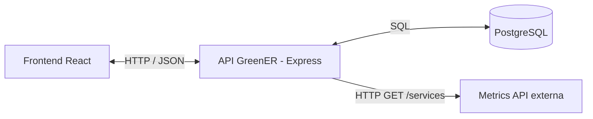
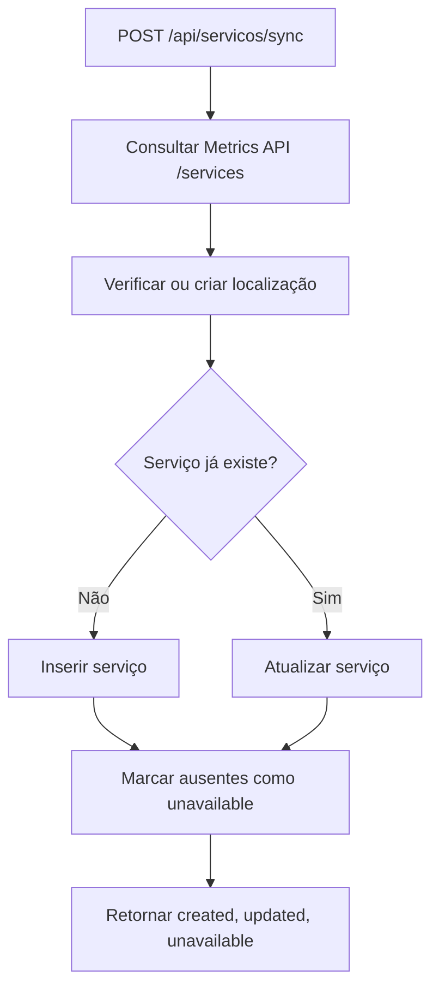

# Documentação da API — GreenER

> **Referência técnica | Base entregue na Sprint 1 / início da Sprint 2**  
> Esta documentação separa endpoints **já implementados** de endpoints **planejados**. Exemplos de dados são ilustrativos e não substituem a validação da versão em execução.

## 01. Visão geral

O backend do **GreenER** utiliza **Node.js, Express e TypeScript** para fornecer uma API REST que conecta a interface React, o banco de dados PostgreSQL e serviços externos de monitoramento.

**URL base (desenvolvimento local):** `http://localhost:3000`  
**Formato principal:** JSON (`Content-Type: application/json`)  
**Infraestrutura local:** Docker Compose



> A API de intensidade de carbono está prevista para integração nas próximas etapas, mas ainda não participa dos endpoints descritos aqui.

### Endpoints disponíveis

| Método | Endpoint | Função | Referência |
|---|---|---|---|
| `GET` | `/health` | Consultar o estado básico do backend | Infraestrutura |
| `POST` | `/auth/register` | Cadastrar usuário | Autenticação |
| `POST` | `/auth/login` | Autenticar usuário e receber token JWT | Autenticação |
| `GET` | `/api/servicos/discover` | Buscar serviços diretamente na API externa | US01 |
| `POST` | `/api/servicos/sync` | Sincronizar serviços externos com o banco | US02 |
| `GET` | `/api/servicos` | Listar serviços persistidos no banco | RF01 / RF02 / apoio ao monitoramento |

**Situação de acesso:** cadastro/login e emissão de JWT existem, mas a proteção efetiva das rotas no backend permanece pendente na **TEC29 da Sprint 2**. Até essa implementação ser validada, não considerar os endpoints de serviços como protegidos apenas porque o frontend possui sessão.

---

## 02. Saúde do servidor

### `GET /health`

Verifica se o servidor Express está respondendo. Também é utilizado pelo *healthcheck* do container backend no Docker Compose.

**Corpo da requisição:** nenhum.  
**Resposta de sucesso:** `200 OK`.

```json
{
  "status": "ok",
  "message": "GreenER backend funcionando"
}
```

**Exemplo de teste:**

```bash
curl http://localhost:3000/health
```

> Esta rota indica que o processo HTTP está respondendo, mas não verifica individualmente a conexão com o banco nem a disponibilidade das APIs externas.

---

## 03. Autenticação

### `POST /auth/register`

Cadastra um usuário no PostgreSQL. A senha é processada pelo utilitário de hash do projeto antes de ser persistida.

**Cabeçalho:** `Content-Type: application/json`  
**Corpo esperado:**

```json
{
  "name": "Usuário Exemplo",
  "email": "exemplo@dominio.com",
  "password": "senha-de-exemplo"
}
```

| Campo | Tipo esperado | Descrição |
|---|---|---|
| `name` | `string` | Nome do usuário |
| `email` | `string` | E-mail utilizado no cadastro |
| `password` | `string` | Senha para autenticação |

**Sucesso:** `201 Created`.

```json
{
  "id": 1,
  "email": "exemplo@dominio.com"
}
```

**Falha tratada pelo controller:** `400 Bad Request`.

```json
{
  "error": "Email já cadastrado"
}
```

**Exemplo:**

```bash
curl -X POST http://localhost:3000/auth/register \
  -H "Content-Type: application/json" \
  -d '{"name":"Usuário Exemplo","email":"exemplo@dominio.com","password":"senha-de-exemplo"}'
```

> **Validação:** os campos são lidos diretamente de `req.body`; a versão analisada ainda não possui validação estruturada de formato, obrigatoriedade ou tamanho no controller. Não interpretar a tabela de tipos como garantia de validação em tempo de execução.

### `POST /auth/login`

Autentica um usuário existente e, em caso de sucesso, retorna um **JWT (JSON Web Token)** e informações públicas do usuário.

**Corpo esperado:**

```json
{
  "email": "exemplo@dominio.com",
  "password": "senha-de-exemplo"
}
```

**Sucesso:** `200 OK`.

```json
{
  "token": "<token-jwt-gerado-pelo-servidor>",
  "user": {
    "id": "1",
    "name": "Usuário Exemplo",
    "email": "exemplo@dominio.com"
  }
}
```

**Credenciais inválidas (fluxo previsto):** `401 Unauthorized`.

```json
{
  "error": "Credenciais inválidas"
}
```

**Exemplo:**

```bash
curl -X POST http://localhost:3000/auth/login \
  -H "Content-Type: application/json" \
  -d '{"email":"exemplo@dominio.com","password":"senha-de-exemplo"}'
```

**Ponto de atenção conhecido:** a função `UserRepository.findUser()` não verifica se `result.rows[0]` é `undefined` antes de acessar suas propriedades. Portanto, na versão analisada, um e-mail inexistente pode produzir um erro diferente de `Credenciais inválidas`, embora o controller ainda retorne HTTP `401` com uma mensagem de erro. Esse caso precisa de correção e teste.

**Sobre JWT:** o token é assinado com `JWT_SECRET`, com expiração controlada por `JWT_EXPIRES_IN`. O projeto contém utilitário para verificar JWT, mas **não aplica** essa verificação às rotas registradas em `app.ts` na versão analisada.

---

## 04. Serviços monitorados

### `GET /api/servicos/discover` — US01

Consulta **diretamente** o endpoint `/services` da Metrics API externa e devolve os serviços identificados. **Esta operação não salva os dados no banco.**

**Parâmetros:** nenhum.  
**Sucesso:** `200 OK`.

**Exemplo ilustrativo:**

```json
{
  "message": "1 serviços encontrados",
  "services": [
    {
      "id": "service-example",
      "name": "Serviço Exemplo",
      "location": {
        "region_code": "BR-SP",
        "country": "Brazil",
        "region": "São Paulo",
        "city": "São Paulo",
        "latitude": -23.55,
        "longitude": -46.63
      },
      "metrics_path": "/metrics/service-example"
    }
  ]
}
```

**Falha na consulta externa:** `502 Bad Gateway`.

```json
{
  "error": "Falha ao consultar a API de métricas",
  "code": "EXTERNAL_API_ERROR"
}
```

**Exemplo:**

```bash
curl http://localhost:3000/api/servicos/discover
```

**Origem no código:** `servicos.routes.ts` → `ServicosController.discover()` → `ServicosService.discoverServices()` → `GET {METRICS_API_URL}/services`.

### `POST /api/servicos/sync` — US02

Realiza a sincronização entre a lista de serviços externa e o PostgreSQL. Para cada serviço, verifica a localização, cria ou atualiza seu cadastro e sinaliza como indisponíveis os serviços persistidos que não constem mais da resposta externa.

**Corpo da requisição:** nenhum.  
**Sucesso:** `200 OK`.

```json
{
  "message": "Serviços sincronizados com sucesso",
  "created": 2,
  "updated": 5,
  "unavailable": 0
}
```

| Campo | Descrição |
|---|---|
| `created` | Quantidade de serviços criados nesta sincronização |
| `updated` | Quantidade de serviços já existentes que foram atualizados |
| `unavailable` | Quantidade de registros alterados para status `unavailable` |

**Exemplo:**

```bash
curl -X POST http://localhost:3000/api/servicos/sync
```

**Falha de acesso à API externa:** `502 Bad Gateway`, com código `EXTERNAL_API_ERROR`. Erros inesperados, inclusive possíveis falhas do banco, passam pelo middleware global e normalmente resultam em `500 Internal Server Error`.

**Fluxo simplificado:**



> **Sincronização automática:** além deste endpoint manual, `server.ts` inicia o job `startServiceSync()` quando o backend sobe. Na versão atual, a variável de intervalo está associada à **sincronização do catálogo**, não à futura coleta de métricas. A Sprint 2 deve separar claramente os intervalos de sincronização, coleta e atualização do frontend.

### `GET /api/servicos` — listagem persistida

Lista os serviços armazenados no PostgreSQL, com localização e status. Não consulta a API externa durante esta chamada.

**Parâmetros:** nenhum.  
**Sucesso:** `200 OK`.

**Exemplo ilustrativo:**

```json
{
  "message": "1 serviços encontrados",
  "services": [
    {
      "id_service": 1,
      "external_id": "service-example",
      "name": "Serviço Exemplo",
      "status": "active",
      "last_seen_at": "2026-10-18T14:00:00.000Z",
      "region_code": "BR-SP",
      "country": "Brazil",
      "region": "São Paulo",
      "city": "São Paulo",
      "latitude": -23.55,
      "longitude": -46.63
    }
  ]
}
```

**Exemplo:**

```bash
curl http://localhost:3000/api/servicos
```

**Observação:** `latitude` e `longitude` são colunas numéricas no banco; dependendo do parser do PostgreSQL e do tipo SQL adotado, podem chegar serializadas como strings. O exemplo mostra valores numéricos para facilitar a leitura, mas o contrato precisa ser validado em execução.

---

## 05. Erros e códigos HTTP

Os endpoints de serviços utilizam um middleware global para tratamento de erros. Os endpoints de autenticação, por sua vez, tratam exceções dentro de seus próprios controllers.

| Código | Significado | Exemplos no projeto |
|---|---|---|
| `200 OK` | Operação realizada | Health, login, descoberta, sincronização e listagem |
| `201 Created` | Registro criado | Cadastro de usuário |
| `400 Bad Request` | Falha tratada no cadastro | E-mail já cadastrado e outros erros capturados pelo controller |
| `401 Unauthorized` | Erro tratado no login | Credenciais inválidas; outras falhas capturadas no mesmo controller |
| `404 Not Found` | Rota/recurso inexistente | Para URLs não registradas, Express responde com seu comportamento padrão; a classe `NotFoundError` existe, mas não está aplicada aos endpoints descritos |
| `500 Internal Server Error` | Exceção não prevista | Falha inesperada no módulo de serviços |
| `502 Bad Gateway` | Falha de integração externa | Erro consultando a Metrics API |

**Exemplo do formato de erro global:**

```json
{
  "error": "Erro interno do servidor",
  "code": "INTERNAL_ERROR"
}
```

> As respostas de autenticação usam `{ "error": "..." }` e não incluem o campo `code` implementado no middleware global. A unificação do contrato de erros pode ser considerada em uma evolução futura.

---

## 06. Como testar localmente

1. Configure o `.env` conforme o `.env.example`, sem publicar senhas ou segredos.
2. Inicie a infraestrutura no diretório raiz:

   ```bash
   docker compose up --build -d
   ```

3. Verifique o estado dos containers:

   ```bash
   docker compose ps
   ```

4. Teste a API em `http://localhost:3000/health`.
5. Teste a descoberta de serviços, a sincronização e a listagem, nesta ordem, para comparar os dados da origem externa com os registros persistidos.
6. Para consultar logs:

   ```bash
   docker compose logs --tail=50 backend
   ```

**Portas locais do Compose:** frontend `5173`, backend `3000` e PostgreSQL `5433` (conectado à porta `5432` dentro do container).

> O comportamento final depende de PostgreSQL disponível, esquema aplicado e URLs/credenciais adequadas para os serviços externos.

---

## 07. Endpoints planejados para a Sprint 2

Os recursos abaixo fazem parte do planejamento, mas **não devem ser considerados endpoints ativos até aparecerem no código, testes e documentação de resposta**:

- coleta de métricas por serviço;
- histórico de coletas por serviço/período;
- dados consolidados do dashboard;
- indicadores ambientais;
- recursos protegidos por middleware JWT.

Ao implementar um endpoint novo, registrar nesta documentação: método, URL, parâmetros, autenticação, resposta de sucesso, erros esperados e exemplo de verificação.

## 08. Integrações e funcionalidades futuras

A Metrics API externa fornece a rota `/services`, utilizada na descoberta e sincronização. O campo `metrics_path` retornado por ela indica onde consultar métricas de cada serviço, mas **não existe ainda um endpoint interno registrado no Express para expor essas coletas** na versão analisada.

| Recurso | Situação na versão analisada |
|---|---|
| Descoberta e sincronização de serviços | Implementadas |
| Cadastro e login com emissão de JWT | Implementados, com ressalvas descritas acima |
| Proteção de endpoints por JWT | Ainda não aplicada |
| Coleta e histórico de métricas | Planejados; arquivos de módulo ainda vazios |
| Cálculo de consumo energético e CO₂e | Planejado |
| Integração funcional com Carbon Intensity API | Planejada; não conectada às rotas atuais |
| Endpoints de indicadores consolidados | Planejados; arquivos de módulo ainda vazios |
| Ranking, comparações e filtros por período | Evolução prevista nas próximas sprints |

**Importante:** nomes e caminhos de endpoints futuros somente devem entrar na tabela oficial quando forem definidos pela equipe e registrados no código. Isso evita que o frontend dependa de rotas ainda inexistentes.

---

## 09. Onde encontrar os endpoints no projeto

```text
backend/src/
├── app.ts                         # Registra prefixos e middlewares
├── server.ts                      # Inicializa o servidor e o job
├── modules/
│   ├── auth/
│   │   ├── auth.routes.ts         # POST /auth/register e /auth/login
│   │   ├── auth.controller.ts     # Entrada e saída HTTP
│   │   ├── auth.service.ts        # Regras de autenticação
│   │   └── auth.repository.ts     # Consultas SQL de usuários
│   └── servicos/
│       ├── servicos.routes.ts     # GET /discover, POST /sync, GET /
│       ├── servicos.controller.ts # Entrada e saída HTTP
│       ├── servicos.service.ts    # Descoberta e sincronização
│       └── servicos.repository.ts # Consultas SQL de serviços
├── jobs/
│   └── service-sync.job.ts        # Sincronização periódica
└── shared/
    ├── middlewares/error.middleware.ts
    └── errors/AppError.ts
```

**Como ler o fluxo:** uma **rota** define o endereço HTTP; o **controller** recebe a requisição e formata a resposta; o **service** implementa as regras de negócio; o **repository** acessa o PostgreSQL.

---

## 10. Manutenção desta documentação

Sempre que um endpoint for criado ou alterado, atualizar:

- Método e URL;
- Campos de entrada e formato da resposta;
- Códigos de status e tratamento de erro;
- Requisitos de autenticação;
- Exemplo de teste;
- Estado de implementação e vínculo com a user story correspondente.

**Código-fonte de referência:** snapshot do repositório enviado para revisão em 18/10/2026. A versão publicada na branch `develop` deve ser conferida novamente antes de considerar este documento um contrato definitivo.
