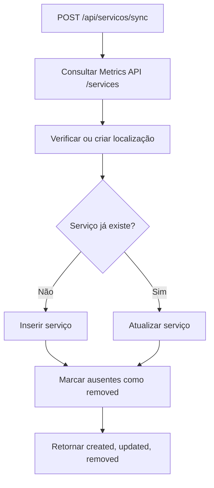

# Documentação da API — GreenER

> **Referência técnica | Implementação em evolução na Sprint 2**
> Esta documentação separa endpoints **já implementados** de endpoints **planejados**. Exemplos de dados são ilustrativos e não substituem a validação da versão em execução.

## 01. Visão geral

O backend do **GreenER** utiliza **Node.js, Express e TypeScript** para fornecer uma API REST que conecta a interface React, o banco de dados PostgreSQL e serviços externos de monitoramento.

**URL base (desenvolvimento local):** `http://localhost:3000`  
**Formato principal:** JSON (`Content-Type: application/json`)  
**Infraestrutura local:** Docker Compose

```mermaid
flowchart LR
    A[Frontend React] <-->|HTTP / JSON| B[API GreenER - Express]
    B <-->|SQL| C[(PostgreSQL)]
    B -->|HTTP GET /services e /metrics/{id}| D[Metrics API externa]
    B -->|Cálculo sobre dados persistidos| C
```

> A integração da Carbon API fornece descoberta e sincronização de snapshots regionais. O endpoint de indicadores calcula energia e emissões usando coletas e intensidades persistidas; ele não consulta as APIs externas durante a requisição.

### Endpoints disponíveis

| Método | Endpoint | Função | Referência |
|---|---|---|---|
| `GET` | `/health` | Consultar o estado básico do backend | Infraestrutura |
| `POST` | `/auth/register` | Cadastrar usuário | Autenticação |
| `POST` | `/auth/login` | Autenticar usuário e receber token JWT | Autenticação |
| `GET` | `/auth/me` | Validar token e obter dados do usuário logado (Rota Protegida) | TEC29 |
| `GET` | `/api/servicos/discover` | Buscar serviços diretamente na API externa | US01 |
| `POST` | `/api/servicos/sync` | Sincronizar serviços externos com o banco | US02 |
| `GET` | `/api/servicos` | Listar serviços persistidos no banco | RF01 / RF02 / apoio ao monitoramento |
| `GET` | `/api/intensidades/discover` | Consultar catálogo regional da Carbon API | Intensidades |
| `POST` | `/api/intensidades/sync` | Registrar snapshots regionais | Intensidades |
| `GET` | `/api/intensidades` | Listar snapshots regionais registrados | Intensidades |
| `GET` | `/api/indicadores?start=<ISO>&end=<ISO>` | Calcular indicadores ambientais no período | US07 (backend parcial) |

**Situação de acesso:** O backend agora conta com um **middleware de autenticação JWT** (implementado na TEC29).
O token gerado no login deve ser enviado no header `Authorization: Bearer <token>` para acessar rotas protegidas, incluindo `/auth/me` e todas as rotas de intensidades. O backend retorna `401 Unauthorized` caso ele esteja ausente, inválido ou expirado.

---

## 02. Saúde do servidor

### `GET /health`

Verifica se o servidor Express está respondendo. Também é utilizado pelo *healthcheck* do container backend no Docker Compose.

**Corpo da requisição:** nenhum.  
**Resposta de sucesso:** `200 OK`.

```json
{
  "status": "ok",
  "message": "GreenER backend funcionando"
}
```

**Exemplo de teste:**

```bash
curl http://localhost:3000/health
```

> Esta rota indica que o processo HTTP está respondendo, mas não verifica individualmente a conexão com o banco nem a disponibilidade das APIs externas.

---

## 03. Autenticação

### `POST /auth/register`

Cadastra um usuário no PostgreSQL. A senha é processada pelo utilitário de hash do projeto antes de ser persistida.

**Cabeçalho:** `Content-Type: application/json`  
**Corpo esperado:**

```json
{
  "name": "Usuário Exemplo",
  "email": "exemplo@dominio.com",
  "password": "senha-de-exemplo"
}
```

| Campo | Tipo esperado | Descrição |
|---|---|---|
| `name` | `string` | Nome do usuário |
| `email` | `string` | E-mail utilizado no cadastro |
| `password` | `string` | Senha para autenticação |

**Sucesso:** `201 Created`.

```json
{
  "id": 1,
  "email": "exemplo@dominio.com"
}
```

**Falha tratada pelo controller:** `400 Bad Request`.

```json
{
  "error": "Email já cadastrado"
}
```

**Exemplo:**

```bash
curl -X POST http://localhost:3000/auth/register \
  -H "Content-Type: application/json" \
  -d '{"name":"Usuário Exemplo","email":"exemplo@dominio.com","password":"senha-de-exemplo"}'
```

> **Validação:** os campos são lidos diretamente de `req.body`; a versão analisada ainda não possui validação estruturada de formato, obrigatoriedade ou tamanho no controller. Não interpretar a tabela de tipos como garantia de validação em tempo de execução.

### `POST /auth/login`

Autentica um usuário existente e, em caso de sucesso, retorna um **JWT (JSON Web Token)** e informações públicas do usuário.

**Corpo esperado:**

```json
{
  "email": "exemplo@dominio.com",
  "password": "senha-de-exemplo"
}
```

**Sucesso:** `200 OK`.

```json
{
  "token": "<token-jwt-gerado-pelo-servidor>",
  "user": {
    "id": "1",
    "name": "Usuário Exemplo",
    "email": "exemplo@dominio.com"
  }
}
```

**Credenciais inválidas (fluxo previsto):** `401 Unauthorized`.

```json
{
  "error": "Credenciais inválidas"
}
```

**Exemplo:**

```bash
curl -X POST http://localhost:3000/auth/login \
  -H "Content-Type: application/json" \
  -d '{"email":"exemplo@dominio.com","password":"senha-de-exemplo"}'
```

**Ponto de atenção conhecido:** a função `UserRepository.findUser()` não verifica se `result.rows[0]` é `undefined` antes de acessar suas propriedades. Portanto, na versão analisada, um e-mail inexistente pode produzir um erro diferente de `Credenciais inválidas`, embora o controller ainda retorne HTTP `401` com uma mensagem de erro. Esse caso precisa de correção e teste.

**Sobre JWT:** o token é assinado com `JWT_SECRET`, com expiração controlada por `JWT_EXPIRES_IN`. O projeto contém utilitário para verificar JWT, mas **não aplica** essa verificação às rotas registradas em `app.ts` na versão analisada.

---

## 04. Serviços monitorados

### `GET /api/servicos/discover` — US01

Consulta **diretamente** o endpoint `/services` da Metrics API externa e devolve os serviços identificados. **Esta operação não salva os dados no banco.**

**Parâmetros:** nenhum.  
**Sucesso:** `200 OK`.

**Exemplo ilustrativo:**

```json
{
  "message": "1 serviços encontrados",
  "services": [
    {
      "id": "service-example",
      "name": "Serviço Exemplo",
      "location": {
        "region_code": "BR-SP",
        "country": "Brazil",
        "region": "São Paulo",
        "city": "São Paulo",
        "latitude": -23.55,
        "longitude": -46.63
      },
      "metrics_path": "/metrics/service-example"
    }
  ]
}
```

**Falha na consulta externa:** `502 Bad Gateway`.

```json
{
  "error": "Falha ao consultar a API de métricas",
  "code": "EXTERNAL_API_ERROR"
}
```

**Exemplo:**

```bash
curl http://localhost:3000/api/servicos/discover
```

**Origem no código:** `servicos.routes.ts` → `ServicosController.discover()` → `ServicosService.discoverServices()` → `GET {METRICS_API_URL}/services`.

### `POST /api/servicos/sync` — US02

Realiza a sincronização entre a lista de serviços externa e o PostgreSQL. Para cada serviço, verifica a localização, cria ou atualiza seu cadastro e marca como removidos os serviços persistidos que não constem mais da resposta externa.

**Corpo da requisição:** nenhum.  
**Sucesso:** `200 OK`.

```json
{
  "message": "Serviços sincronizados com sucesso",
  "created": 2,
  "updated": 5,
  "removed": 0
}
```

| Campo | Descrição |
|---|---|
| `created` | Quantidade de serviços criados nesta sincronização |
| `updated` | Quantidade de serviços já existentes que foram atualizados |
| `removed` | Quantidade de registros alterados para status `removed` |

**Exemplo:**

```bash
curl -X POST http://localhost:3000/api/servicos/sync
```

**Falha de acesso à API externa:** `502 Bad Gateway`, com código `EXTERNAL_API_ERROR`. Erros inesperados, inclusive possíveis falhas do banco, passam pelo middleware global e normalmente resultam em `500 Internal Server Error`.

**Fluxo simplificado:**



> **Execução automática:** além dos endpoints manuais, `server.ts` inicia dois jobs independentes quando o backend sobe: `startServiceSync()` (sincronização do catálogo, a cada `SERVICE_SYNC_INTERVAL_MS`) e `startMetricsCollection()` (coleta de métricas, a cada `COLLECTION_INTERVAL_MS`). Cada ciclo só é reagendado depois que o anterior termina. Detalhes na seção 05.

### `GET /api/servicos` — listagem persistida

Lista os serviços armazenados no PostgreSQL, com localização e status. Não consulta a API externa durante esta chamada.

**Parâmetros:** nenhum.  
**Sucesso:** `200 OK`.

**Exemplo ilustrativo:**

```json
{
  "message": "1 serviços encontrados",
  "services": [
    {
      "id_service": 1,
      "external_id": "service-example",
      "name": "Serviço Exemplo",
      "status": "active",
      "last_seen_at": "2026-10-18T14:00:00.000Z",
      "region_code": "BR-SP",
      "country": "Brazil",
      "region": "São Paulo",
      "city": "São Paulo",
      "latitude": -23.55,
      "longitude": -46.63,
      "last_collection_status": "unavailable",
      "last_collection_at": "2026-10-18T14:01:00.000Z"
    }
  ]
}
```

| Campo | Descrição |
|---|---|
| `status` | Estado do catálogo: `active` ou `removed` |
| `last_collection_status` | Resultado da coleta mais recente: `success`, `no_metrics`, `unavailable` ou `error`; `null` quando o serviço ainda não foi coletado |
| `last_collection_at` | Instante da tentativa de coleta mais recente; `null` quando ainda não houve coleta |

**Exemplo:**

```bash
curl http://localhost:3000/api/servicos
```

**Observação:** `latitude` e `longitude` são colunas numéricas no banco; dependendo do parser do PostgreSQL e do tipo SQL adotado, podem chegar serializadas como strings. O exemplo mostra valores numéricos para facilitar a leitura, mas o contrato precisa ser validado em execução.

---

### Intensidades de carbono

As três rotas exigem `Authorization: Bearer <token>`. A descoberta consulta `GET {CARBON_API_URL}/regions`, valida o envelope `{ regions, total }` e converte os campos externos para o modelo interno. A API externa não fornece histórico nem vigência; `registered_at` registra quando o backend observou os valores.

#### `GET /api/intensidades/discover`

Consulta o catálogo sem persistir. A coleção da resposta usa a chave `intensities` e os campos internos `regionCode`, `carbonIntensity` e `renewableShare`.

#### `POST /api/intensidades/sync`

Insere um snapshot por região em cada sincronização, sem substituir registros anteriores.

```json
{
  "message": "Intensidades sincronizadas com sucesso",
  "snapshotsInserted": 5
}
```

#### `GET /api/intensidades`

Lista os snapshots persistidos, incluindo `region_code` e `registered_at`. Os fatores são associados ao código regional e não a uma cidade arbitrária.

`CARBON_INTENSITY_MAX_AGE_MS` configura a idade máxima em milissegundos para a seleção temporal usada pelos cálculos. A variável não tem valor padrão definido: sem configuração, a busca de fator utilizável retorna ausência, em vez de selecionar silenciosamente um snapshot antigo.

Falhas HTTP, conexão, timeout ou formato inválido da Carbon API resultam em `502 Bad Gateway`. Rotas chamadas sem JWT válido resultam em `401 Unauthorized`.

### Indicadores ambientais — US07 (backend parcial)

#### `GET /api/indicadores`

Calcula os indicadores para serviços e coletas persistidos no banco. A associação da intensidade de carbono é feita pelo `region_code` do serviço, usando o snapshot mais recente registrado até o instante da tentativa de coleta e dentro de `CARBON_INTENSITY_MAX_AGE_MS`. Esta rota exige JWT.

**Query parameters:**

| Parâmetro | Obrigatório | Descrição |
|---|---|---|
| `start` | Sim | Data/hora inicial válida, em formato ISO |
| `end` | Sim | Data/hora final válida, em formato ISO e posterior a `start` |

O intervalo consultado é semiaberto: inclui tentativas com `attempted_at >= start` e exclui tentativas com `attempted_at >= end`. A requisição não chama a Metrics API nem a Carbon API; valores indisponíveis ou inválidos não são substituídos por dados simulados.

**Exemplo:**

```bash
curl "http://localhost:3000/api/indicadores?start=2026-10-01T00:00:00.000Z&end=2026-10-02T00:00:00.000Z" \
  -H "Authorization: Bearer <token>"
```

**Resposta `200 OK` (estrutura resumida):**

```json
{
  "message": "Indicadores calculados",
  "period": {
    "start": "2026-10-01T00:00:00.000Z",
    "end": "2026-10-02T00:00:00.000Z",
    "collectionIntervalMs": 60000
  },
  "powerModel": {
    "version": "1",
    "cpuMaximumWatts": 100,
    "memoryWattsPerGb": 0.375,
    "diskWattsPerGb": 0.01,
    "networkWattsPerGb": 0.02
  },
  "summary": {
    "serviceCount": 1,
    "activeServiceCount": 1,
    "energyKwh": 0.001,
    "emissionsGco2e": 0.4,
    "collectionCount": 1,
    "validMetricCount": 1,
    "validCarbonIntensityCount": 1,
    "metricCoveragePercent": 100,
    "carbonIntensityCoveragePercent": 100,
    "isPartial": false
  },
  "services": [
    {
      "serviceId": 1,
      "name": "servico-exemplo",
      "status": "active",
      "regionCode": "regiao-exemplo",
      "latestSampleInPeriod": {
        "collectionId": "id-da-coleta",
        "attemptedAt": "2026-10-01T12:00:00.000Z",
        "status": "success",
        "collectionIntervalSeconds": 45,
        "energyKwh": 0.001,
        "emissionsGco2e": 0.4,
        "carbonIntensityGco2ePerKwh": 400,
        "gapReason": null
      },
      "periodTotals": {
        "energyKwh": 0.001,
        "emissionsGco2e": 0.4,
        "collectionCount": 1,
        "validMetricCount": 1,
        "validCarbonIntensityCount": 1,
        "metricCoveragePercent": 100,
        "carbonIntensityCoveragePercent": 100,
        "isPartial": false,
        "gaps": []
      }
    }
  ]
}
```

Os números do exemplo são ilustrativos. A energia é estimada com o modelo de potência retornado em `powerModel` e `latestSampleInPeriod.collectionIntervalSeconds`, que contém a duração da amostra em segundos usada no cálculo. `period.collectionIntervalMs` permanece por compatibilidade e informa somente o intervalo configurado entre ciclos do job (`COLLECTION_INTERVAL_MS`); não é usado para calcular a energia.

`latestSampleInPeriod` é a tentativa mais recente do serviço dentro do período, ou `null` se não houver tentativas. `periodTotals` agrega as tentativas registradas. `isPartial`, as coberturas e `gaps` indicam tentativas sem métricas válidas, duração de amostra ou intensidade de carbono utilizável; os motivos podem incluir `no_metrics`, `unavailable`, `error`, `invalid_metrics`, `collection_interval_unavailable` e `carbon_intensity_unavailable`. Amostras históricas sem intervalo retornam `collectionIntervalSeconds: null` e geram uma lacuna, sem usar `COLLECTION_INTERVAL_MS` como fallback. Uma tentativa sem intensidade ainda pode contribuir para energia, mas não para emissões. A cobertura considera as tentativas registradas no banco e não detecta intervalos em que nenhuma tentativa foi registrada.

Períodos inválidos, parâmetros ausentes ou parâmetros repetidos retornam `400 Bad Request` com `code: "INVALID_INDICATOR_PERIOD"`. A ausência de JWT válido retorna `401 Unauthorized`; falhas inesperadas, inclusive de acesso ao banco, são encaminhadas ao middleware global.

## 05. Coleta de métricas — US03 / US04 / US05

A coleta consulta `GET {METRICS_API_URL}/metrics/{id_servico}` para cada serviço com status `active` e registra uma tentativa por serviço na tabela `collection`. Quando há dados válidos, a amostra também é gravada em `metrics`. Falhas de comunicação (timeout ou conexão recusada) são registradas como `unavailable`, sem interromper a coleta dos demais serviços.

Para registrar uma amostra como válida, a resposta da Metrics API deve conter `collection_interval_seconds` como número finito maior que zero, além dos valores de métricas válidos. O intervalo é persistido em `metrics` junto com a amostra. Campo ausente ou inválido resulta em erro de payload, sem gravar uma métrica parcial.

### `POST /api/metricas/collect` — disparo manual (administrador)

**Autenticação:** JWT válido e usuário administrador (`users.admin = TRUE`). O status administrativo é consultado no banco em cada chamada; usuários registrados recebem `admin = FALSE` por padrão.  
**Corpo da requisição:** nenhum.  
**Sucesso:** `200 OK`.

```json
{
  "message": "Coleta de métricas finalizada com falhas parciais",
  "skipped": false,
  "totalServices": 13,
  "successCount": 9,
  "noMetricsCount": 1,
  "unavailableCount": 2,
  "errorCount": 1,
  "failures": [
    {
      "service": "Serviço Offline",
      "reason": "A consulta à API de métricas excedeu o tempo limite."
    },
    {
      "service": "Serviço Sem Exportador",
      "reason": "A API de métricas informou serviço ou exportador de métricas indisponível."
    },
    {
      "service": "Serviço Exemplo",
      "reason": "A API de métricas respondeu com HTTP 502."
    }
  ]
}
```

| Campo | Descrição |
|---|---|
| `skipped` | `true` quando já havia um ciclo em andamento e nenhuma coleta nova foi iniciada |
| `totalServices` | Serviços ativos consultados neste ciclo |
| `successCount` | Coletas com métricas válidas persistidas |
| `noMetricsCount` | Serviços ativos que não retornaram métricas |
| `unavailableCount` | Serviços que não responderam (timeout ou falha de conexão) ou cujo exportador está indisponível (HTTP 500) |
| `errorCount` | Falhas de processamento, de resposta inválida ou de persistência |
| `failures` | Lista com `service` e `reason` para cada indisponibilidade ou erro |

**Execuções concorrentes:** o job periódico e a rota manual compartilham uma guarda de execução. Se uma coleta já estiver em andamento, a nova chamada retorna `skipped: true`, contadores zerados, `failures: []` e a mensagem `"Coleta anterior ainda em execução; nenhuma nova coleta iniciada"`.

**Acesso negado:** `401 Unauthorized` para token inválido/ausente ou usuário não encontrado; `403 Forbidden` para usuário autenticado que não é administrador.

**Exemplo:**

```bash
curl -X POST http://localhost:3000/api/metricas/collect \
  -H "Authorization: Bearer <token-de-administrador>"
```

**Estados persistidos:** `success` (coleta + métricas), `no_metrics` (serviço disponível sem métricas), `unavailable` (não foi possível consultar o serviço: timeout, conexão recusada ou HTTP 500 do agregador) e `error` (resposta inválida, outro erro HTTP inesperado ou falha no processamento). Cada execução insere novos registros; amostras anteriores não são atualizadas nem removidas, mesmo quando os valores variam entre coletas.

**Classificação das respostas de `/metrics/{id}`:** o agregador de métricas documenta `404` como serviço removido ou métricas inexistentes e `500` como serviço indisponível ou exportador de métricas indisponível. Por isso o backend grava `no_metrics` para `200` sem métricas válidas e para `404`, `unavailable` para `500`, timeout ou falha de conexão, e `error` para os demais HTTP inesperados, JSON inválido ou payload incompleto.

**Sinalização de indisponibilidade:** o estado `unavailable` fica registrado em `collection.failure_reason` e é exposto ao frontend em `GET /api/servicos` pelo campo `last_collection_status`. A tela de monitoramento exibe o serviço como `Indisponível`, com contador próprio na visão geral, e volta ao normal quando uma coleta seguinte obtém sucesso.

**Sinalização de ausência de métricas:** o estado `no_metrics` também é exposto em `last_collection_status`, mas não remove o serviço nem altera `service.status`. A tela de monitoramento exibe o serviço como `Sem métricas`, com contador próprio e destaque distinto de `Indisponível`, e o cartão informa que o serviço continua ativo no catálogo e o horário da última tentativa de coleta.

### Descoberta e coleta automáticas

Ao subir, o backend dispara dois ciclos independentes:

- `startServiceSync()` em `backend/src/jobs/service-sync.job.ts` consulta `/services` e sincroniza o catálogo a cada `SERVICE_SYNC_INTERVAL_MS`.
- `startMetricsCollection()` em `backend/src/jobs/metrics-collection.job.ts` coleta as métricas dos serviços ativos a cada `COLLECTION_INTERVAL_MS`.

Cada job executa um ciclo imediatamente ao iniciar e reagenda o próximo com `setTimeout` somente depois que o ciclo atual termina, então um mesmo job nunca inicia um ciclo enquanto o anterior está em andamento. Falhas de descoberta ou de coleta são registradas no log e não encerram o backend nem interrompem o ciclo automático.

Os logs identificam cada ciclo pelo número sequencial:

```text
🕒 Descoberta automática ativa: intervalo de 300000 ms
🔄 Iniciando descoberta automática #1...
✅ Descoberta #1 concluída: 12 criados, 3 atualizados, 0 removidos
🕒 Coleta automática ativa: intervalo de 60000 ms
🔄 Iniciando coleta automática #1...
✅ Coleta #1 concluída: 9 sucessos, 1 sem métricas, 1 indisponíveis, 1 falhas
```

Quando uma coleta automática coincide com uma coleta manual em andamento, o ciclo é pulado e registrado como `⚠️ Coleta #N ignorada: ciclo anterior ainda em execução.`

| Variável | Padrão | Função |
|---|---:|---|
| `COLLECTION_INTERVAL_MS` | `60000` | Intervalo entre ciclos de coleta de métricas |
| `SERVICE_SYNC_INTERVAL_MS` | `300000` | Intervalo da sincronização do catálogo de serviços |
| `EXTERNAL_API_TIMEOUT_MS` | `10000` | Timeout de cada requisição às APIs externas |

Os intervalos devem ser inteiros positivos; valores inválidos interrompem a inicialização do backend com mensagem explícita.

---

## 06. Erros e códigos HTTP

Os endpoints de serviços e intensidades encaminham exceções ao middleware global. Os endpoints de autenticação tratam exceções dentro de seus próprios controllers.

| Código | Significado | Exemplos no projeto |
|---|---|---|
| `200 OK` | Operação realizada | Health, login, descoberta, sincronização, listagem e coleta (pode indicar falhas parciais no corpo) |
| `201 Created` | Registro criado | Cadastro de usuário |
| `400 Bad Request` | Falha tratada no cadastro | E-mail já cadastrado e outros erros capturados pelo controller |
| `401 Unauthorized` | Falha de autenticação | Credenciais inválidas ou token ausente, inválido ou associado a usuário inexistente |
| `403 Forbidden` | Usuário autenticado sem permissão | Usuário não administrador tenta iniciar coleta manual |
| `404 Not Found` | Rota/recurso inexistente | Para URLs não registradas, Express responde com seu comportamento padrão; a classe `NotFoundError` existe, mas não está aplicada aos endpoints descritos |
| `500 Internal Server Error` | Exceção não prevista | Falha inesperada nos módulos de serviços, intensidades ou indicadores |
| `502 Bad Gateway` | Falha de integração externa | Erro consultando a Metrics API ou a Carbon API |

**Exemplo do formato de erro global:**

```json
{
  "error": "Erro interno do servidor",
  "code": "INTERNAL_ERROR"
}
```

> As respostas de autenticação usam `{ "error": "..." }` e não incluem o campo `code` implementado no middleware global. A unificação do contrato de erros pode ser considerada em uma evolução futura.

---

## 07. Como testar localmente

1. Configure o `.env` conforme o `.env.example`, sem publicar senhas ou segredos.
2. Inicie a infraestrutura no diretório raiz:

   ```bash
   docker compose up --build -d
   ```

3. Verifique o estado dos containers:

   ```bash
   docker compose ps
   ```

4. Teste a API em `http://localhost:3000/health`.
5. Teste a descoberta de serviços, a sincronização e a listagem, nesta ordem, para comparar os dados da origem externa com os registros persistidos.
6. Com um token de administrador, dispare uma coleta manual e confira os contadores retornados:

   ```bash
   curl -X POST http://localhost:3000/api/metricas/collect \
     -H "Authorization: Bearer <token-de-administrador>"
   ```

   A descoberta e a coleta automáticas também rodam ao iniciar o backend, nos intervalos configurados; os logs do container mostram cada ciclo numerado.
7. Para consultar logs:

   ```bash
   docker compose logs --tail=50 backend
   ```

**Portas locais do Compose:** frontend `5173`, backend `3000` e PostgreSQL `5433` (conectado à porta `5432` dentro do container).

> O comportamento final depende de PostgreSQL disponível, esquema aplicado e URLs/credenciais adequadas para os serviços externos.

---

## 08. Endpoints ainda planejados

Os recursos abaixo continuam no planejamento e **ainda não possuem endpoints internos implementados**:

- histórico de coletas por serviço/período;
- endpoint consolidado do dashboard;
- ranking e comparações entre serviços.

O endpoint de indicadores descrito nesta documentação já calcula energia e CO₂e no backend. Isso não significa que o dashboard/frontend esteja integrado ou que todos os indicadores previstos estejam concluídos.

## 09. Integrações e funcionalidades futuras

A Metrics API externa fornece a rota `/services`, utilizada na descoberta e sincronização, e a rota `/metrics/{id_servico}`, consumida pela coleta manual (restrita a administradores) e pelo job periódico. Ainda não existe endpoint interno para consultar o histórico de coletas por serviço ou período.

| Recurso | Situação na versão analisada |
|---|---|
| Descoberta e sincronização de serviços | Implementadas |
| Cadastro e login com emissão de JWT | Implementados, com ressalvas descritas acima |
| Proteção de endpoints por JWT | Aplicada seletivamente; coleta manual restrita a administradores |
| Coleta de métricas | Implementada (manual com administrador e automática); histórico planejado |
| Cálculo de consumo energético e CO₂e | Implementado parcialmente em `/api/indicadores`; intervalo por amostra ainda provisório |
| Descoberta e snapshots da Carbon Intensity API | Implementados nas rotas de intensidades |
| Endpoint de indicadores por período | Implementado no backend; integração com frontend e validação de ponta a ponta pendentes |
| Ranking e comparações | Planejados |

O módulo de indicadores consulta dados persistidos; não busca métricas ou intensidades diretamente nas APIs externas durante a requisição. As lacunas de coleta e de intensidade são representadas na resposta, sem imputação de valores.

**Importante:** nomes e caminhos de endpoints futuros somente devem entrar na tabela oficial quando forem definidos pela equipe e registrados no código. Isso evita que o frontend dependa de rotas ainda inexistentes.
---

## 10. Onde encontrar os endpoints no projeto

```text
backend/src/
├── app.ts                         # Registra prefixos e middlewares
├── server.ts                      # Inicializa o servidor e os jobs periódicos
├── modules/
│   ├── auth/
│   │   ├── auth.routes.ts         # POST /auth/register e /auth/login
│   │   ├── auth.controller.ts     # Entrada e saída HTTP
│   │   ├── auth.service.ts        # Regras de autenticação
│   │   └── auth.repository.ts     # Consultas SQL de usuários
│   ├── servicos/
│   │   ├── servicos.routes.ts     # GET /discover, POST /sync, GET /
│   │   ├── servicos.controller.ts # Entrada e saída HTTP
│   │   ├── servicos.service.ts    # Descoberta e sincronização
│   │   └── servicos.repository.ts # Consultas SQL de serviços
│   ├── indicadores/
│   │   ├── indicadores.routes.ts     # GET / (protegido por JWT)
│   │   ├── indicadores.controller.ts # Validação da query e resposta HTTP
│   │   ├── indicadores.service.ts    # Cálculos, agregação e cobertura
│   │   └── indicadores.repository.ts # Consultas de coletas e intensidades
│   └── intensidades/
│       ├── intensidades.routes.ts     # GET /discover, POST /sync, GET /
│       ├── intensidades.controller.ts # Contrato HTTP das intensidades
│       ├── intensidades.service.ts    # Mapeamento e snapshots regionais
│       └── intensidades.repository.ts # Histórico e seleção temporal
├── integrations/
│   └── carbon-api.ts              # Consulta e validação da Carbon API
├── jobs/
│   ├── service-sync.job.ts        # Sincronização periódica do catálogo
│   └── metrics-collection.job.ts  # Coleta periódica de métricas
└── shared/
    ├── middlewares/error.middleware.ts
    └── errors/AppError.ts
```

**Como ler o fluxo:** uma **rota** define o endereço HTTP; o **controller** recebe a requisição e formata a resposta; o **service** implementa as regras de negócio; o **repository** acessa o PostgreSQL.

---

## 11. Manutenção desta documentação

Sempre que um endpoint for criado ou alterado, atualizar:

- Método e URL;
- Campos de entrada e formato da resposta;
- Códigos de status e tratamento de erro;
- Requisitos de autenticação;
- Exemplo de teste;
- Estado de implementação e vínculo com a user story correspondente.

**Código-fonte de referência:** snapshot do repositório enviado para revisão em 18/10/2026. A versão publicada na branch `develop` deve ser conferida novamente antes de considerar este documento um contrato definitivo.
