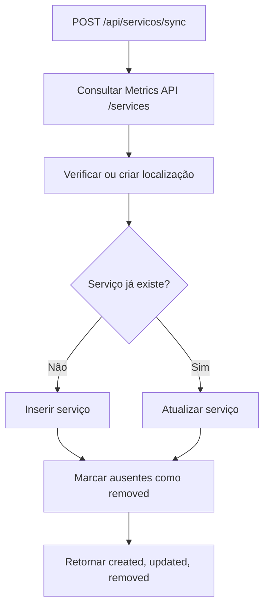

# Documentação da API — GreenER
_> _**Referência técnica | Versão validada no fechamento da Sprint 2 — 09/11/2026**

_> Esta documentação separa endpoints _**já implementados**_ de endpoints _**planejados**_. Exemplos de dados são ilustrativos e não substituem a validação da versão em execução._


## 01. Visão geral
O backend do **GreenER** utiliza **Node.js, Express e TypeScript** para fornecer uma API REST que conecta a interface React, o banco de dados PostgreSQL e serviços externos de monitoramento.


**URL base (desenvolvimento local):** `http://localhost:3000`  

**Formato principal:** JSON (`Content-Type: application/json`)  

**Infraestrutura local:** Docker Compose


```mermaid

flowchart LR

    A[Frontend React] <-->|HTTP / JSON| B[API GreenER - Express]

    B <-->|SQL| C[(PostgreSQL)]

    B -->|HTTP GET /services e /metrics/{id}| D[Metrics API externa]

    B -->|Cálculo sobre dados persistidos| C

```


> A integração da Carbon API fornece descoberta e sincronização de snapshots regionais. O endpoint de indicadores calcula energia e emissões usando coletas e intensidades persistidas; ele não consulta as APIs externas durante a requisição.
### Endpoints disponíveis
| Método | Endpoint | Função | Referência |

|---|---|---|---|

| `GET` | `/health` | Consultar o estado básico do backend | Infraestrutura |

| `POST` | `/auth/register` | Cadastrar usuário | Autenticação |

| `POST` | `/auth/login` | Autenticar usuário e receber token JWT | Autenticação |

| `GET` | `/auth/me` | Validar token e obter dados do usuário logado (Rota Protegida) | TEC29 |

| `GET` | `/api/servicos/discover` | Buscar serviços diretamente na API externa | US01 |

| `POST` | `/api/servicos/sync` | Sincronizar serviços externos com o banco | US02 |

| `GET` | `/api/servicos` | Listar serviços persistidos no banco | RF01 / RF02 / apoio ao monitoramento |

| `GET` | `/api/intensidades/discover` | Consultar catálogo regional da Carbon API | Intensidades |

| `POST` | `/api/intensidades/sync` | Registrar snapshots regionais | Intensidades |

| `GET` | `/api/intensidades` | Listar snapshots regionais registrados | Intensidades |

| `GET` | `/api/indicadores?start=\<ISO>&end=\<ISO>` | Calcular indicadores ambientais no período | US07 / RF08 |

| `GET` | `/api/indicadores/:serviceId/historico?start=\<ISO>&end=\<ISO>` | Consultar histórico ambiental calculado de um serviço | TEC23 / RF10 |

| `GET` | `/api/dashboard` | Obter indicadores consolidados para o dashboard | TEC19 |


**Situação de acesso:** O backend agora conta com um **middleware de autenticação JWT** (implementado na TEC29).

O token gerado no login deve ser enviado no header `Authorization: Bearer \<token>` para acessar rotas protegidas, incluindo `/auth/me` e todas as rotas de intensidades. O backend retorna `401 Unauthorized` caso ele esteja ausente, inválido ou expirado.


---
## 02. Saúde do servidor
**### **`GET /health`


Verifica se o servidor Express está respondendo. Também é utilizado pelo **healthcheck** do container backend no Docker Compose.


**Corpo da requisição:** nenhum.  

**Resposta de sucesso:** `200 OK`.


```json

{

  *"status"*: "ok",

  *"message"*: "GreenER backend funcionando"

}

```


**Exemplo de teste:**


```bash

curl http://localhost:3000/health

```


> Esta rota indica que o processo HTTP está respondendo, mas não verifica individualmente a conexão com o banco nem a disponibilidade das APIs externas.
---
## 03. Autenticação

### `POST /auth/register`

Cadastra um usuário no PostgreSQL. A senha é armazenada de forma não reversível pelo utilitário de hash do projeto.

**Corpo esperado:**

```json
{
  "name": "Usuário Exemplo",
  "email": "exemplo@dominio.com",
  "password": "senha-de-exemplo"
}
```

**Sucesso:** `201 Created`.

```json
{
  "id": 1,
  "email": "exemplo@dominio.com"
}
```

**E-mail já cadastrado:** `409 Conflict`.

```json
{
  "error": "Email já cadastrado",
  "code": "CONFLICT"
}
```

Erros da autenticação são encaminhados ao middleware global, que utiliza o formato `{ "error": "...", "code": "..." }`.

**Exemplo:**

```bash
curl -X POST http://localhost:3000/auth/register \
  -H "Content-Type: application/json" \
  -d '{"name":"Usuário Exemplo","email":"exemplo@dominio.com","password":"senha-de-exemplo"}'
```

### `POST /auth/login`

Autentica um usuário e retorna um JWT e os dados públicos do usuário.

**Corpo esperado:**

```json
{
  "email": "exemplo@dominio.com",
  "password": "senha-de-exemplo"
}
```

**Sucesso:** `200 OK`.

```json
{
  "token": "<token-jwt>",
  "user": {
    "id": "1",
    "name": "Usuário Exemplo",
    "email": "exemplo@dominio.com"
  }
}
```

**Credenciais inválidas:** `401 Unauthorized`.

```json
{
  "error": "Credenciais inválidas",
  "code": "UNAUTHORIZED"
}
```

O mesmo retorno é usado quando o e-mail não existe ou quando a senha está incorreta.

### `GET /auth/me`

Rota protegida utilizada para comprovar e consumir a autenticação JWT.

**Autenticação:** obrigatória.

**Exemplo:**

```bash
curl http://localhost:3000/auth/me \
  -H "Authorization: Bearer <token>"
```

**Sucesso:** `200 OK`.

A resposta contém uma mensagem de sucesso e o payload JWT validado em `user`, incluindo `sub`, `iat` e `exp`.

Sem o cabeçalho `Authorization: Bearer <token>`:

```json
{
  "error": "Token de autenticação não fornecido",
  "code": "UNAUTHORIZED"
}
```

**Status:** `401 Unauthorized`.

Token inválido ou expirado também retorna `401`, com mensagem correspondente.

---

## 04. Serviços monitorados
### **`GET /api/servicos/discover`** — US01
Consulta **diretamente** o endpoint `/services` da Metrics API externa e devolve os serviços identificados. **Esta operação não salva os dados no banco.**


**Parâmetros:** nenhum.  

**Sucesso:** `200 OK`.


**Exemplo ilustrativo:**


```json

{

  *"message"*: "1 serviços encontrados",

  *"services"*: [

    {

      *"id"*: "service-example",

      *"name"*: "Serviço Exemplo",

      *"location"*: {

        *"region_code"*: "BR-SP",

        *"country"*: "Brazil",

        *"region"*: "São Paulo",

        *"city"*: "São Paulo",

        *"latitude"*: -23.55,

        *"longitude"*: -46.63

      },

      *"metrics_path"*: "/metrics/service-example"

    }

  ]

}

```


**Falha na consulta externa:** `502 Bad Gateway`.


```json

{

  *"error"*: "Falha ao consultar a API de métricas",

  *"code"*: "EXTERNAL_API_ERROR"

}

```


**Exemplo:**


```bash

curl http://localhost:3000/api/servicos/discover

```


**Origem no código:** `servicos.routes.ts` → `ServicosController.discover()` → `ServicosService.discoverServices()` → `GET {METRICS_API_URL}/services`.


### **`POST /api/servicos/sync`** — US02
Realiza a sincronização entre a lista de serviços externa e o PostgreSQL. Para cada serviço, verifica a localização, cria ou atualiza seu cadastro e marca como removidos os serviços persistidos que não constem mais da resposta externa.


**Corpo da requisição:** nenhum.  

**Sucesso:** `200 OK`.


```json

{

  *"message"*: "Serviços sincronizados com sucesso",

  *"created"*: 2,

  *"updated"*: 5,

  *"removed"*: 0

}

```


| Campo | Descrição |

|---|---|

| `created` | Quantidade de serviços criados nesta sincronização |

| `updated` | Quantidade de serviços já existentes que foram atualizados |

| `removed` | Quantidade de registros alterados para status `removed` |


**Exemplo:**


```bash

curl -X POST http://localhost:3000/api/servicos/sync

```


**Falha de acesso à API externa:** `502 Bad Gateway`, com código `EXTERNAL_API_ERROR`. Erros inesperados, inclusive possíveis falhas do banco, passam pelo middleware global e normalmente resultam em `500 Internal Server Error`.


**Fluxo simplificado:**





_> _**Execução automática:**_ além dos endpoints manuais, _`server.ts`* inicia dois jobs independentes quando o backend sobe: *`startServiceSync()`* (sincronização do catálogo, a cada *`SERVICE_SYNC_INTERVAL_MS`*) e *`startMetricsCollection()`* (coleta de métricas, a cada *`COLLECTION_INTERVAL_MS`*). Cada ciclo só é reagendado depois que o anterior termina. Detalhes na seção 05.*


### **`GET /api/servicos`** — listagem persistida
Lista os serviços armazenados no PostgreSQL, com localização e status. Não consulta a API externa durante esta chamada.


**Parâmetros:** nenhum.  

**Sucesso:** `200 OK`.


**Exemplo ilustrativo:**


```json

{

  *"message"*: "1 serviços encontrados",

  *"services"*: [

    {

      *"id_service"*: 1,

      *"external_id"*: "service-example",

      *"name"*: "Serviço Exemplo",

      *"status"*: "active",

      *"last_seen_at"*: "2026-10-18T14:00:00.000Z",

      *"region_code"*: "BR-SP",

      *"country"*: "Brazil",

      *"region"*: "São Paulo",

      *"city"*: "São Paulo",

      *"latitude"*: -23.55,

      *"longitude"*: -46.63,

      *"last_collection_status"*: "unavailable",

      *"last_collection_at"*: "2026-10-18T14:01:00.000Z"

    }

  ]

}

```


| Campo | Descrição |

|---|---|

| `status` | Estado do catálogo: `active` ou `removed` |

| `last_collection_status` | Resultado da coleta mais recente: `success`, `no_metrics`, `unavailable` ou `error`; `null` quando o serviço ainda não foi coletado |

| `last_collection_at` | Instante da tentativa de coleta mais recente; `null` quando ainda não houve coleta |


**Exemplo:**


```bash

curl http://localhost:3000/api/servicos

```


**Observação:** `latitude` e `longitude` são utilizados pelo frontend para a visualização geográfica quando disponíveis. A ausência dessas coordenadas não remove o serviço das demais visualizações.

---
### Intensidades de carbono
As três rotas exigem `Authorization: Bearer \<token>`. A descoberta consulta `GET {CARBON_API_URL}/regions`, valida o envelope `{ regions, total }` e converte os campos externos para o modelo interno. A API externa não fornece histórico nem vigência; `registered_at` registra quando o backend observou os valores.


**#### **`GET /api/intensidades/discover`


Consulta o catálogo sem persistir. A coleção da resposta usa a chave `intensities` e os campos internos `regionCode`, `carbonIntensity` e `renewableShare`.


**#### **`POST /api/intensidades/sync`


Insere um snapshot por região em cada sincronização, sem substituir registros anteriores.


```json

{

  *"message"*: "Intensidades sincronizadas com sucesso",

  *"snapshotsInserted"*: 5

}

```


**#### **`GET /api/intensidades`


Lista os snapshots persistidos, incluindo `region_code` e `registered_at`. Os fatores são associados ao código regional e não a uma cidade arbitrária.


`CARBON_INTENSITY_MAX_AGE_MS` configura a idade máxima em milissegundos para a seleção temporal usada pelos cálculos. Na configuração de entrega foi utilizado `1000000`. Quando não existe snapshot elegível para a tentativa, a API preserva a lacuna em vez de inventar um fator.


Falhas HTTP, conexão, timeout ou formato inválido da Carbon API resultam em `502 Bad Gateway`. Rotas chamadas sem JWT válido resultam em `401 Unauthorized`.


### Indicadores agregados do ambiente — RF08 / TEC19
**#### **`GET /api/dashboard`


Retorna os indicadores agregados do ambiente monitorado: consumo energético estimado, emissão estimada de CO₂e e contagens de serviços por estado. Este endpoint atende ao RF08 e reutiliza a consolidação da TEC19. A rota exige JWT e não exige perfil administrador.


**Query parameters opcionais:**


| Parâmetro | Obrigatório | Descrição |

|---|---|---|

| `start` | Não | Data/hora inicial ISO do período consultado |

| `end` | Não | Data/hora final ISO, posterior a `start` |


Quando ambos são omitidos, o período corresponde às últimas 24 horas, usando o relógio do backend. Se um deles for informado, ambos devem ser enviados como uma única data válida. O período é semiaberto: inclui `start` e exclui `end`.


**Exemplo:**


```bash

curl "http://localhost:3000/api/dashboard" \\

  -H "Authorization: Bearer \<token>"

```


**Resposta **`200 OK`**:**


```json

{

  *"message"*: "Dados consolidados do dashboard",

  *"period"*: {

    *"start"*: "2026-10-30T12:00:00.000Z",

    *"end"*: "2026-10-31T12:00:00.000Z"

  },

  *"summary"*: {

    *"energyKwh"*: 0.000636875,

    *"emissionsGco2e"*: 0.127375,

    *"activeServiceCount"*: 7,

    *"noMetricsServiceCount"*: 1,

    *"unavailableServiceCount"*: 2,

    *"isPartial"*: false

  }

}

```


Os valores são derivados de dados reais persistidos no PostgreSQL: métricas e tentativas de coleta para o período, e snapshots regionais de intensidade de carbono elegíveis para cada tentativa. Não são consultadas APIs externas durante a requisição e não são usados valores simulados.


Energia e emissões são somadas somente para serviços atualmente `active` no catálogo e com coletas registradas no período. Energia usa `collection_interval_seconds` real de cada amostra. Emissões usam a energia calculada multiplicada pela intensidade de carbono regional válida para a tentativa. Portanto, `energyKwh` está em kWh e `emissionsGco2e` em gCO₂e; são estimativas do modelo documentado em [Cálculos Ambientais](calculos.md), não medições diretas de consumo físico.


As contagens classificam os serviços atualmente ativos no catálogo de acordo com a última tentativa registrada, independentemente do período dos totais ambientais:


| Campo | Como interpretar |

|---|---|

| `activeServiceCount` | Última tentativa `success`, `error` ou nenhuma tentativa. Indica que o serviço não foi classificado como sem métricas ou indisponível; não garante que esteja respondendo com sucesso agora. |

| `noMetricsServiceCount` | Última tentativa `no_metrics`: o serviço está no catálogo, mas a consulta não retornou métricas. |

| `unavailableServiceCount` | Última tentativa `unavailable`: a integração não conseguiu obter métricas porque o serviço/API não estava disponível, por exemplo timeout ou falha de conexão. |


A soma dessas três contagens corresponde ao total de serviços atualmente ativos no catálogo; serviços `removed` não entram. A categoria `error` permanece em `activeServiceCount` porque representa resposta inválida, status HTTP não classificado ou falha de processamento, e não confirma por si só que o serviço monitorado esteja indisponível.


`isPartial` é `true` quando algum serviço ativo do catálogo não tem coleta no período ou apresenta lacuna no cálculo, como tentativa sem métricas, métricas inválidas, intervalo real da amostra ausente ou intensidade de carbono indisponível. Uma amostra sem intensidade ainda pode contribuir para `energyKwh`, mas não para `emissionsGco2e`; nesse caso, o total de emissões é parcial. Totais parciais não devem ser interpretados como completos: a API não inventa nem preenche dados ausentes. Quando não há serviços ativos no catálogo, os totais e contagens são zero e `isPartial` é `false`.


Parâmetros inválidos, repetidos, enviados sem o par correspondente ou com `end` não posterior a `start` retornam `400 Bad Request` com `code: "INVALID_DASHBOARD_PERIOD"`. A ausência de JWT válido retorna `401 Unauthorized`; falhas inesperadas, inclusive de acesso ao banco, seguem o middleware global de erros.

> **Validação de fechamento:** em 09/11/2026, `/api/dashboard` e `/api/indicadores` retornaram os mesmos totais de energia e CO₂e para a mesma janela temporal, confirmando a consistência entre consolidação e indicadores.


### Indicadores ambientais — US07 / RF08
**#### **`GET /api/indicadores`


Calcula os indicadores para serviços e coletas persistidos no banco. A associação da intensidade de carbono é feita pelo `region_code` do serviço, usando o snapshot mais recente registrado até o instante da tentativa de coleta e dentro de `CARBON_INTENSITY_MAX_AGE_MS`. Esta rota exige JWT.


**Query parameters:**


| Parâmetro | Obrigatório | Descrição |

|---|---|---|

| `start` | Sim | Data/hora inicial válida, em formato ISO |

| `end` | Sim | Data/hora final válida, em formato ISO e posterior a `start` |


O intervalo consultado é semiaberto: inclui tentativas com `attempted_at >= start` e exclui tentativas com `attempted_at >= end`. A requisição não chama a Metrics API nem a Carbon API; valores indisponíveis ou inválidos não são substituídos por dados simulados.


**Exemplo:**


```bash

curl "http://localhost:3000/api/indicadores?start=2026-10-01T00:00:00.000Z&end=2026-10-02T00:00:00.000Z" \\

  -H "Authorization: Bearer \<token>"

```


**Resposta **`200 OK`** (estrutura resumida):**


```json

{

  *"message"*: "Indicadores calculados",

  *"period"*: {

    *"start"*: "2026-10-01T00:00:00.000Z",

    *"end"*: "2026-10-02T00:00:00.000Z",

    *"collectionIntervalMs"*: 60000

  },

  *"powerModel"*: {

    *"version"*: "1",

    *"cpuMaximumWatts"*: 100,

    *"memoryWattsPerGb"*: 0.375,

    *"diskWattsPerGb"*: 0.01,

    *"networkWattsPerGb"*: 0.02

  },

  *"summary"*: {

    *"serviceCount"*: 1,

    *"activeServiceCount"*: 1,

    *"energyKwh"*: 0.001,

    *"emissionsGco2e"*: 0.4,

    *"collectionCount"*: 1,

    *"validMetricCount"*: 1,

    *"validCarbonIntensityCount"*: 1,

    *"metricCoveragePercent"*: 100,

    *"carbonIntensityCoveragePercent"*: 100,

    *"isPartial"*: false

  },

  *"services"*: [

    {

      *"serviceId"*: 1,

      *"name"*: "servico-exemplo",

      *"status"*: "active",

      *"regionCode"*: "regiao-exemplo",

      *"latestSampleInPeriod"*: {

        *"collectionId"*: "id-da-coleta",

        *"attemptedAt"*: "2026-10-01T12:00:00.000Z",

        *"status"*: "success",

        *"collectionIntervalSeconds"*: 45,

        *"energyKwh"*: 0.001,

        *"emissionsGco2e"*: 0.4,

        *"carbonIntensityGco2ePerKwh"*: 400,

        *"gapReason"*: null

      },

      *"periodTotals"*: {

        *"energyKwh"*: 0.001,

        *"emissionsGco2e"*: 0.4,

        *"collectionCount"*: 1,

        *"validMetricCount"*: 1,

        *"validCarbonIntensityCount"*: 1,

        *"metricCoveragePercent"*: 100,

        *"carbonIntensityCoveragePercent"*: 100,

        *"isPartial"*: false,

        *"gaps"*: []

      }

    }

  ]

}

```


Os números do exemplo são ilustrativos. A energia é estimada com o modelo de potência retornado em `powerModel` e `latestSampleInPeriod.collectionIntervalSeconds`, que contém a duração da amostra em segundos usada no cálculo. `period.collectionIntervalMs` permanece por compatibilidade e informa somente o intervalo configurado entre ciclos do job (`COLLECTION_INTERVAL_MS`); não é usado para calcular a energia.


`latestSampleInPeriod` é a tentativa mais recente do serviço dentro do período, ou `null` se não houver tentativas. `periodTotals` agrega as tentativas registradas. `isPartial`, as coberturas e `gaps` indicam tentativas sem métricas válidas, duração de amostra ou intensidade de carbono utilizável; os motivos podem incluir `no_metrics`, `unavailable`, `error`, `invalid_metrics`, `collection_interval_unavailable` e `carbon_intensity_unavailable`. Amostras históricas sem intervalo retornam `collectionIntervalSeconds: null` e geram uma lacuna, sem usar `COLLECTION_INTERVAL_MS` como fallback. Uma tentativa sem intensidade ainda pode contribuir para energia, mas não para emissões. A cobertura considera as tentativas registradas no banco e não detecta intervalos em que nenhuma tentativa foi registrada.


Períodos inválidos, parâmetros ausentes ou parâmetros repetidos retornam `400 Bad Request` com `code: "INVALID_INDICATOR_PERIOD"`. A ausência de JWT válido retorna `401 Unauthorized`; falhas inesperadas, inclusive de acesso ao banco, são encaminhadas ao middleware global.


#### **`GET /api/indicadores/:serviceId/historico`** — TEC23 / RF10
Retorna o histórico ambiental calculado de um serviço em um período informado. A rota utiliza as coletas persistidas no PostgreSQL e reaproveita o mesmo modelo de cálculo de energia e CO₂e usado pelos demais indicadores do GreenER.


A operação exige autenticação JWT e não consulta as APIs externas durante a requisição.


**Parâmetro de rota:**


| Parâmetro | Tipo | Descrição |

|---|---|---|

| `serviceId` | `number` | Identificador interno do serviço no PostgreSQL |


**Query parameters:**


| Parâmetro | Obrigatório | Descrição |

|---|---|---|

| `start` | Sim | Data/hora inicial válida em formato ISO |

| `end` | Sim | Data/hora final válida em formato ISO e posterior a `start` |


O período consultado é definido pelo frontend conforme o intervalo selecionado pelo usuário. A visualização inicial oferece períodos de **1 hora, 6 horas, 24 horas e 7 dias**, mas o endpoint aceita qualquer intervalo válido informado por `start` e `end`.


**Exemplo:**


```bash

curl "http://localhost:3000/api/indicadores/7/historico?start=2026-11-04T00:00:00.000Z&end=2026-11-05T00:00:00.000Z" \\

  -H "Authorization: Bearer \<token>"

```


**Resposta **`200 OK`** — estrutura resumida:**


```json

{

  *"message"*: "Histórico de indicadores calculado",

  *"period"*: {

    *"start"*: "2026-11-04T00:00:00.000Z",

    *"end"*: "2026-11-05T00:00:00.000Z",

    *"collectionIntervalMs"*: 60000,

    *"displayIntervalMs"*: 60000

  },

  *"service"*: {

    *"serviceId"*: 7,

    *"name"*: "Serviço de pedidos",

    *"status"*: "active",

    *"regionCode"*: "BR-SP"

  },

  *"samples"*: [

    {

      *"collectionId"*: "101",

      *"attemptedAt"*: "2026-11-04T12:00:00.000Z",

      *"status"*: "success",

      *"collectionIntervalSeconds"*: 60,

      *"energyKwh"*: 0.000849,

      *"emissionsGco2e"*: 0.1698,

      *"carbonIntensityGco2ePerKwh"*: 200,

      *"gapReason"*: null

    }

  ]

}

```

No objeto `period`:


- `collectionIntervalMs`: intervalo real configurado entre as coletas.

- `displayIntervalMs`: resolução temporal dos pontos retornados para visualização.


Para evitar o envio de milhares de pontos em períodos extensos, o backend reduz a quantidade de amostras retornadas para visualização, mantendo aproximadamente até 500 pontos por consulta.


O histórico persistido no banco não é alterado. A redução ocorre apenas na resposta utilizada pelo gráfico.


Durante essa redução, amostras sem energia calculável são priorizadas dentro de cada grupo para preservar visualmente interrupções e indisponibilidades.


As amostras são retornadas em ordem temporal e preservam lacunas de cálculo. Uma tentativa que não permita calcular energia retorna `energyKwh: null` em vez de assumir consumo zero.


Um serviço existente sem coletas no período retorna `200 OK` com:


```json

{

  *"samples"*: []

}

```


A interface diferencia ausência de histórico, coletas sem energia calculável e falhas de carregamento. Intervalos sem qualquer coleta também são representados visualmente como interrupções, sem criar registros artificiais no banco.


**Erros tratados:**


| Status | Código | Situação |

|---|---|---|

| `400 Bad Request` | `INVALID_SERVICE_ID` | `serviceId` não representa um inteiro positivo |

| `400 Bad Request` | `INVALID_INDICATOR_PERIOD` | período ausente, inválido ou com `end` não posterior a `start` |

| `401 Unauthorized` | — | JWT ausente, inválido ou expirado |

| `404 Not Found` | `SERVICE_NOT_FOUND` | serviço informado não existe |


O frontend consome esta rota na página **Análises**, permitindo seleção do serviço, seleção de período, atualização automática e exploração do histórico por zoom. O cálculo ambiental permanece centralizado no backend; o gráfico apenas representa os valores retornados pela API.


## 05. Coleta de métricas — US03 / US04 / US05
A coleta consulta `GET {METRICS_API_URL}/metrics/{id_servico}` para cada serviço com status `active` e registra uma tentativa por serviço na tabela `collection`. Quando há dados válidos, a amostra também é gravada em `metrics`. Falhas de comunicação (timeout ou conexão recusada) são registradas como `unavailable`, sem interromper a coleta dos demais serviços.


Para registrar uma amostra como válida, a resposta da Metrics API deve conter `collection_interval_seconds` como número finito maior que zero, além dos valores de métricas válidos. O intervalo é persistido em `metrics` junto com a amostra. Campo ausente ou inválido resulta em erro de payload, sem gravar uma métrica parcial.


### **`POST /api/metricas/collect`** — disparo manual (administrador)
**Autenticação:** JWT válido e usuário administrador (`users.admin = TRUE`). O status administrativo é consultado no banco em cada chamada; usuários registrados recebem `admin = FALSE` por padrão.  

**Corpo da requisição:** nenhum.  

**Sucesso:** `200 OK`.


```json

{

  *"message"*: "Coleta de métricas finalizada com falhas parciais",

  *"skipped"*: false,

  *"totalServices"*: 13,

  *"successCount"*: 9,

  *"noMetricsCount"*: 1,

  *"unavailableCount"*: 2,

  *"errorCount"*: 1,

  *"failures"*: [

    {

      *"service"*: "Serviço Offline",

      *"reason"*: "A consulta à API de métricas excedeu o tempo limite."

    },

    {

      *"service"*: "Serviço Sem Exportador",

      *"reason"*: "A API de métricas informou serviço ou exportador de métricas indisponível."

    },

    {

      *"service"*: "Serviço Exemplo",

      *"reason"*: "A API de métricas respondeu com HTTP 502."

    }

  ]

}

```


| Campo | Descrição |

|---|---|

| `skipped` | `true` quando já havia um ciclo em andamento e nenhuma coleta nova foi iniciada |

| `totalServices` | Serviços ativos consultados neste ciclo |

| `successCount` | Coletas com métricas válidas persistidas |

| `noMetricsCount` | Serviços ativos que não retornaram métricas |

| `unavailableCount` | Serviços que não responderam (timeout ou falha de conexão) ou cujo exportador está indisponível (HTTP 500) |

| `errorCount` | Falhas de processamento, de resposta inválida ou de persistência |

| `failures` | Lista com `service` e `reason` para cada indisponibilidade ou erro |


**Execuções concorrentes:** o job periódico e a rota manual compartilham uma guarda de execução. Se uma coleta já estiver em andamento, a nova chamada retorna `skipped: true`, contadores zerados, `failures: []` e a mensagem `"Coleta anterior ainda em execução; nenhuma nova coleta iniciada"`.


**Acesso negado:** `401 Unauthorized` para token inválido/ausente ou usuário não encontrado; `403 Forbidden` para usuário autenticado que não é administrador.


**Exemplo:**


```bash

curl -X POST http://localhost:3000/api/metricas/collect \\

  -H "Authorization: Bearer \<token-de-administrador>"

```


**Estados persistidos:** `success` (coleta + métricas), `no_metrics` (serviço disponível sem métricas), `unavailable` (não foi possível consultar o serviço: timeout, conexão recusada ou HTTP 500 do agregador) e `error` (resposta inválida, outro erro HTTP inesperado ou falha no processamento). Cada execução insere novos registros; amostras anteriores não são atualizadas nem removidas, mesmo quando os valores variam entre coletas.


**Classificação das respostas de **`/metrics/{id}`**:** o agregador de métricas documenta `404` como serviço removido ou métricas inexistentes e `500` como serviço indisponível ou exportador de métricas indisponível. Por isso o backend grava `no_metrics` para `200` sem métricas válidas e para `404`, `unavailable` para `500`, timeout ou falha de conexão, e `error` para os demais HTTP inesperados, JSON inválido ou payload incompleto.


**Sinalização de indisponibilidade:** o estado `unavailable` fica registrado em `collection.failure_reason` e é exposto ao frontend em `GET /api/servicos` pelo campo `last_collection_status`. A tela de monitoramento exibe o serviço como `Indisponível`, com contador próprio na visão geral, e volta ao normal quando uma coleta seguinte obtém sucesso.


**Sinalização de ausência de métricas:** o estado `no_metrics` também é exposto em `last_collection_status`, mas não remove o serviço nem altera `service.status`. A tela de monitoramento exibe o serviço como `Sem métricas`, com contador próprio e destaque distinto de `Indisponível`, e o cartão informa que o serviço continua ativo no catálogo e o horário da última tentativa de coleta.


### `GET /api/metricas/historico/:serviceId`

Retorna o histórico bruto de tentativas de coleta persistidas para um serviço.

**Autenticação:** JWT obrigatório.

**Parâmetro de rota:**

| Parâmetro | Descrição |
|---|---|
| `serviceId` | Identificador interno do serviço |

**Exemplo:**

```bash
curl http://localhost:3000/api/metricas/historico/1 \
  -H "Authorization: Bearer <token>"
```

**Sucesso:** `200 OK`.

```json
{
  "service_id": 1,
  "collections": []
}
```

A coleção pode incluir tentativas `success`, `no_metrics`, `unavailable` e `error`. O histórico ambiental calculado, com energia e CO₂e por período, é fornecido separadamente por `GET /api/indicadores/:serviceId/historico`.

### Descoberta e coleta automáticas
Ao subir, o backend dispara dois ciclos independentes:


- `startServiceSync()` em `backend/src/jobs/service-sync.job.ts` consulta `/services` e sincroniza o catálogo a cada `SERVICE_SYNC_INTERVAL_MS`.

- `startMetricsCollection()` em `backend/src/jobs/metrics-collection.job.ts` coleta as métricas dos serviços ativos a cada `COLLECTION_INTERVAL_MS`.


Cada job executa um ciclo imediatamente ao iniciar e reagenda o próximo com `setTimeout` somente depois que o ciclo atual termina, então um mesmo job nunca inicia um ciclo enquanto o anterior está em andamento. Falhas de descoberta ou de coleta são registradas no log e não encerram o backend nem interrompem o ciclo automático.


Os logs identificam cada ciclo pelo número sequencial:


```text

🕒 Descoberta automática ativa: intervalo de 300000 ms

🔄 Iniciando descoberta automática #1...

✅ Descoberta #1 concluída: 12 criados, 3 atualizados, 0 removidos

🕒 Coleta automática ativa: intervalo de 60000 ms

🔄 Iniciando coleta automática #1...

✅ Coleta #1 concluída: 9 sucessos, 1 sem métricas, 1 indisponíveis, 1 falhas

```


Quando uma coleta automática coincide com uma coleta manual em andamento, o ciclo é pulado e registrado como `⚠️ Coleta #N ignorada: ciclo anterior ainda em execução.`


| Variável | Padrão | Função |

|---|---:|---|

| `COLLECTION_INTERVAL_MS` | `60000` | Intervalo entre ciclos de coleta de métricas |

| `SERVICE_SYNC_INTERVAL_MS` | `300000` no fallback do backend; `60000` na configuração de entrega | Intervalo da sincronização do catálogo de serviços |

| `EXTERNAL_API_TIMEOUT_MS` | `10000` | Timeout de cada requisição às APIs externas |


Os intervalos devem ser inteiros positivos; valores inválidos interrompem a inicialização do backend com mensagem explícita.


---
## 06. Erros e códigos HTTP

O backend utiliza `AppError` e um middleware global para padronizar erros conhecidos.

| Código | Significado | Exemplos |
|---|---|---|
| `200 OK` | Operação realizada | Login, listagens, dashboard, indicadores, histórico e coleta manual |
| `201 Created` | Recurso criado | Cadastro de usuário |
| `400 Bad Request` | Parâmetros inválidos | Período inválido, `serviceId` inválido |
| `401 Unauthorized` | Falha de autenticação | Credenciais inválidas, JWT ausente, inválido ou expirado |
| `403 Forbidden` | Usuário autenticado sem permissão | Usuário não administrador solicita coleta manual |
| `404 Not Found` | Recurso solicitado não existe | Serviço inexistente em histórico ambiental |
| `409 Conflict` | Recurso já existente | E-mail já cadastrado |
| `500 Internal Server Error` | Erro inesperado | Falha não classificada |
| `502 Bad Gateway` | Falha de integração externa | Metrics API ou Carbon API indisponível/resposta inválida |

**Formato dos erros conhecidos:**

```json
{
  "error": "Mensagem compreensível",
  "code": "CODIGO_DO_ERRO"
}
```

Exemplo sem JWT:

```json
{
  "error": "Token de autenticação não fornecido",
  "code": "UNAUTHORIZED"
}
```

---

## 07. Como testar localmente
1\. Configure o `.env` conforme o `.env.example`, sem publicar senhas ou segredos.

2\. Inicie a infraestrutura no diretório raiz:


   ```bash

   docker compose up --build -d

   ```


3\. Verifique o estado dos containers:


   ```bash

   docker compose ps

   ```


4\. Teste a API em `http://localhost:3000/health`.

5\. Teste a descoberta de serviços, a sincronização e a listagem, nesta ordem, para comparar os dados da origem externa com os registros persistidos.

6\. Com um token de administrador, dispare uma coleta manual e confira os contadores retornados:


   ```bash

   curl -X POST http://localhost:3000/api/metricas/collect \\

     -H "Authorization: Bearer \<token-de-administrador>"

   ```


   A descoberta e a coleta automáticas também rodam ao iniciar o backend, nos intervalos configurados; os logs do container mostram cada ciclo numerado.

7\. Para consultar logs:


   ```bash

   docker compose logs --tail=50 backend

   ```


**Portas locais do Compose:** frontend `5173`, backend `3000` e PostgreSQL `5433` (conectado à porta `5432` dentro do container).


> O comportamento final depende de PostgreSQL disponível, esquema aplicado e URLs/credenciais adequadas para os serviços externos.
---
## 08. Situação funcional no fechamento da Sprint 2

No fechamento da Sprint 2 estão implementados e integrados ao produto:

- descoberta e sincronização do catálogo de serviços;
- coleta manual e periódica de métricas;
- histórico bruto de coletas;
- snapshots de intensidade de carbono;
- indicadores ambientais por período;
- histórico ambiental por serviço;
- resumo consolidado do dashboard;
- autenticação JWT;
- autorização administrativa para coleta manual;
- consumo dos endpoints pelo Monitoramento e pela página de Análises.

A validação de 09/11/2026 confirmou o fluxo com dados persistidos e atualização automática. Os detalhes estão em [`docs/testes/manualdevalidacao.md`](testes/manualdevalidacao.md).

## 09. Recursos previstos para a Sprint 3

Ranking de impacto e comparação entre serviços continuam no planejamento da Sprint 3. Os caminhos HTTP desses recursos só devem ser documentados quando seus contratos forem definidos no código.

A visualização geográfica (`US13`) foi antecipada para o frontend na Sprint 2 e utiliza os dados de localização já expostos por `GET /api/servicos`; ela não exige um novo endpoint específico de mapa.

---

## 10. Onde encontrar os endpoints no projeto
```text

backend/src/

├── app.ts                         # Registra prefixos e middlewares

├── server.ts                      # Inicializa o servidor e os jobs periódicos

├── modules/

│   ├── auth/

│   │   ├── auth.routes.ts         # POST /register, POST /login e GET /me

│   │   ├── auth.controller.ts     # Entrada e saída HTTP

│   │   ├── auth.service.ts        # Regras de autenticação

│   │   └── auth.repository.ts     # Consultas SQL de usuários

│   ├── servicos/

│   │   ├── servicos.routes.ts     # GET /discover, POST /sync, GET /

│   │   ├── servicos.controller.ts # Entrada e saída HTTP

│   │   ├── servicos.service.ts    # Descoberta e sincronização

│   │   └── servicos.repository.ts # Consultas SQL de serviços

│   ├── indicadores/

│   │   ├── indicadores.routes.ts     # GET / (protegido por JWT)

│   │   ├── indicadores.controller.ts # Validação da query e resposta HTTP

│   │   ├── indicadores.service.ts    # Cálculos, agregação e cobertura

│   │   └── indicadores.repository.ts # Consultas de coletas e intensidades

│   │── intensidades/

│   │  ├── intensidades.routes.ts     # GET /discover, POST /sync, GET /

│   │   ├── intensidades.controller.ts # Contrato HTTP das intensidades

│   │   ├── intensidades.service.ts    # Mapeamento e snapshots regionais

│   │   └── intensidades.repository.ts # Histórico e seleção temporal

│   ├── dashboard/

│   │   ├── dashboard.routes.ts      # GET / (protegido por JWT)

│   │   ├── dashboard.controller.ts  # Validação do período e resposta HTTP

│   │   ├── dashboard.service.ts     # Consolidação dos indicadores

│   │   └── dashboard.repository.ts  # Contagem do estado dos serviços

├── integrations/

│   └── carbon-api.ts              # Consulta e validação da Carbon API

├── jobs/

│   ├── service-sync.job.ts        # Sincronização periódica do catálogo

│   └── metrics-collection.job.ts  # Coleta periódica de métricas

└── shared/

    ├── middlewares/error.middleware.ts

    └── errors/AppError.ts

```


**Como ler o fluxo:** uma **rota** define o endereço HTTP; o **controller** recebe a requisição e formata a resposta; o **service** implementa as regras de negócio; o **repository** acessa o PostgreSQL.


---
## 11. Manutenção desta documentação
Sempre que um endpoint for criado ou alterado, atualizar:


- Método e URL;

- Campos de entrada e formato da resposta;

- Códigos de status e tratamento de erro;

- Requisitos de autenticação;

- Exemplo de teste;

- Estado de implementação e vínculo com a user story correspondente.


**Código-fonte de referência:** branch `develop`, revisada em 09/11/2026 durante o fechamento da Sprint 2.
