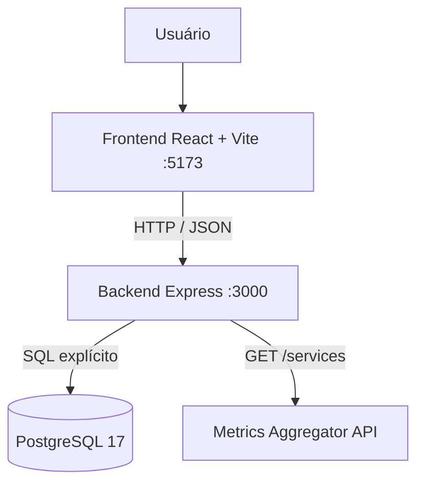
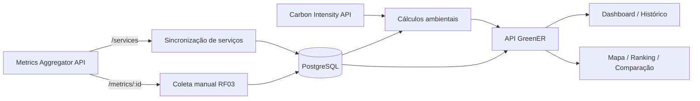

# Arquitetura — GreenER

← [Voltar ao índice da documentação](../README.md)

> Este documento separa a **arquitetura já implementada** da **evolução planejada**. Recursos das Sprints 2 e 3 não devem ser apresentados como concluídos antes de sua integração e validação.

---

## 1. Visão geral

O GreenER utiliza arquitetura web cliente-servidor, com frontend em React + TypeScript, backend em Node.js + Express + TypeScript, persistência PostgreSQL e execução por Docker Compose.

### Estado atual da aplicação



O fluxo funcional validado na Sprint 1 continua sendo:

```text
Metrics Aggregator /services
        ↓
Backend GreenER
        ↓
PostgreSQL
        ↓
GET /api/servicos
        ↓
Frontend React
```

A Sprint 2 iniciou a evolução da camada de persistência. O banco já representa tentativas de coleta relacionadas às métricas. A consulta individual de `/metrics/{id}` está implementada no fluxo manual RF03; a execução periódica automática permanece como evolução planejada.

### Evolução planejada



O objetivo da Sprint 2 é transformar o fluxo já existente de descoberta de serviços em um ciclo completo de:

```text
descoberta
    ↓
coleta
    ↓
persistência
    ↓
histórico
    ↓
cálculo ambiental
    ↓
indicadores
    ↓
dashboard
```

---

## 2. Responsabilidades por camada

| Camada | Responsabilidade |
| --- | --- |
| **Frontend** | Navegação, autenticação de interface, apresentação dos serviços, estados de consulta e visualizações analíticas. |
| **Routes** | Definir recursos e métodos HTTP e encaminhar chamadas para controllers. |
| **Controllers** | Tratar entrada/saída HTTP, códigos de resposta e delegar regras de negócio. |
| **Services** | Implementar regras de negócio, orquestração de integrações, cálculos e estados. |
| **Repositories** | Concentrar SQL explícito e parametrizado de acesso ao PostgreSQL. |
| **Jobs** | Executar processos recorrentes sem ação manual, como sincronização e futuras coletas. |
| **PostgreSQL** | Persistir usuários, serviços, localizações, estrutura de coletas, métricas e demais dados históricos utilizados pela aplicação. |
| **Metrics Aggregator API** | Fornecer catálogo de serviços e métricas por serviço. |
| **Carbon Intensity API** | Fornecer intensidade de carbono por região para cálculo de CO₂e. |

---

## 3. Organização do backend

O backend segue a separação:

```text
route
  ↓
controller
  ↓
service
  ↓
repository
  ↓
PostgreSQL
```

Exemplo atual para listagem de serviços:

```text
GET /api/servicos
  ↓
servicos.routes.ts
  ↓
ServicosController.list()
  ↓
ServicosService.listAll()
  ↓
ServicosRepository.listAll()
  ↓
PostgreSQL
```

A coleta manual preserva esse padrão em camadas:

```text
POST /api/metricas/collect
  ↓
coletas.routes.ts
  ↓
ColetasController.collect()
  ↓
ColetasService.collectAllMetrics()
  ├── ServicosService.listAll()
  ├── Metrics API /metrics/{external_id}
  └── ColetasRepository.saveCollection()
        ↓
      PostgreSQL
```

O middleware JWT autentica a requisição e o middleware administrativo consulta `users.admin` no PostgreSQL antes de permitir a coleta manual.

A estrutura atual do módulo de coletas é:

```text
modules/coletas/
├── coletas.routes.ts
├── coletas.controller.ts
├── coletas.service.ts
└── coletas.repository.ts
```

O endpoint manual coleta somente serviços com status `active`. Cada chamada externa tem timeout; uma falha individual é registrada e não interrompe os serviços seguintes. Coletas bem-sucedidas gravam a tentativa e as métricas na mesma transação; resultados sem métricas ou com erro gravam apenas a tentativa.

---

## 4. Sincronização automática de serviços

Ao iniciar, o backend dispara um job de sincronização do catálogo de serviços.

O job consulta `/services`, cria ou atualiza registros e marca como `removed` serviços persistidos que deixaram de aparecer na resposta externa.


> O intervalo usado por esse job deve ser distinguido do intervalo de **coleta de métricas**. Na Sprint 2, a nomenclatura e a configuração desses intervalos devem permanecer separadas para evitar ambiguidade.

---

## 5. Estados dos serviços e das coletas

A arquitetura passa a distinguir dois conceitos diferentes:

```text
estado atual do serviço
≠
resultado de uma tentativa de coleta
```

### Estado atual do serviço

A tabela `service` mantém informações relacionadas ao estado atual conhecido do serviço, utilizando principalmente:

```text
service.status
service.last_seen_at
```

Os estados persistidos atualmente têm foco em:

- `active`;
- `removed`.

Esses dados permitem consultas rápidas sobre a situação atual do catálogo.

### Estados transitórios da interface

O frontend pode representar estados visuais temporários, como:

- `new`;
- `returned`.

Esses estados não substituem o estado persistido no backend.

### Estado da coleta

A partir da TEC02, cada tentativa de coleta pode possuir um dos seguintes estados no banco:

| Estado | Significado |
| --- | --- |
| `success` | A consulta retornou métricas válidas |
| `no_metrics` | O serviço está disponível, mas não forneceu métricas válidas |
| `unavailable` | Não foi possível consultar o serviço |
| `error` | Ocorreu erro durante o processamento da coleta |

Isso permite representar, por exemplo:

```text
serviço: active
última coleta: no_metrics
```

sem confundir ausência de métricas com indisponibilidade durante uma tentativa de coleta.

A causa técnica de uma falha pode ser registrada separadamente em `collection.failure_reason`, enquanto `http_status` pode armazenar o código HTTP quando houver resposta.

#### Classificação das respostas de `/metrics/{id}`

| Resposta externa | Estado persistido |
| --- | --- |
| `200` com métricas válidas | `success` |
| `200` com `metrics` ausente, `null` ou vazio | `no_metrics` |
| `404` (serviço listado, métricas inexistentes) | `no_metrics` |
| `500` (serviço ou exportador de métricas indisponível) | `unavailable` |
| Timeout ou falha de conexão | `unavailable` |
| Outro HTTP inesperado, JSON inválido ou payload incompleto | `error` |

O agregador de métricas documenta `404` como "serviço removido ou métricas inexistentes" e `500` como "serviço indisponível ou exportador de métricas indisponível". Por isso, `no_metrics` representa um serviço que continua no catálogo mas não exporta métricas, enquanto `unavailable` representa a impossibilidade de consultá-lo.

---

## 6. Autenticação

### Implementado

- cadastro de usuário;
- hash de senha;
- login;
- geração de JWT;
- sessão e proteção de navegação no frontend.

### Pendente para Sprint 2

O backend ainda precisa validar o token nas rotas protegidas.

O fluxo esperado é:

```text
requisição
  ↓
Authorization: Bearer <token>
  ↓
auth middleware
  ↓
verifyToken()
  ↓
 token válido? ── não → 401
      │
     sim
      ↓
controller
```

A autenticação só deverá ser documentada como concluída após esse fluxo estar implementado e testado.

---

## 7. Persistência e histórico

A revisão da modelagem do banco foi iniciada pela TEC02 antes da implementação da coleta periódica.

O objetivo foi garantir que o modelo consiga preservar o histórico das tentativas de coleta sem criar registros vazios em `metrics`.

### Modelo implementado

O relacionamento anterior:

```text
service
   ↓
metrics
```

foi substituído por:

```text
service
   │
   │ 1:N
   ▼
collection
   │
   │ 1:0..1
   ▼
metrics
```

A tabela `collection` representa o **evento de coleta**.

A tabela `metrics` representa os **dados válidos obtidos naquela coleta**.

Essa separação é importante porque uma tentativa pode existir mesmo quando nenhuma métrica válida é retornada.

### Collection

Cada registro em `collection` contém:

```text
id_collection
service_id_service
status
failure_reason
http_status
attempted_at
```

A entidade registra:

- qual serviço foi consultado;
- quando a tentativa ocorreu;
- qual foi o resultado da tentativa;
- qual foi o motivo da falha, quando aplicável;
- qual código HTTP foi retornado, quando aplicável.

Um serviço pode possuir múltiplas coletas:

```text
Billing API
    │
    ├── collection #1 → success
    ├── collection #2 → success
    ├── collection #3 → no_metrics
    └── collection #4 → unavailable
```

Isso preserva eventos que anteriormente não poderiam ser registrados apenas na tabela `metrics`.

### Metrics

A tabela `metrics` armazena somente dados válidos.

Seu relacionamento com o serviço passa a ser indireto:

```text
metrics
   ↓
collection
   ↓
service
```

A referência direta anterior entre `metrics` e `service` foi removida para evitar redundância.

Cada registro de `metrics` possui:

```text
collection_id_collection
```

como chave estrangeira para a coleta correspondente.

A restrição `UNIQUE` aplicada a essa referência garante a cardinalidade:

```text
collection 1 → 0..1 metrics
```

Assim:

```text
success
    ↓
collection + metrics
```

enquanto:

```text
no_metrics
unavailable
error
    ↓
collection sem metrics
```

### Integridade do modelo

O banco utiliza restrições para proteger o domínio.

O campo `collection.status` aceita somente:

```text
success
no_metrics
unavailable
error
```

Também são validados:

- códigos HTTP entre `100` e `599`, quando existentes;
- impossibilidade de uma coleta `success` possuir `failure_reason`;
- associação obrigatória da coleta a um serviço;
- associação obrigatória de uma métrica à coleta que a originou;
- no máximo um conjunto de métricas por coleta.

### Consultas históricas

O índice:

```text
(service_id_service, attempted_at DESC)
```

foi criado para favorecer consultas como:

```text
histórico de determinado serviço
ordenado da coleta mais recente para a mais antiga
```

A estrutura também prepara consultas futuras por período utilizadas em:

- histórico temporal;
- gráficos;
- ranking;
- comparação entre serviços.

### Cálculos ambientais

Os resultados calculados de energia e CO₂e **não são persistidos em `collection` nesta etapa**.

A TEC02 preserva a estrutura necessária para o histórico de coleta, enquanto a estratégia de cálculo e sua associação temporal com `carbon_intensity` será definida na implementação específica do cálculo ambiental.

Essa decisão evita antecipar regras pertencentes à US07.

---

## 8. Evolução do schema e migrations

O arquivo:

```text
database/schema.sql
```

representa o estado completo atual do banco e foi validado através da criação de um PostgreSQL vazio.

Para atualizar bancos que já utilizavam o modelo anterior, foi criada:

```text
database/migrations/001_add_collection.sql
```

A migration transforma:

```text
service → metrics
```

em:

```text
service → collection → metrics
```

sem exigir a exclusão do volume PostgreSQL.

Caso existam métricas anteriores à alteração, a migration cria uma coleta de estado `success` para cada registro antigo e utiliza `metrics.recorded_at` como referência temporal disponível durante a conversão.

Uma coluna temporária:

```text
legacy_metrics_id
```

é utilizada somente durante a migration para relacionar registros antigos às novas coletas e é removida antes do `COMMIT`.

A migration é executada dentro de uma transação para evitar que o banco permaneça parcialmente atualizado caso alguma operação falhe.

### Validações realizadas na TEC02

Foram verificados:

- criação do `schema.sql` em PostgreSQL vazio;
- criação da tabela `collection`;
- relacionamento `service → collection`;
- relacionamento `collection → metrics`;
- PKs e FKs;
- restrições `CHECK`;
- restrição `UNIQUE` entre coleta e métricas;
- índice para consultas históricas;
- cenário de coleta `success`;
- cenário `no_metrics`;
- cenário `unavailable`;
- rejeição de estado inválido;
- rejeição de `success` associado a `failure_reason`;
- aplicação da migration no banco existente;
- persistência após reinicialização do PostgreSQL;
- inicialização do backend após alteração do schema;
- execução da suíte automatizada existente com **20 de 20 testes aprovados**.

---

## 9. Integrações externas

### Metrics Aggregator API

É utilizada para descoberta dos serviços através de:

```text
GET /services
```

O fluxo manual de coleta consulta cada serviço ativo individualmente:

```text
GET /metrics/{id_servico}
```

O módulo de integração deverá tratar:

- timeout;
- erro HTTP;
- ausência de métricas;
- resposta válida;
- falhas individuais sem interromper a coleta dos demais serviços.

A coleta é disparada por `POST /api/metricas/collect`, protegido por JWT e restrito a usuários administradores. Ainda não há job periódico nem endpoint para consultar o histórico.

### Carbon Intensity API

Será responsável por fornecer os fatores ambientais necessários ao cálculo de CO₂e.

A localização persistida para cada serviço permitirá associar o serviço à região utilizada no cálculo.

A forma definitiva de relacionar temporalmente uma coleta ao registro de intensidade de carbono será definida durante a implementação do cálculo ambiental.

---

## 10. Endpoints confirmados na versão atual

| Método | Rota | Finalidade |
| --- | --- | --- |
| `GET` | `/health` | Saúde básica do backend |
| `POST` | `/auth/register` | Cadastro de usuário |
| `POST` | `/auth/login` | Login e emissão de JWT |
| `GET` | `/api/servicos/discover` | Descoberta direta na Metrics API |
| `POST` | `/api/servicos/sync` | Sincronização manual do catálogo |
| `GET` | `/api/servicos` | Listagem persistida de serviços |

Endpoints de coletas, histórico e indicadores devem ser adicionados somente quando estiverem realmente implementados.

---

## 11. Execução local

O `compose.yaml` executa:

- `postgres` — PostgreSQL 17;
- `backend` — Node.js + TypeScript;
- `frontend` — React + TypeScript.

O volume do PostgreSQL preserva os registros quando os containers são reiniciados com:

```text
docker compose down
docker compose up
```

O comando:

```text
docker compose down -v
```

remove o volume e, portanto, não deve ser utilizado em testes cujo objetivo seja validar persistência.

Alterações incrementais no modelo de um banco já inicializado devem utilizar as migrations disponíveis em:

```text
database/migrations/
```

em vez de depender da recriação do volume.

---

## 12. Decisões arquiteturais da Sprint 2

### Decisões já registradas

- adoção da entidade `collection`;
- separação entre tentativa de coleta e métricas válidas;
- relacionamento `service → collection → metrics`;
- cardinalidade de zero ou um registro de métricas por coleta;
- estados de coleta:
  - `success`;
  - `no_metrics`;
  - `unavailable`;
  - `error`;
- `service.status` e `service.last_seen_at` permanecem responsáveis pelo estado atual conhecido do serviço;
- `collection` preserva o histórico das tentativas;
- falhas não geram registros vazios em `metrics`;
- evolução do schema realizada por migration;
- classificação das respostas de `/metrics/{id}` em `success`, `no_metrics`, `unavailable` e `error`;
- energia e CO₂e não são persistidos na entidade `collection` nesta etapa.

### Decisões ainda pendentes

- intervalo de sincronização do catálogo;
- intervalo de coleta de métricas;
- intervalo de atualização do frontend;
- política definitiva de retries e timeouts;
- forma de associação temporal da intensidade de carbono à coleta;
- fórmulas e unidades de energia e CO₂e;
- endpoints de histórico e indicadores;
- proteção JWT das rotas configuráveis.

Essas decisões devem ser documentadas conforme forem implementadas e validadas, evitando apresentar comportamento planejado como funcionalidade concluída.