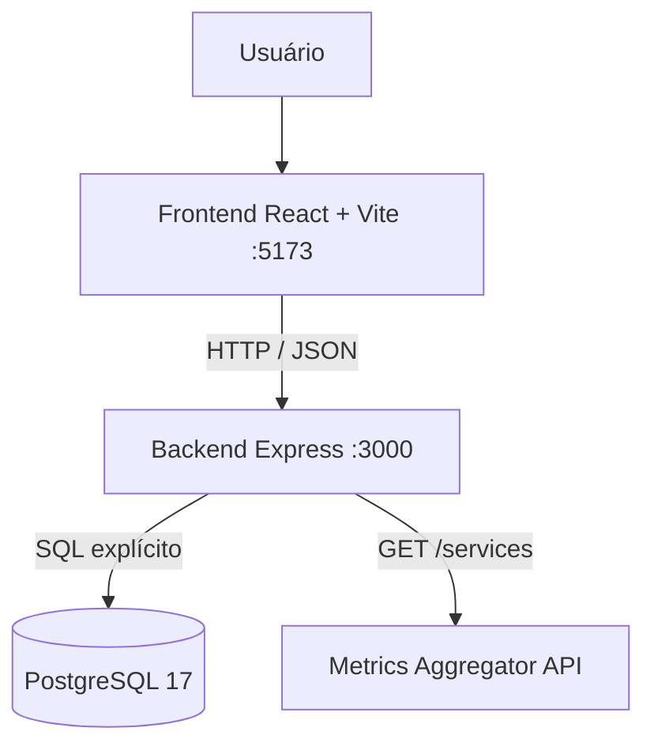
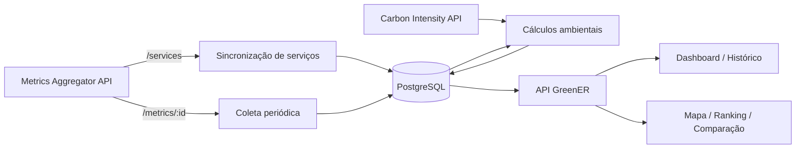
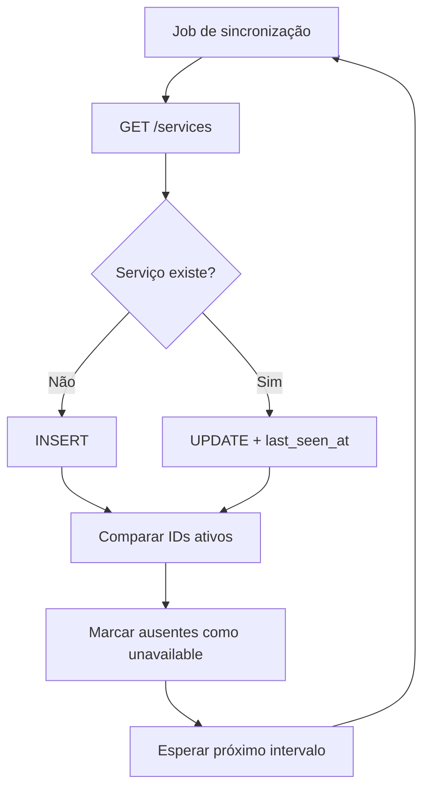

# Arquitetura — GreenER

← [Voltar ao índice da documentação](../README.md)

> Este documento separa a **arquitetura já implementada** da **evolução planejada**. Recursos da Sprint 2 e 3 não devem ser apresentados como concluídos antes de sua integração e validação.

---

## 1. Visão geral

O GreenER utiliza arquitetura web cliente-servidor, com frontend em React + TypeScript, backend em Node.js + Express + TypeScript, persistência PostgreSQL e execução por Docker Compose.

### Estado atual



O fluxo funcional validado na Sprint 1 é:

```text
Metrics Aggregator /services
        ↓
Backend GreenER
        ↓
PostgreSQL
        ↓
GET /api/servicos
        ↓
Frontend React
```

### Evolução planejada



---

## 2. Responsabilidades por camada

| Camada | Responsabilidade |
|---|---|
| **Frontend** | Navegação, autenticação de interface, apresentação dos serviços, estados de consulta e visualizações analíticas. |
| **Routes** | Definir recursos e métodos HTTP e encaminhar chamadas para controllers. |
| **Controllers** | Tratar entrada/saída HTTP, códigos de resposta e delegar regras de negócio. |
| **Services** | Implementar regras de negócio, orquestração de integrações, cálculos e estados. |
| **Repositories** | Concentrar SQL explícito e parametrizado de acesso ao PostgreSQL. |
| **Jobs** | Executar processos recorrentes sem ação manual, como sincronização e futuras coletas. |
| **PostgreSQL** | Persistir usuários, serviços, localizações e, após Sprint 2, coletas/histórico e dados ambientais. |
| **Metrics Aggregator API** | Fornecer catálogo de serviços e métricas por serviço. |
| **Carbon Intensity API** | Fornecer intensidade de carbono por região para cálculo de CO₂e. |

---

## 3. Organização do backend

O backend segue a separação:

```text
route
  ↓
controller
  ↓
service
  ↓
repository
  ↓
PostgreSQL
```

Exemplo atual para listagem de serviços:

```text
GET /api/servicos
  ↓
servicos.routes.ts
  ↓
ServicosController.list()
  ↓
ServicosService.listAll()
  ↓
ServicosRepository.listAll()
  ↓
PostgreSQL
```

A Sprint 2 deve preservar esse padrão para o módulo de coletas e para endpoints de indicadores.

---

## 4. Sincronização automática de serviços

Ao iniciar, o backend dispara um job de sincronização do catálogo de serviços. O job consulta `/services`, cria/atualiza registros e marca como `unavailable` serviços persistidos que deixaram de aparecer na resposta externa.



> O intervalo usado por esse job deve ser distinguido do futuro intervalo de **coleta de métricas**. Na Sprint 2, a nomenclatura/configuração dos intervalos deve ser revisada para evitar ambiguidade.

---

## 5. Estados dos serviços

### Estado persistido

O backend/banco é a fonte de verdade para o estado estrutural do serviço, atualmente com foco em:

- `active`;
- `unavailable`.

### Estado transitório da interface

O frontend pode representar transições visuais temporárias, como:

- `new`;
- `returned`.

Esses estados não substituem o estado persistido do backend.

### Evolução prevista na Sprint 2

A ausência de métricas não deve ser confundida com indisponibilidade. O planejamento deve permitir distinguir, por exemplo:

```text
serviço: active
última coleta: no_metrics
```

A definição final deve ser refletida no modelo de dados, nos contratos TypeScript e na documentação da API.

---

## 6. Autenticação

### Implementado

- cadastro de usuário;
- hash de senha;
- login;
- geração de JWT;
- sessão/proteção de navegação no frontend.

### Pendente para Sprint 2

O backend ainda precisa validar o token nas rotas protegidas. O fluxo esperado é:

```text
requisição
  ↓
Authorization: Bearer <token>
  ↓
auth middleware
  ↓
verifyToken()
  ↓
 token válido? ── não → 401
      │
     sim
      ↓
controller
```

A autenticação só deverá ser documentada como concluída após esse fluxo estar implementado e testado.

---

## 7. Persistência e histórico — decisão prioritária da Sprint 2

A Sprint Review 1 reforçou a necessidade de revisar o banco antes de implementar as coletas. O modelo deve sustentar, no mínimo:

- múltiplas coletas do mesmo serviço sem sobrescrever histórico;
- timestamp de cada tentativa;
- associação da coleta ao serviço;
- diferenciação entre sucesso, ausência de métricas e falha;
- dados necessários ao cálculo de energia e CO₂e;
- consultas por período;
- persistência após reinicialização dos containers.

A estrutura final deve ser refletida em `database/schema.sql`, no modelo de dados e em `database/README.md`.

---

## 8. Endpoints confirmados na versão atual

| Método | Rota | Finalidade |
|---|---|---|
| `GET` | `/health` | Saúde básica do backend |
| `POST` | `/auth/register` | Cadastro de usuário |
| `POST` | `/auth/login` | Login e emissão de JWT |
| `GET` | `/api/servicos/discover` | Descoberta direta na Metrics API |
| `POST` | `/api/servicos/sync` | Sincronização manual do catálogo |
| `GET` | `/api/servicos` | Listagem persistida de serviços |

Endpoints de coletas, histórico e indicadores devem ser adicionados aqui somente quando estiverem realmente implementados.

---

## 9. Execução local

O `compose.yaml` executa:

- `postgres` — PostgreSQL 17;
- `backend` — Node.js + TypeScript;
- `frontend` — React + TypeScript.

O volume do PostgreSQL preserva dados quando os containers são reiniciados com `docker compose down` / `docker compose up`. `docker compose down -v` remove o volume e, portanto, não deve ser utilizado em testes de persistência.

---

## 10. Decisões arquiteturais a registrar durante a Sprint 2

- modelo definitivo da entidade de coleta;
- política de estados da coleta (`success`, `no_metrics`, falha etc.);
- intervalo de sincronização do catálogo;
- intervalo de coleta de métricas;
- intervalo de atualização do frontend;
- política de retries/timeouts;
- forma de associação da intensidade de carbono à coleta;
- fórmulas e unidades de energia/CO₂e;
- endpoints de histórico e indicadores;
- proteção JWT das rotas configuráveis.

Essas decisões devem ser documentadas quando forem implementadas, evitando anunciar comportamento ainda não validado.
