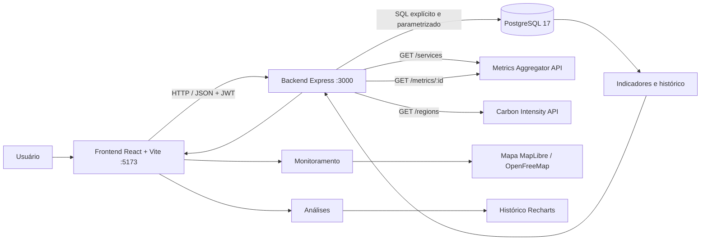
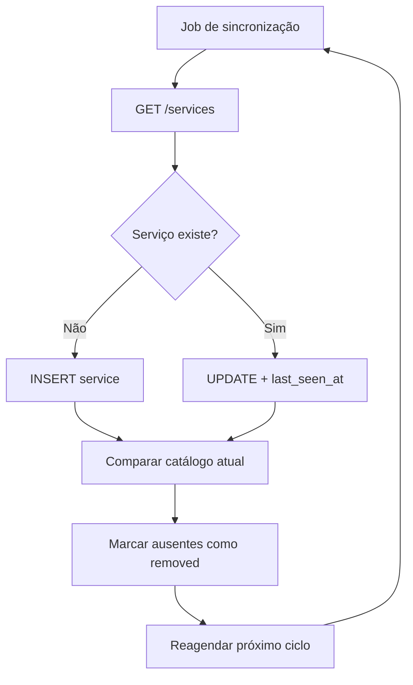
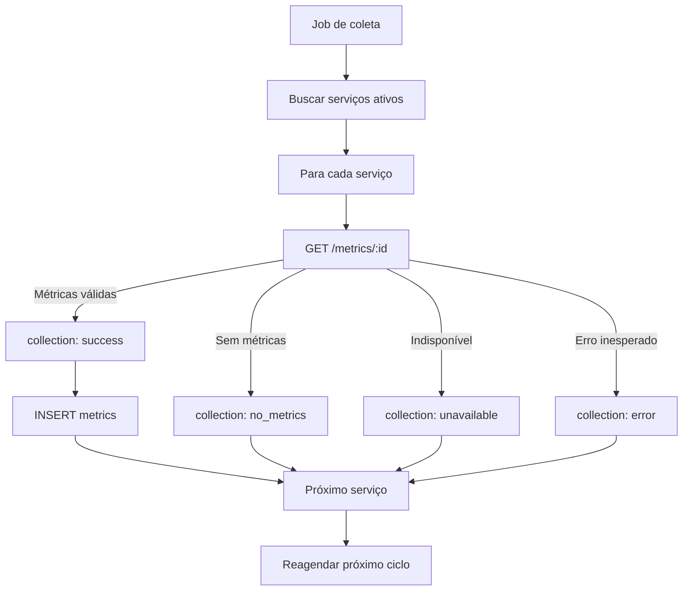
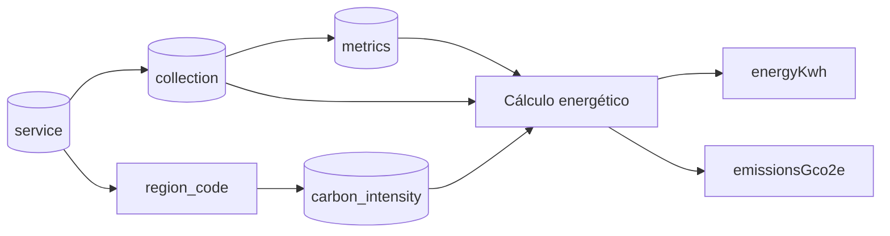
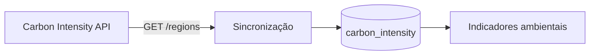
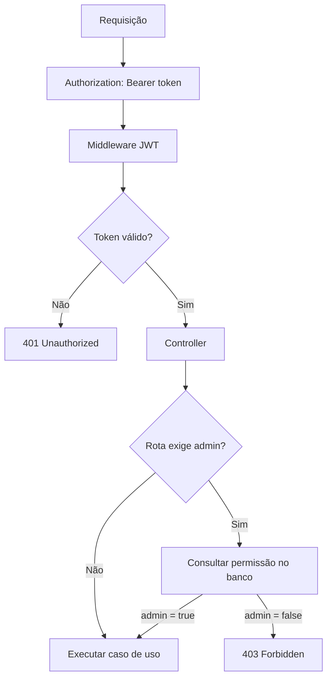
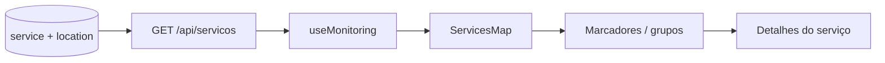

# Arquitetura — GreenER

← [Voltar ao índice da documentação](../README.md)

> **Referência arquitetural atualizada no fechamento da Sprint 2 — 09/11/2026.**  
> Este documento descreve a arquitetura efetivamente utilizada pelo GreenER e separa o que já compõe o incremento funcional do que permanece planejado para a Sprint 3.

---

## 1. Visão geral

O GreenER utiliza uma arquitetura web cliente-servidor com:

- **Frontend:** React + TypeScript + Vite;
- **Backend:** Node.js + Express + TypeScript;
- **Banco de dados:** PostgreSQL;
- **Execução:** Docker Compose;
- **APIs auxiliares:** Metrics Aggregator API e Carbon Intensity API;
- **Visualizações:** Recharts para histórico e MapLibre GL com OpenFreeMap para o mapa do Monitoramento.

A aplicação mantém as regras de negócio e os cálculos ambientais no backend. O frontend consome respostas estruturadas e não recalcula energia ou CO₂e.

### Arquitetura atual



O fluxo principal validado ao final da Sprint 2 é:

```text
descoberta de serviços
        ↓
sincronização do catálogo
        ↓
coleta periódica de métricas
        ↓
persistência de tentativas e amostras
        ↓
snapshots de intensidade de carbono
        ↓
cálculo de energia e CO₂e
        ↓
indicadores e consolidação
        ↓
Monitoramento + Análises
```

A visualização geográfica da US13 foi antecipada da Sprint 3 e incorporada ao Monitoramento durante o fechamento da Sprint 2. Como a tarefa ainda estava em revisão no fechamento documental, seus refinamentos finais permanecem sujeitos à integração definitiva.

---

## 2. Responsabilidades por camada

| Camada | Responsabilidade |
| --- | --- |
| **Frontend** | Navegação, autenticação de interface, consumo da API, Monitoramento, Análises, estados visuais e visualizações. |
| **Routes** | Definir métodos e caminhos HTTP e aplicar middlewares adequados. |
| **Controllers** | Validar entrada HTTP, delegar regras de negócio e formatar respostas. |
| **Services** | Implementar regras de negócio, orquestração, cálculos, estados e tratamento de casos de uso. |
| **Repositories** | Executar SQL explícito e parametrizado no PostgreSQL. |
| **Jobs** | Executar sincronização, coleta e atualização de dados externos em ciclos independentes. |
| **Middlewares** | Autenticação JWT, autorização e tratamento global de erros. |
| **PostgreSQL** | Persistir usuários, serviços, localização, tentativas de coleta, métricas e intensidade de carbono. |
| **Metrics Aggregator API** | Fornecer catálogo de serviços e métricas de cada serviço. |
| **Carbon Intensity API** | Fornecer fatores regionais utilizados para estimar emissões de CO₂e. |

A arquitetura procura impedir duplicação de regra de negócio entre frontend e backend. Por exemplo, o frontend exibe os valores ambientais retornados pela API, mas não implementa novamente as fórmulas de energia ou emissão.

---

## 3. Organização do backend

O padrão principal é:

```text
route
  ↓
controller
  ↓
service
  ↓
repository
  ↓
PostgreSQL
```

Exemplo de consulta de serviços:

```text
GET /api/servicos
  ↓
servicos.routes.ts
  ↓
ServicosController
  ↓
ServicosService
  ↓
ServicosRepository
  ↓
PostgreSQL
```

O mesmo princípio é utilizado nos módulos de:

- autenticação;
- serviços;
- coletas;
- intensidades de carbono;
- indicadores;
- dashboard.

Estrutura conceitual:

```text
backend/src/
├── modules/
│   ├── auth/
│   ├── servicos/
│   ├── coletas/
│   ├── intensidades/
│   ├── indicadores/
│   └── dashboard/
├── integrations/
├── jobs/
└── shared/
```

### Separação de responsabilidades

O controller não deve concentrar cálculo ambiental ou SQL.

O service não acessa o PostgreSQL diretamente quando existe repository responsável por essa persistência.

O repository não decide regras de interface ou comportamento de domínio além do necessário para executar consultas e persistência.

Essa separação atende à organização esperada para o backend Node.js + TypeScript do projeto.

---

## 4. Processos automáticos

O backend executa processos independentes para manter os dados atualizados.

### 4.1 Sincronização do catálogo

O job de serviços consulta periodicamente:

```text
GET {METRICS_API_URL}/services
```

O fluxo é:



Serviços que deixam de aparecer não são apagados do banco. Seu estado é atualizado para `removed`, preservando histórico e rastreabilidade.

### 4.2 Coleta periódica de métricas

Para cada serviço ativo, o backend consulta:

```text
GET {METRICS_API_URL}/metrics/{id_servico}
```

Cada ciclo cria uma nova tentativa em `collection`.

Quando existem métricas válidas, uma linha correspondente é criada em `metrics`.



Uma falha de serviço não interrompe o restante do ciclo.

### 4.3 Estratégia de agendamento

Os jobs utilizam reagendamento após o término da execução anterior, evitando empilhamento de ciclos do mesmo job.

A configuração utilizada na entrega diferencia:

| Processo | Configuração |
| --- | --- |
| Coleta de métricas | `COLLECTION_INTERVAL_MS` |
| Sincronização do catálogo | `SERVICE_SYNC_INTERVAL_MS` |
| Sincronização de intensidade | `CARBON_INTENSITY_SYNC_INTERVAL_MS` |
| Timeout de API externa | `EXTERNAL_API_TIMEOUT_MS` |

Na configuração de entrega, coleta e atualização principal foram utilizadas em ciclos de aproximadamente **60 segundos**, enquanto a intensidade de carbono possui ciclo próprio mais longo.

---

## 5. Estado do serviço x estado da coleta

A arquitetura distingue:

```text
estado do catálogo
≠
resultado de uma tentativa de coleta
```

### Estado do serviço

A tabela `service` representa o estado atual conhecido no catálogo externo.

Estados principais:

- `active`;
- `removed`.

O frontend também pode derivar estados transitórios como:

- `new`;
- `returned`.

Esses estados visuais não substituem a persistência de domínio.

### Estado da coleta

Cada tentativa em `collection` possui um estado:

| Estado | Significado |
| --- | --- |
| `success` | Foram obtidas métricas válidas. |
| `no_metrics` | O serviço continua disponível, mas não forneceu métricas válidas. |
| `unavailable` | Não foi possível obter métricas por indisponibilidade, timeout ou falha de conexão. |
| `error` | Houve erro inesperado de resposta, processamento ou persistência. |

Exemplo válido:

```text
service.status = active
última collection.status = no_metrics
```

Isso permite comunicar ausência de métricas sem declarar incorretamente que o serviço foi removido do catálogo.

Detalhes técnicos podem ser preservados em:

```text
collection.failure_reason
collection.http_status
```

---

## 6. Persistência e modelo histórico

A Sprint 2 consolidou a entidade `collection`.

O relacionamento principal é:

```text
service
   │
   │ 1:N
   ▼
collection
   │
   │ 1:0..1
   ▼
metrics
```

### `service`

Representa o serviço descoberto no catálogo externo e sua localização conhecida.

### `collection`

Representa uma **tentativa de coleta**, mesmo quando nenhuma métrica válida foi retornada.

Campos relevantes:

```text
id_collection
service_id_service
status
failure_reason
http_status
attempted_at
```

### `metrics`

Representa somente os dados válidos associados a uma coleta bem-sucedida.

A ligação é feita por:

```text
collection_id_collection
```

A restrição `UNIQUE` garante:

```text
collection 1 → 0..1 metrics
```

Assim:

```text
success
  ↓
collection + metrics
```

enquanto:

```text
no_metrics
unavailable
error
  ↓
collection sem metrics
```

Esse modelo evita criar métricas artificiais ou valores zero para representar falhas.

---

## 7. Histórico, energia e CO₂e

Os valores calculados de energia e CO₂e não precisam ser gravados diretamente em `collection`.

O backend utiliza os dados históricos persistidos para calcular os indicadores no período solicitado.

Fluxo simplificado:



### Seleção temporal

Para cada tentativa elegível, o módulo de indicadores associa:

- métricas válidas da coleta;
- intervalo real da amostra;
- região do serviço;
- snapshot de intensidade de carbono temporalmente elegível.

Dados ausentes são representados como lacunas. A arquitetura não substitui automaticamente ausência de informação por consumo zero.

### Agregação

O backend produz:

- indicadores individuais por serviço;
- totais no período;
- cobertura de métricas;
- cobertura de intensidade de carbono;
- sinalização `isPartial`;
- lista de lacunas quando aplicável.

O dashboard reutiliza essas regras em vez de implementar cálculos ambientais separados.

As fórmulas e premissas estão documentadas em [`docs/calculos.md`](calculos.md).

---

## 8. Carbon Intensity API

A Carbon Intensity API fornece os fatores ambientais regionais.

O backend consulta o catálogo e persiste **snapshots**, mantendo o instante em que cada valor foi observado.



O cálculo seleciona um snapshot compatível com:

- `region_code` do serviço;
- instante da tentativa de coleta;
- idade máxima configurada em `CARBON_INTENSITY_MAX_AGE_MS`.

Caso nenhum fator seja elegível, a energia pode continuar calculável, mas a emissão daquele ponto permanece indisponível.

---

## 9. Autenticação e autorização

A autenticação JWT está aplicada no backend.

Fluxo:



Exemplos:

- `/auth/me`: exige JWT;
- indicadores e dashboard: exigem JWT;
- coleta manual de métricas: exige JWT + administrador.

A autorização administrativa é consultada no banco, evitando depender apenas de estado do frontend.

---

## 10. Arquitetura do frontend

O frontend separa responsabilidades entre:

```text
pages
  ↓
components
  ↓
hooks / services
  ↓
API GreenER
```

### Monitoramento

A página de **Monitoramento** concentra a leitura operacional do ambiente:

- serviços monitorados;
- estados atuais;
- última coleta;
- indicadores ambientais;
- energia e CO₂e consolidados;
- localização;
- mapa geográfico;
- atualização automática.

O Monitoramento não deve se tornar uma tela de análise histórica profunda.

### Análises

A página de **Análises** concentra exploração temporal:

- seleção de serviço;
- seleção de período;
- histórico ambiental;
- gráfico de energia;
- lacunas no histórico;
- navegação entre serviços.

Ranking e comparação permanecem planejados para a Sprint 3.

### Atualização automática

Os hooks mantêm os últimos dados válidos em falhas transitórias e executam novas consultas periodicamente.

Fluxo simplificado:

```text
hook
  ↓
requisição autenticada
  ↓
sucesso?
 ├─ sim → substitui dados + atualiza horário
 └─ não → mantém dados anteriores + sinaliza erro
  ↓
agenda próxima consulta
```

Esse comportamento evita apagar a interface durante uma falha temporária de rede/backend.

---

## 11. Visualização geográfica — US13

A US13 foi antecipada da Sprint 3 durante a reformulação do Monitoramento.

O mapa utiliza:

- **MapLibre GL**;
- estilo/tile source do **OpenFreeMap**;
- latitude e longitude recebidas pelo backend;
- estado de monitoramento para diferenciar marcadores;
- agrupamento de serviços que compartilham coordenadas.



A ausência de coordenadas não remove o serviço do Monitoramento. O mapa é uma visualização complementar, atendendo ao RF13 sem tornar a localização geográfica a única forma de consultar os serviços.

No fechamento documental da Sprint 2, a US13 permanece em revisão antes de ser considerada definitivamente integrada.

---

## 12. Histórico visual — TEC23

A página de Análises utiliza Recharts para representar os dados históricos retornados por:

```text
GET /api/indicadores/:serviceId/historico
```

O backend continua responsável por:

- consulta do período;
- associação de intensidade de carbono;
- cálculo ambiental;
- detecção de lacunas.

O gráfico é responsável apenas pela representação.

Amostras sem energia calculável permanecem `null`, permitindo interrupções visuais no gráfico em vez de criar uma linha falsa em zero.

---

## 13. Evolução do schema e migrations

`database/schema.sql` representa o estado completo esperado para um banco criado do zero.

Para bancos existentes, a evolução deve ocorrer por scripts de migration em:

```text
database/migrations/
```

A migration:

```text
001_add_collection.sql
```

introduziu a estrutura:

```text
service → collection → metrics
```

sem exigir a remoção do volume PostgreSQL.

Essa estratégia é importante porque:

- preserva histórico já existente;
- permite evolução incremental do banco;
- reduz dependência de `docker compose down -v`;
- torna a atualização do ambiente reproduzível.

Detalhes operacionais ficam em [`database/README.md`](../database/README.md).

---

## 14. Persistência Docker

O Compose executa:

- `postgres`;
- `backend`;
- `frontend`.

O volume do PostgreSQL preserva os dados quando o ambiente é reiniciado com:

```bash
docker compose down
docker compose up -d
```

O comando:

```bash
docker compose down -v
```

remove o volume e não deve ser usado quando o objetivo é validar persistência.

Na validação de 09/11/2026, uma coleta e sua métrica associada permaneceram disponíveis após a remoção e recriação dos containers, confirmando o comportamento do volume.

---

## 15. Tolerância a falhas

A arquitetura busca impedir que falhas isoladas derrubem o monitoramento completo.

### Falha de um serviço

Cada serviço é processado individualmente durante o ciclo de coleta.

```text
serviço A → success
serviço B → unavailable
serviço C → success
```

A indisponibilidade de B não impede C de ser processado.

### Falha de API externa

As integrações possuem timeout e tratamento de erro.

Falhas são convertidas em estados ou erros controlados e não devem encerrar o processo principal do backend.

### Falha temporária no frontend

Os hooks preservam os últimos dados válidos quando uma atualização falha e tentam novamente no próximo ciclo.

### Dados incompletos

O backend utiliza `isPartial`, coberturas e lacunas para comunicar que um resultado não está completo, evitando apresentar ausência como valor zero.

---

## 16. Endpoints arquiteturalmente relevantes

A lista detalhada de contratos está em [`docs/api.md`](api.md).

Principais fluxos:

| Método | Endpoint | Papel arquitetural |
| --- | --- | --- |
| `POST` | `/auth/login` | Emissão do JWT |
| `GET` | `/auth/me` | Validação da sessão |
| `GET` | `/api/servicos` | Catálogo persistido e localização |
| `POST` | `/api/servicos/sync` | Sincronização manual do catálogo |
| `POST` | `/api/metricas/collect` | Disparo administrativo da coleta |
| `GET` | `/api/metricas/historico/:serviceId` | Histórico bruto |
| `GET` | `/api/intensidades` | Snapshots de carbono |
| `GET` | `/api/indicadores` | Indicadores ambientais por período |
| `GET` | `/api/indicadores/:serviceId/historico` | Histórico ambiental |
| `GET` | `/api/dashboard` | Resumo operacional |

---

## 17. Arquitetura validada no fechamento da Sprint 2

Em 09/11/2026 foram confirmados no ambiente Docker:

- backend e PostgreSQL com healthcheck;
- coleta periódica ativa;
- histórico persistente;
- estados `success`, `no_metrics` e `unavailable`;
- persistência após reinicialização dos containers;
- cálculo e consolidação de energia e CO₂e;
- consistência entre indicadores e dashboard;
- histórico ambiental;
- autenticação JWT;
- autorização administrativa;
- atualização automática do frontend;
- tolerância à falha de um serviço.

As evidências e comandos estão registrados em:

[`docs/testes/manualdevalidacao.md`](testes/manualdevalidacao.md)

---

## 18. Evolução planejada para a Sprint 3

A arquitetura base necessária para a Sprint 3 já está disponível.

Os principais recursos ainda previstos são:

- filtros analíticos reutilizáveis;
- ranking por energia e CO₂e;
- comparação entre dois ou mais serviços no mesmo período;
- refinamentos de responsividade;
- consolidação do mapa antecipado na Sprint 2;
- otimizações de desempenho;
- ampliação de testes e validação final do MVP.

Essas funcionalidades devem reutilizar os dados históricos e cálculos existentes, evitando criar fluxos paralelos ou duplicar regras já consolidadas no backend.

---

## 19. Princípios arquiteturais mantidos

1. **Regra de negócio no backend:** cálculos e consolidações não são duplicados no React.
2. **SQL explícito e parametrizado:** sem ORM.
3. **Histórico imutável:** novas coletas geram novos registros.
4. **Falha não equivale a zero:** dados ausentes são representados por estados/lacunas.
5. **Falha isolada não interrompe o todo:** serviços são processados independentemente.
6. **Jobs independentes:** catálogo, métricas e intensidade possuem ciclos próprios.
7. **Frontend orientado a dados reais:** indicadores principais vêm da API GreenER.
8. **Evolução por migrations:** bancos existentes não dependem de recriação do volume.
9. **Monitoramento e Análises têm papéis distintos:** operação atual x exploração histórica.
10. **Visualização geográfica é complementar:** serviços continuam acessíveis mesmo sem coordenadas.
