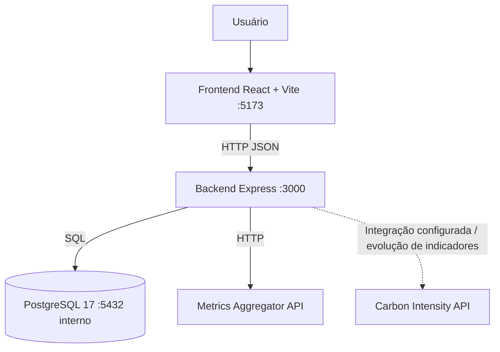

# Arquitetura — GreenER

## Visão geral
O GreenER utiliza arquitetura web cliente-servidor, com frontend React/TypeScript, API Node.js/Express/TypeScript e persistência PostgreSQL. O ambiente local é orquestrado por Docker Compose.

## Responsabilidades
| Camada | Responsabilidade |
|---|---|
| Frontend | Navegação, exibição dos serviços e estados de carregamento/erro; futuras visualizações analíticas. |
| Rotas e controllers | Expor recursos HTTP, receber solicitações e delegar regras de negócio. |
| Services | Executar descoberta, sincronização e regras de aplicação. |
| Repositories | Concentrar acesso e persistência no PostgreSQL. |
| PostgreSQL | Armazenar entidades e dados necessários à análise histórica. |
| APIs externas | Fornecer catálogo/métricas dos serviços e dados de intensidade de carbono. |

## Endpoints confirmados no código
| Método | Rota | Finalidade |
|---|---|---|
| GET | `/health` | Saúde da API |
| POST | `/auth/register` | Registro |
| POST | `/auth/login` | Login |
| GET | `/api/servicos/discover` | Descoberta na API externa |
| POST | `/api/servicos/sync` | Sincronização no banco |
| GET | `/api/servicos` | Listagem de serviços |

As rotas de `coletas` e `indicadores` estão vazias no snapshot analisado. Não devem ser apresentadas como endpoints ativos.

## Execução local
O `compose.yaml` define `postgres` (imagem `postgres:17-alpine`, porta host 5433), `backend` (porta 3000) e `frontend` (porta 5173). O backend depende do healthcheck do banco; o frontend depende do healthcheck do backend. O esquema inicial é montado de `database/schema.sql`; o volume `postgres_data` preserva os dados.

## Configuração e segurança
As credenciais e URLs são fornecidas por variáveis de ambiente. Não versionar segredos; manter `.env.example` sem credenciais reais. O backend configura CORS e rotas de autenticação. A presença de JWT não significa que todas as rotas estejam protegidas: conferir middlewares por rota antes de afirmar isso.

## Evolução prevista
Sprint 2: agendamento de coletas, armazenamento histórico, cálculos de energia e CO₂e, indicadores e gráficos. Sprint 3: filtros por período, ranking, comparação, mapa e robustez operacional.

## Decisões a documentar
Periodicidade da coleta, critérios de atualização dos serviços, fórmulas e fatores de emissão, tratamento de falhas externas, proteção das rotas e política de retenção dos históricos.
