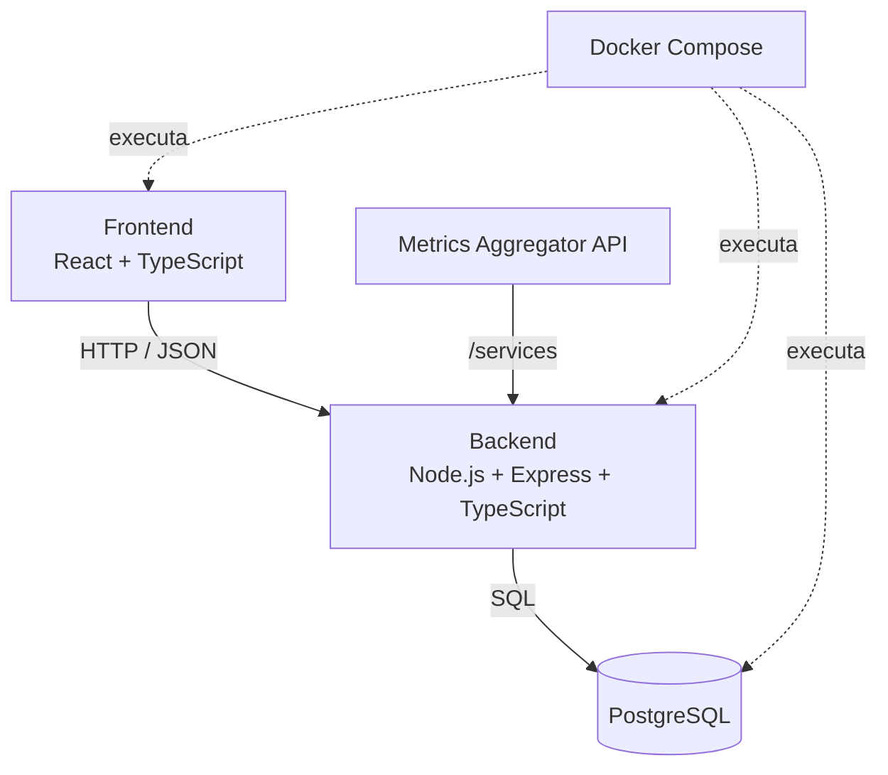
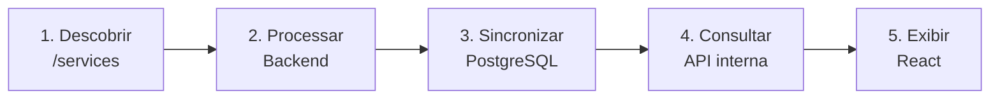
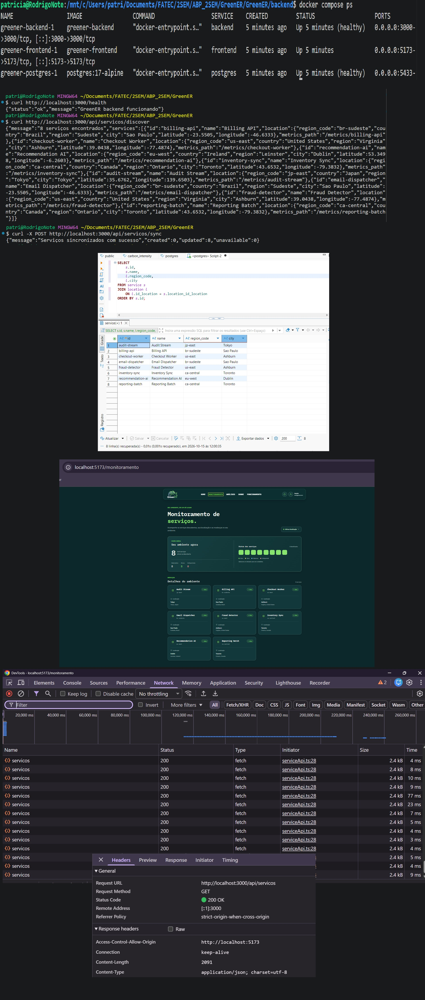
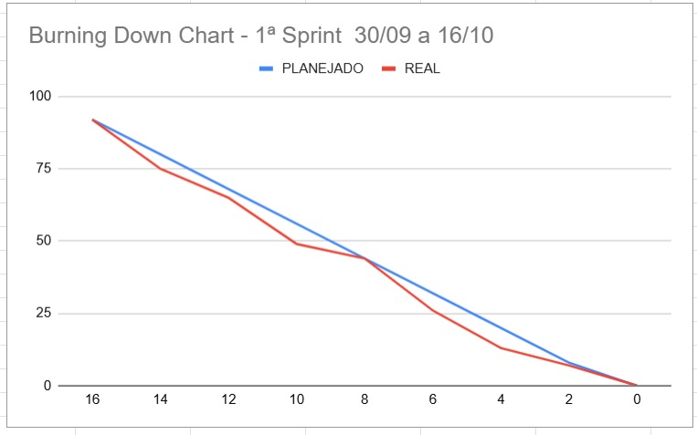

# 🌿 GreenER — Sprint 1

### Da concepção ao primeiro fluxo funcional

**28 de setembro → 19 de outubro de 2026**

[← Voltar ao projeto](../../README.md) · [Plano de entregas](../plano-de-entregas.md) · [Arquitetura](../arquitetura.md)

---

## 01 · O desafio

Como construir uma base confiável para medir o impacto ambiental de serviços de software, antes de iniciar os cálculos de consumo energético e emissões?

Nesta primeira sprint, o foco foi **estruturar a aplicação e validar sua comunicação ponta a ponta**: descobrir serviços em uma API externa, armazenar suas informações no PostgreSQL e disponibilizá-las para visualização no frontend.

> **Objetivo da Sprint 1:** entregar a fundação técnica do GreenER e demonstrar a descoberta, sincronização e listagem de serviços integradas.

## 02 · Da ideia ao planejamento

A equipe iniciou com a definição dos fluxos, a modelagem de dados e a prototipação das interfaces. Esses materiais orientaram a implementação das camadas do sistema.

| Artefato | O que orientou |
| :--- | :--- |
| [Casos de uso](../uml/UseCase.png) | Interações e funcionalidades previstas |
| [Diagrama de sequência](../uml/Sequence%20Diagram0.png) | Comunicação entre componentes |
| [Diagrama de classes](../uml/Class%20Diagram0.png) | Organização inicial dos elementos de domínio |
| [Modelo lógico do banco](../prototipos/database/logical-model-greener.png) | Entidades e relacionamentos para persistência |
| [Protótipos de interface](../prototipos/frontend) | Navegação, hierarquia visual e telas previstas |

## 03 · Construção da base tecnológica

A equipe preparou uma estrutura com serviços separados para facilitar o desenvolvimento, a integração e os testes.

**Fundamentos entregues:** organização do repositório, backend e frontend iniciais, banco de dados, ambiente Docker, autenticação inicial e estrutura modular de serviços. A integração com a API externa tornou possível realizar o primeiro fluxo funcional do produto.

> **Escopo desta etapa:** os cálculos de energia e CO₂e, as coletas periódicas e os painéis analíticos pertencem às evoluções planejadas para as próximas sprints.

## 04 · O primeiro incremento funcional

O núcleo da Sprint 1 foi fazer dados reais de serviços percorrerem o sistema:

A implementação incluiu descoberta de serviços, atualização de registros sem duplicação, disponibilização pela API interna e primeira listagem no frontend, com tratamento dos estados de carregamento, ausência de dados e erro.

## 05 · Como validamos

A sprint incluiu testes automatizados iniciais e uma verificação de integração entre API externa, backend, banco e interface. As imagens a seguir registram evidências armazenadas no repositório.

<table>
<tr>
<td align="center" width="50%"> Testes unitários</td>
<td align="center" width="50%"> Validação da integração</td>
</tr>
</table>

**Registros técnicos:** [manual de testes unitários](../testes/manual_teste_unitario.md) · [manual de validação](../testes/manualdevalidacao.md)

## 06 · Acompanhamento da sprint

O burndown registra a evolução das atividades ao longo do período, foi definido 16 dias úteis de trabalho para a primeira sprint, com atualizações a cada 2 dias. O detalhamento completo das tarefas, responsáveis, prioridades e requisitos permanece acessível abaixo.

*Burndown — Sprint 1.*

<strong>📋 Consultar backlog completo da Sprint 1 (19 atividades)</strong>

 

[Ver quadro no GitHub Projects](https://github.com/orgs/let-zapplin/projects/2)

| Tarefa | Dificuldade | Responsável | Requisitos | Prioridade | Área | Objetivo / Entrega esperada | Concluída |
| -------- | :---------: | :------------ | :----------: | :----------: | :---- | :--------------------------- | :---------: |
| Estruturar repositório e padrões do projeto | 3 | Vitor, Igor, Gustavo | `RNF05` `RP07` | Alta | Geral | Organizar pastas, padrões de commit, branches, .env.example e README inicial para que toda a equipe consiga trabalhar no projeto | ✔️ |
| Modelagem inicial do banco de dados | 5 | Patricia, Gustavo | `RF10` `RP03` | Alta | Backend / DB | Definir entidades, atributos e relacionamentos necessários ao MVP e produzir o modelo de dados inicial | ✔️ |
| Diagrama de casos de uso | 2 | Marcelo | `RNF05` | Alta | Geral | Representar de forma clara os atores e principais funcionalidades do sistema | ✔️ |
| Diagramas de fluxo e arquitetura inicial | 2 | Vitor | `RNF05` | Média | Geral | Representar o fluxo do usuário, fluxo de dados, frontend, backend, banco e APIs externas | ✔️ |
| Configurar ambiente Docker | 5 | Vitor, Gustavo | `RP04` | Média | Infra | Permitir que frontend, backend e PostgreSQL sejam executados através do Docker | ✔️ |
| Criar estrutura inicial do PostgreSQL | 8 | Gustavo, Patricia e Marcelo | `RP03` | Alta | Backend / DB | Implementar no PostgreSQL o modelo de banco definido pela equipe e configurar sua conexão com o backend | ✔️ |
| Criar estrutura base do backend Node + TypeScript | 5 | Igor | `RP02` | Alta | Backend | Preparar projeto com estrutura inicial de módulos, controllers, services e repositories | ✔️ |
| Criar estrutura base do frontend React + TypeScript | 5 | Igor, Patricia | `RP01` | Alta | Frontend | Preparar projeto React, navegação, estrutura de páginas e componentes base | ✔️ |
| Prototipação inicial do frontend | 8 | Vitor, Igor, Patricia | `RNF01` `RF09` | Alta | Frontend / UX | Criar protótipo inicial das principais telas e validar navegação, hierarquia das informações e estrutura visual antes da implementação definitiva | ✔️ |
| Descobrir serviços pela Metrics Aggregator API | 8 | Marcelo, Gustavo | `RF01` | Alta | Backend | Consultar /services, interpretar o retorno e identificar automaticamente os serviços disponíveis | ✔️ |
| Acompanhar mudanças nos serviços | 5 | Marcelo, Gustavo | `RF01` `RF02` | Média | Backend / DB | Salvar os serviços no PostgreSQL, evitar duplicação e atualizar os dados quando necessário | ✔️ |
| Disponibilizar serviços pela API do GreenER | 5 | marcelo, gustavo | `RF01` `RP02` | Média | Backend | Criar endpoint interno para que o frontend consulte os serviços armazenados pelo sistema | ✔️ |
| Implementar autenticação da área de configuração | 5 | Gustavo | `RP06` | Média | Backend / Frontend | Autenticar usuários pelo backend utilizando JWT e impedir acesso não autorizado aos recursos protegidos | ✔️ |
| Exibir primeira listagem de serviços no frontend | 5 | Igor, Vitor | `RF09` | Média | Frontend | Criar uma tela que apresente os serviços com nome, status e localização | ✔️ |
| Tratar estados da consulta de serviços (loading, erro e ausência de serviços) | 3 | Patricia, Igor, Vitor | `RNF01` `RNF04` | Baixa | Frontend | Informar corretamente carregamento, ausência de serviços e erro na consulta | ✔️ |
| Criar interface inicial responsiva | 3 | Igor | `RNF01` | Média | Frontend / UI | Garantir que a primeira versão da interface funcione adequadamente em desktop e mobile | ✔️ |
| Documentação técnica da Sprint 1 | 2 | TODOS | `RNF05` | Alta | Geral | Documentar execução, arquitetura, modelo de dados, endpoints e configuração das APIs utilizadas | ✔️ |
| Configurar testes automatizados iniciais (unitario) | 8 | Patricia | `Qualidade` | Baixa | Backend / Frontend | Configurar a ferramenta de testes do projeto e criar pelo menos um teste automatizado para validar um fluxo crítico da Sprint 1 | ✔️ |
| Validar integração ponta a ponta | 5 | Patricia | `RF01` `RP01–RP04` | Média | Geral | Validar o fluxo Metrics API → Backend → PostgreSQL → API GreenER → React | ✔️ |
---

## 07 · Demonstração do incremento

Nesta demonstração, apresentamos a evolução da equipe desde a estruturação inicial até o fluxo de dados entre os serviços externos, o backend, o banco e o frontend.

**[▶ Assistir à demonstração da Sprint 1](https://youtu.be/pGdiciJxTPw)**

## 08. Retrospectiva da Sprint

### Da organização à integração

A retrospectiva da primeira sprint reuniu as percepções dos cinco integrantes da equipe, permitindo avaliar os resultados alcançados, identificar desafios e estabelecer oportunidades de melhoria para as próximas etapas do desenvolvimento.

### Principais percepções

<table>
  <tr>
    <td width="50%" valign="top">
      <h4>✅ O que funcionou bem</h4>
      A organização das tarefas foi destacada unanimemente como um dos principais fatores de sucesso. A distribuição de responsabilidades, a comunicação e o comprometimento contribuíram para o cumprimento do planejamento e permitiram antecipar atividades futuras.
    </td>
    <td width="50%" valign="top">
      <h4>⚠️ Desafios identificados</h4>
      A conciliação com compromissos externos impactou pontualmente o desenvolvimento. Também foram identificadas oportunidades de melhoria na integração entre frontend e backend e na resolução colaborativa de conflitos de merge.
    </td>
  </tr>
  <tr>
    <td width="50%" valign="top">
      <h4>💡 Aprendizados</h4>
      A equipe reconheceu a importância da organização, da responsabilidade individual, da confiança e da comunicação. A experiência também evidenciou a necessidade de compartilhar conhecimentos e reconhecer limitações individuais.
    </td>
    <td width="50%" valign="top">
      <h4>🚀 Oportunidades de evolução</h4>
      Fortalecer a integração técnica entre as diferentes frentes, aprimorar a documentação das alterações, incentivar revisões colaborativas e antecipar possíveis impedimentos.
    </td>
  </tr>
</table>

### Direcionamentos para a Sprint 2

A partir dos aprendizados da primeira sprint, foram propostas as seguintes ações:

| Diretriz | Ação proposta |
|---|---|
| ✅ **Continuar** | Manter a organização do backlog, a divisão clara de responsabilidades, a comunicação transparente e o comprometimento com as entregas. |
| 🚀 **Começar** | Promover maior integração entre frontend e backend, revisões colaborativas de código e documentação mais detalhada das alterações. |
| 🛑 **Evitar** | Integrações sem validação suficiente, concentração excessiva de conhecimento e retrabalho decorrente de falhas de comunicação. |
| 🔧 **Aprimorar** | Planejamento da disponibilidade dos integrantes e acompanhamento antecipado de possíveis impedimentos. |

### Plano de melhoria para a Sprint 2

| Ação | Critério de acompanhamento |
|---|---|
| Melhorar as descrições dos Pull Requests | Registrar o que foi alterado, os módulos afetados e como validar as mudanças. |
| Incentivar revisões cruzadas | Realizar ao menos uma revisão ou sessão de compartilhamento técnico entre frontend e backend. |
| Antecipar impedimentos | Comunicar dificuldades e indisponibilidades durante o acompanhamento das tarefas. |

> **Principal aprendizado**
>
> A Sprint 1 consolidou uma base organizacional sólida para o GreenER. O principal desafio para a próxima etapa será transformar essa organização em maior integração técnica, preservando a produtividade e ampliando o domínio coletivo sobre o sistema.

<strong>📋 Sobre a retrospectiva</strong>

 

A síntese foi elaborada a partir das respostas dos cinco integrantes da equipe: Gustavo, Patrícia, Vitor, Marcelo e Igor.

As avaliações individuais foram consolidadas em temas recorrentes, preservando os principais consensos e as oportunidades de melhoria identificadas.

Os direcionamentos apresentados são propostas derivadas da retrospectiva, a serem acompanhadas durante a Sprint 2.

---

## 09 · Resultados e continuidade

Ao final da Sprint 1, o projeto já conta com sua **base de execução, persistência e comunicação entre camadas**, além de um primeiro incremento demonstrável. Esse resultado estabelece as condições para avançar da identificação dos serviços para a análise de seu impacto ambiental.

**Próximo capítulo — Sprint 2:** coleta periódica de métricas, histórico, indicadores de energia e CO₂e e primeiros componentes do dashboard.

### Registros da equipe

- [Ata da Sprint 1](https://docs.google.com/document/d/1X6rmJBm1bTjtur5AG_jwcQY1v6v7jn2c4BwI4HIcfgg/edit?tab=t.0)
- [Retrospectiva da Sprint 1](https://docs.google.com/document/d/1X6rmJBm1bTjtur5AG_jwcQY1v6v7jn2c4BwI4HIcfgg/edit?tab=t.xxxrd1bjaza0)

---

**GreenER · Sprint 1** — Fundação técnica e primeiro incremento funcional

[← Voltar ao README](../../README.md)

