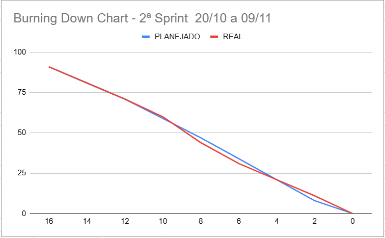

# Sprint Backlog 2 - GreenER

← [Voltar ao índice da documentação](../../README.md)

> **Período:** 20/10/2026 a 09/11/2026  
> **Objetivo da Sprint:** construir e validar o ciclo de coleta histórica do GreenER, desde a obtenção periódica das métricas até sua persistência, cálculo ambiental e apresentação dos primeiros indicadores, revisando a modelagem de dados para garantir histórico e rastreabilidade.

---

## 1. Diretrizes de planejamento

A Sprint 2 concentra o núcleo funcional do produto:

```text
coleta → persistência → histórico → cálculo ambiental → indicadores → dashboard
```

A distribuição foi revisada a partir do desempenho e das frentes assumidas na Sprint 1, buscando manter **carga principal próxima entre todos os integrantes**, continuidade de conhecimento e participação relevante em código, testes, documentação, integração ou revisão.

> **Story Points (SP)** representam esforço, incerteza e complexidade relativa; não representam horas nem produtividade individual.

### Prioridade

| Prioridade | Significado |
| --- | --- |
| **P0** | Bloqueia outras entregas ou é essencial para o objetivo da Sprint |
| **P1** | Entrega central da Sprint, necessária para compor o incremento funcional |
| **P2** | Importante, mas pode ter escopo reduzido caso haja risco ao objetivo principal |

### Fluxo de trabalho

```text
Backlog → Ready → In progress → In review → Done
```

Uma tarefa só entra em **Ready** quando suas dependências e critérios de aceite estiverem claros.

Uma tarefa só entra em **In progress** quando o responsável iniciar efetivamente seu desenvolvimento.

A tarefa entra em **In review** quando possuir Pull Request aberto e passa para **Done** somente após atender à Definition of Done da Sprint.

Na tabela de status, **Integrado** indica que a implementação está presente na `develop`; **Concluído** indica que os critérios da Definition of Done também foram confirmados. A documentação desta Sprint foi atualizada para revisão final.

---

## 2. Sprint Backlog
| Ordem | ID | Tipo | Item | Requisitos | Rubrica relacionada | Área | Prioridade | SP | Responsável | Apoio / revisão | Dependências | Status | Entrega esperada |

| ---: | --- | --- | --- | --- | --- | --- | :---: | ---: | --- | --- | --- | --- | --- |

| 1 | TEC02 | Técnico | Revisar a estrutura base do banco e criar a entidade de coleta | RF03, RF10, RP03 | BD01, BD03 | Backend / DB | **P0** | **5** | **Vitor** | Gustavo + Patricia | - | ✅ Concluído | Modelo capaz de registrar tentativas de coleta, histórico e estados sem sobrescrever registros anteriores. |

| 2 | TEC29 | Técnico | Completar autenticação JWT e proteção das rotas configuráveis | RP06 | DW06, TP03 | Backend / Frontend | **P0** | **5** | **Marcello** | Vitor | - | ✅ Concluído | Backend validando JWT em recursos protegidos, rejeitando acesso não autenticado e mantendo tratamento seguro de senha e segredo. |

| 3 | US03 | User Story | Coletar métricas de todos os serviços disponíveis | RF03 | DW02, DW03, TP02, TP03 | Backend | **P0** | **5** | **Marcello** | Igor | TEC02 | ✅ Concluído | Consulta real a `/metrics/{id_servico}` para cada serviço identificado, com respostas tipadas e tratamento de falhas. |

| 4 | US04 | User Story | Implementar coleta periódica e tratamento da variação das métricas | RF03, RF04 | DW02, TP02, TP03 | Backend | **P0** | **5** | **Igor** | Marcello | US03 | ✅ Concluído | Novas coletas executadas em intervalo definido, preservando cada amostra e aceitando valores variáveis entre requisições. |

| 5 | TEC17 | Técnico | Consolidar a orquestração automática de descoberta e coleta | RF02, RF03 | DW02, DW03, TP03 | Backend | **P0** | **3** | **Igor** | Vitor | US03, US04 | ✅ Concluído | Processo automático executando descoberta e coleta sem ação manual e sem sobrepor execuções anteriores. |

| 6 | US05 | User Story | Detectar indisponibilidade durante a coleta individual | RF05, RNF04 | DW02, TP03 | Backend / Frontend | **P0** | **3** | **Igor** | Patricia | US03, US04 | ✅ Concluído | Falha ou timeout de um serviço identificado e apresentado sem interromper o monitoramento dos demais. |

| 7 | US06 | User Story | Detectar serviço ativo sem métricas | RF06 | DW02, TP02, TP03 | Backend / Frontend | **P0** | **5** | **Igor** | Patricia + Marcello | US03, US04 | ✅ Concluído | Diferenciação clara entre coleta `unavailable` e serviço presente em `/services` que não exporta métricas. |

| 8 | TEC18 | Técnico | Integrar Carbon Intensity API | RF07 | DW02, TP02, TP03 | Backend | **P1** | **5** | **Gustavo** | Igor | TEC02 | ✅ Concluído | Consulta do fator de intensidade de carbono por região, com tipagem, timeout e tratamento de erro. |

| 9 | US07 | User Story | Calcular impacto ambiental individual dos serviços | RF07 | DW03, TP01, TP02, TP03 | Backend | **P1** | **8** | **Gustavo** | Marcello | US03, TEC18 | ✅ Concluído | Energia e CO₂e calculados a partir das métricas e do fator de carbono; fórmula, unidades e premissas documentadas e testadas. |

| 10 | US11 | User Story | Persistir e consultar histórico de coletas | RF10 | BD02, BD03, DW03 | Backend / DB / Frontend | **P1** | **8** | **Patricia** | Vitor + Marcello | TEC02, US03 | ✅ Concluído | Histórico associado ao serviço, consultável por período e preservado após reinicialização dos containers. |

| 11 | TEC19 | Técnico | Criar endpoint de dados consolidados do dashboard | RF08, RF09 | DW03, BD02 | Backend | **P1** | **5** | **Marcello** | Gustavo | US07, US11 | ✅ Concluído | Endpoint entrega indicadores gerais reais para cards e visualizações, com resposta JSON documentada. |

| 12 | US08 | User Story | Visualizar indicadores gerais | RF08 | DW04, DW05 | Backend / Frontend | **P1** | **5** | **Marcello** | Patricia | TEC19 | ✅ Concluído | Consumo total, emissão total e quantidade de serviços ativos/indisponíveis exibidos com dados reais. |

| 13 | TEC22 | Frontend / UI | Implementar visualizações iniciais do dashboard | RF08, RF09 | DW04, DW05 | Frontend | **P1** | **5** | **Patricia** | Vitor | TEC19 | ✅ Concluído | Cards e componentes reutilizáveis para indicadores, estado e impacto dos serviços. |

| 14 | US09 | User Story | Consolidar dashboard operacional | RF09 | DW04, DW05 | Frontend | **P1** | **5** | **Vitor** | Patricia | US07, US08, TEC22 | ✅ Concluído | Dashboard apresenta status, localização, métricas, energia e CO₂e com leitura clara. |

| 15 | US10 | User Story | Atualizar dashboard automaticamente | RF11, RNF02 | DW05 | Frontend / Backend | **P1** | **3** | **Vitor** | Igor | TEC17, US09 | ✅ Concluído | Atualização sem reload, intervalo definido/documentado e data/hora da última atualização visível. |

| 16 | TEC23 | Frontend / UI | Implementar gráfico inicial de histórico | RF10 | DW04, DW05 | Frontend | **P1** | **5** | **Vitor** | Patricia | US11, US07 | ✅ Concluído | Um gráfico temporal real e legível de energia ou CO₂e de um serviço. |

| 17 | TEC20 | Técnico | Ampliar testes automatizados | Qualidade | TP03, ES07 | Backend / Frontend | **P1** | **5** | **Patricia** | Todos | Durante toda a Sprint | ✅ Concluído | Cobertura de coleta, cálculos, estados, persistência, JWT e endpoints críticos. Cada responsável testa sua própria entrega. |

| 18 | TEC21 | Técnico | Atualizar documentação técnica da Sprint 2 | RNF05 | ES06, ES08 | Geral | **P1** | **3** | **Gustavo** | Vitor + todos | Durante toda a Sprint | 🔄 Em fechamento | README, arquitetura, API, banco, cálculos, plano de entregas e registro da Sprint coerentes com a versão entregue. |
| 19 | TEC36 | Técnico / UX | Prototipação mobile | RNF01, RF09 | DW04 | Frontend / UX | **P2** | **3** | **Igor + Patricia** | Vitor | Sprint inicial / dashboard existente | ✅ Concluído | Protótipo e direcionamentos de responsividade para o Monitoramento, preservando hierarquia e leitura dos indicadores em telas menores. |
| 20 | TEC37 | Técnico / UI | Reformular a apresentação dos indicadores do dashboard de Monitoramento | RF08, RF09, RF11, RNF01, RNF02 | DW04, DW05 | Frontend / UX | **P1** | **—** | **Igor + Vitor** | Patricia | US09, US10, TEC22, TEC36 | 🔄 In review | Monitoramento reorganizado em blocos analíticos, com indicadores e visualizações alimentados por dados reais, atualização contínua e tratamento independente de loading/erro. [Issue #140](https://github.com/let-zapplin/GreenER/issues/140). |
| 21 | US13 | User Story | Implementar visualização geográfica com serviços reais | RF12, RF13, RNF01, RNF04 | DW04 | Frontend | **P1** | **5** | **Igor** | Vitor + Patricia | Localização já persistida / base de RF12 | 🔄 In review | Mapa funcional no Monitoramento utilizando latitude/longitude reais; serviços sem coordenadas continuam disponíveis nas demais visualizações. Item antecipado da Sprint 3. [Issue #142](https://github.com/let-zapplin/GreenER/issues/142). |


**Baseline planejada no início da Sprint:** 91 SP.

> Os 91 SP correspondem aos 19 itens definidos na baseline da Sprint 2, de TEC02 até TEC36.

### Ajustes de escopo durante a Sprint

O planejamento inicial da Sprint 2 continha **19 itens e 91 SP**.

Durante a execução foram incorporadas duas entregas adicionais:

- **TEC37 — Reformular a apresentação dos indicadores do dashboard de Monitoramento**;
- **US13 — Implementar visualização geográfica com serviços reais**, originalmente planejada para a Sprint 3 e antecipada para a Sprint 2.

A **TEC36 — Prototipação mobile** já fazia parte da baseline original e, portanto, **não é considerada ampliação posterior de escopo**.

A US13 possui **5 SP** no planejamento original da Sprint 3. A TEC37 foi incorporada durante a Sprint e permanece sem SP consolidado nesta documentação enquanto o registro oficial não indicar um valor.

Esses itens são registrados separadamente dos **91 SP iniciais**, preservando a diferença entre planejamento original e adaptação ocorrida durante a execução.

---

## 3. Distribuição de capacidade

| Integrante | SP principais da baseline | Foco da Sprint 2 |
| --- | ---: | --- |
| **Gustavo** | **16** | Carbon API, fundamentação científica, energia/CO₂e e documentação técnica |
| **Marcello** | **20** | Metrics API, JWT, endpoint consolidado e indicadores |
| **Igor** | **16 + participação compartilhada na TEC36** | coleta periódica, orquestração, indisponibilidade, `no_metrics` e prototipação mobile |
| **Patricia** | **18 + participação compartilhada na TEC36** | histórico, visualizações do dashboard, testes e prototipação mobile |
| **Vitor** | **18** | banco/coletas, dashboard, atualização automática e gráfico histórico |

> A TEC36 possui 3 SP e responsabilidade compartilhada entre Igor e Patricia. Por isso, seus SP não são duplicados na soma individual. A baseline da Sprint permanece em **91 SP**.

### Escopo adicional assumido durante a Sprint

| Item | Frente principal | Apoio / revisão | Observação |
| --- | --- | --- | --- |
| TEC37 | Igor + Vitor | Patricia | Reformulação do Monitoramento; item em revisão ao final da Sprint |
| US13 | Igor | Vitor + Patricia | Mapa funcional antecipado da Sprint 3; item em revisão ao final da Sprint |

> A tabela de capacidade original foi mantida como fotografia do planejamento inicial. O escopo adicional é registrado separadamente para preservar a evolução real da Sprint.

---

## 4. Sequência recomendada
### 20/10 a 22/10 — Fundação
- TEC02 — revisar banco, persistência e entidade de coleta.

- TEC29 — concluir proteção JWT no backend.

- Definir contratos necessários à coleta de métricas.


### 23/10 a 27/10 — Coleta e estados
- US03 → US04 → TEC17.

- US05 e US06 sobre a coleta real.

- Validar que uma falha não interrompe o monitoramento dos demais serviços.


### 28/10 a 01/11 — Histórico e impacto ambiental
- TEC18 → US07.

- US11 em paralelo.

- Documentar fórmulas, fatores e unidades utilizados.


### 02/11 a 05/11 — Indicadores e dashboard
- TEC19 → US08 → TEC22 → US09 → US10.


### 06/11 a 07/11 — Histórico visual
- TEC23 utilizando dados reais persistidos.


### 08/11 a 09/11 — Fechamento
- Testes, persistência após restart, regressão e documentação.

- Atualizar README, `docs/plano-de-entregas.md` e `docs/sprints/sprint-2.md`.


---

## 5. Definition of Done da Sprint 2
Uma tarefa só pode ser movida para **Done** quando:


- [x] critérios de aceite estiverem atendidos;

- [x] código estiver integrado à `develop`;

- [x] build/execução via Docker estiver funcionando (execução confirmada pela equipe);

- [x] testes relacionados estiverem passando;

- [x] cenários de erro relevantes estiverem tratados;

- [x] não houver `any` sem justificativa;

- [x] SQL variável estiver parametrizado, quando aplicável;

- [x] documentação relacionada estiver atualizada;

- [x] PR contiver descrição, requisito relacionado e evidência de validação;

- [x] pelo menos outro integrante tiver revisado a entrega.


> A validação técnica dos itens declarados como **Concluído** foi refeita no fechamento de 09/11/2026, incluindo Docker, testes automatizados, integração PostgreSQL, cenários de erro, persistência e atualização automática. **TEC37 e US13 permanecem em `In review` e, portanto, não são contabilizadas como Done neste registro até a conclusão da revisão e integração.**

---

## 6. Critério de sucesso da Sprint
O incremento integrado da Sprint 2 cobre o seguinte fluxo:


```text

serviço descoberto

    ↓

métricas coletadas periodicamente

    ↓

coleta persistida

    ↓

intensidade de carbono obtida

    ↓

energia/CO₂e calculados

    ↓

histórico consultável

    ↓

indicadores exibidos no Monitoramento e histórico visual disponível em Análises

```


O fluxo usa dados persistidos, sem depender de dados simulados no frontend para os indicadores principais. Esse núcleo funcional foi validado tecnicamente em 09/11/2026.

Além do fluxo originalmente definido para a Sprint 2, houve avanço de escopo no frontend: a TEC36 orientou a adaptação mobile, a TEC37 reformulou a leitura operacional do Monitoramento e a US13 antecipou a visualização geográfica prevista para a Sprint 3. Os itens ainda em revisão permanecem identificados como tal no backlog.


---

## 7. Decisões e evidências da Sprint
Esta seção registra decisões técnicas e evidências da implementação integrada. As contagens de testes nos registros individuais são fotografias do momento em que cada alteração foi validada; o resultado mais recente desta Sprint está consolidado ao final da seção.


O status **Integrado** indica que a implementação está presente na `develop`; as tarefas que atenderam à DoD foram atualizadas para **Concluído** após a confirmação do grupo.


### TEC02 — Revisão do banco e entidade de coleta
A modelagem do banco foi revisada para sustentar o ciclo histórico de coleta da Sprint 2 e preparar as próximas funcionalidades de métricas, estados e histórico.


#### Decisão de modelagem
O modelo anterior associava `metrics` diretamente a `service`:


```text

service → metrics

```


Esse modelo permitia armazenar métricas válidas, mas não representava adequadamente tentativas em que:


- o serviço estivesse disponível sem métricas;

- a consulta falhasse;

- o serviço estivesse indisponível;

- ocorresse erro durante o processamento.


Foi criada a entidade `collection`, fazendo com que o relacionamento principal passe a ser:


```text

service

   │

   │ 1:N

   ▼

collection

   │

   │ 1:0..1

   ▼

metrics

```


`collection` representa a **tentativa de coleta**.


`metrics` representa somente os **dados válidos retornados naquela tentativa**.


#### Estados da coleta
Foram definidos inicialmente os seguintes estados:


| Estado | Significado |

| --- | --- |

| `success` | A consulta retornou métricas válidas |

| `no_metrics` | O serviço permaneceu disponível, mas não forneceu métricas válidas |

| `unavailable` | Não foi possível consultar o serviço |

| `error` | Ocorreu erro durante o processamento |


O motivo técnico da falha pode ser armazenado separadamente em `failure_reason`, evitando misturar o estado de domínio com detalhes técnicos como timeout ou erro HTTP.


**#### Relação com **`metrics`


Cada registro de `metrics` referencia a coleta que o originou através de:


```text

collection_id_collection

```


A referência direta anterior de `metrics` para `service` foi removida.


O serviço correspondente passa a ser obtido por:


```text

metrics → collection → service

```


A restrição `UNIQUE` garante que uma coleta possua no máximo um conjunto de métricas.


Portanto:


```text

success

   ↓

collection + metrics

```


enquanto:


```text

no_metrics

unavailable

error

   ↓

collection sem metrics

```


#### Evolução de bancos existentes
Foi adicionada:


```text

database/migrations/001_add_collection.sql

```


para permitir a evolução de bancos já inicializados sem exigir a remoção do volume PostgreSQL.


Caso existam métricas anteriores à mudança, a migration cria uma coleta retroativa com estado `success` para cada registro e utiliza `metrics.recorded_at` como referência temporal disponível durante a conversão.


A coluna temporária `legacy_metrics_id` é utilizada apenas para relacionar os registros durante a migration e é removida antes do `COMMIT`.


#### Escopo dos cálculos ambientais
A TEC02 não persiste resultados calculados de energia ou CO₂e na entidade `collection`.


A estratégia de cálculo e a associação temporal com os registros de `carbon_intensity` permanecem responsabilidade da implementação do cálculo ambiental, evitando antecipar regras da US07.


#### Validações realizadas
Foram executadas as seguintes verificações:


- criação completa do `schema.sql` em PostgreSQL vazio;

- criação da tabela `collection`;

- validação das PKs e FKs;

- validação das restrições `CHECK`;

- validação da restrição `UNIQUE` entre coleta e métricas;

- validação do índice `(service_id_service, attempted_at DESC)`;

- inserção de coleta `success`;

- inserção de coleta `no_metrics`;

- inserção de coleta `unavailable`;

- rejeição de estado inválido;

- rejeição da combinação `success` com `failure_reason`;

- aplicação da migration no banco existente;

- validação da persistência após reinicialização do PostgreSQL;

- inicialização do backend após a mudança estrutural;

- validação da sincronização existente de serviços;

- execução da suíte automatizada do backend com **20 testes aprovados em 20**.


#### Resultado atual
A estrutura de persistência necessária para as próximas tarefas da Sprint está disponível:


```text

service

   ↓

collection

   ↓

metrics

```


As tarefas US03 e US04 passaram a consultar `/metrics/{id_servico}` e criar esses registros nos ciclos de coleta; os detalhes estão nas seções correspondentes e nos testes da suíte.


O código da TEC02 está integrado à `develop`, e o grupo confirmou o atendimento de seus critérios de aceite e da Definition of Done.


### US04 — Coleta periódica e variação das métricas
A coleta passou a ser executada automaticamente, sem depender da rota manual criada na US03.


#### Decisões
- **Job dedicado:** `backend/src/jobs/metrics-collection.job.ts` executa um ciclo assim que o backend inicia e reagenda o próximo com `setTimeout` **somente após o término do ciclo atual**. Isso impede que o mesmo job tenha duas execuções simultâneas.

- **Guarda de execução compartilhada:** `MetricaService.collectAllMetrics()` controla um estado de coleta em andamento no módulo. O job periódico e o `POST /api/metricas/collect` usam a mesma guarda; uma chamada concorrente retorna `skipped: true` sem consultar a API externa novamente.

- **Intervalos independentes:** `COLLECTION_INTERVAL_MS` (padrão `60000`) define a coleta de métricas e `SERVICE_SYNC_INTERVAL_MS` (padrão `300000`) define a sincronização do catálogo. Antes, a única variável existente controlava apenas o catálogo. Ambos são validados como inteiros positivos na inicialização.

- **Variação sem sobrescrita:** cada ciclo chama `/metrics/{id_servico}` novamente e insere uma nova linha em `collection` (e em `metrics` quando o estado é `success`). Não há `UPDATE` sobre amostras anteriores, então valores diferentes entre requisições ficam registrados como coletas sucessivas.

- **Falhas isoladas:** cada serviço é processado em seu próprio `try/catch`. Falha de consulta externa, `no_metrics`, `error` ou erro de persistência contam no resumo e a coleta continua para os demais serviços. O job também captura falhas do ciclo inteiro e mantém o agendamento.

- **Retorno da coleta:** o endpoint e o job recebem um resumo com `skipped`, `services`, `success`, `noMetrics` e `errors`.


#### Evidências
- coleta manual e automática usando o mesmo caso de uso;

- configuração do intervalo em `env.ts`, `.env.example` e `compose.yaml`;

- testes de coletas sucessivas com valores diferentes, sem sobrescrever a amostra anterior;

- teste de falha de persistência sem interromper os demais serviços;

- teste de guarda contra execução concorrente;

- teste do job executando imediatamente, repetindo no intervalo e continuando após falha;

- suíte do backend com **32 testes aprovados em 32** (6 novos) e `npm run typecheck` sem erros.


O código da US04 está integrado à `develop`, e o grupo confirmou o atendimento de seus critérios de aceite e da Definition of Done.


### US06 — Serviço ativo sem métricas
Um serviço que continua presente em `/services` mas deixa de exportar métricas passou a ser representado pelo estado próprio `no_metrics`, sem ser confundido com `unavailable`.


#### Decisões
- **Classificação pelo contrato externo:** o agregador documenta `404` como "serviço removido ou métricas inexistentes" e `500` como "serviço indisponível ou exportador de métricas indisponível". O backend grava `no_metrics` para `404` e para `200` sem `metrics` válido; grava `unavailable` para `500`, timeout e falha de conexão; e mantém `error` para outros HTTP inesperados, JSON inválido ou payload incompleto.

- **Serviço permanece no catálogo:** `no_metrics` é registrado apenas em `collection`; `service.status` continua `active`, então o serviço segue retornando em `GET /api/servicos` enquanto aparecer em `/services`.

- **Consulta mantida:** todo serviço ativo tem `/metrics/{id}` consultado em cada ciclo; ausência de métricas não interrompe o ciclo nem remove o serviço.

- **Registro no fluxo de coleta:** a tentativa é inserida em `collection` com `status = 'no_metrics'`, `http_status` quando houver e sem registro em `metrics`. O resumo do ciclo contabiliza `noMetricsCount`.

- **Sinalização no frontend:** `last_collection_status` é convertido em estado próprio da interface (`no_metrics`), com contador, cor e legenda distintos de `Indisponível`. O cartão informa que o serviço continua ativo no catálogo e exibe o horário da última tentativa de coleta; o popover do indicador reforça a distinção.


#### Evidências
- teste de `fetchServiceMetrics` para `200` sem métricas, `404`, `500`, timeout e falha de conexão;

- teste de persistência de `no_metrics` sem inserção em `metrics`;

- teste do resumo da coleta contabilizando `no_metrics` separado de `unavailable` e `error`;

- teste do mapeamento de `last_collection_status` para o estado da interface;

- suíte do backend com **73 testes aprovados em 73** e suíte do frontend com **26 testes aprovados em 26**, ambas com typecheck sem erros (29/10/2026).


O código da US06 está integrado à `develop`, e o grupo confirmou o atendimento de seus critérios de aceite e da Definition of Done. A classificação e a apresentação de `no_metrics` possuem cobertura automatizada; essa evidência não equivale a uma validação independente contra a API real.


### TEC23 — Gráfico inicial de histórico ambiental
Foi implementada a primeira visualização temporal de indicadores ambientais do GreenER utilizando dados históricos reais persistidos no PostgreSQL.


#### Decisões técnicas
- Foi criado o endpoint protegido `GET /api/indicadores/:serviceId/historico`, com seleção de serviço e período por `start` e `end`.

- A consulta ao histórico reutiliza o módulo de indicadores e o mesmo cálculo ambiental utilizado pelo dashboard, evitando duplicação da fórmula de energia e CO₂e.

- O repository passou a aceitar filtro opcional por serviço, mantendo SQL parametrizado e reutilizando a consulta temporal existente.

- Amostras sem energia calculável permanecem como `null`; ausência de dado não é convertida em consumo zero.

- Períodos sem coletas são preservados como lacunas temporais na visualização, evitando conectar artificialmente amostras separadas por longos intervalos.

- O frontend utiliza Recharts para representar a evolução da energia estimada em `kWh`.

- A página de Análises permite selecionar o serviço e consultar períodos de `1h`, `6h`, `24h` e `7d`.

- O gráfico possui tooltip contextual, indicação de lacunas, atualização automática e zoom por seleção de intervalo.

- A navegação temporal permite desfazer o último zoom ou restaurar o período completo.

- A troca de serviço pode ser realizada pelo seletor ou pela navegação sequencial entre os serviços monitorados.


#### Estados tratados
A interface diferencia:


- carregamento do histórico;

- erro de consulta;

- serviço existente sem coletas no período;

- coletas existentes sem energia calculável;

- lacunas causadas por indisponibilidade ou ausência de coleta;

- atualização temporariamente indisponível mantendo os últimos dados válidos.


#### Validações realizadas
- testes do service para histórico válido, ausência de coletas, lacunas e serviço inexistente;

- testes do controller para parâmetros e propagação de erros;

- testes HTTP para autenticação, período inválido, identificador inválido, serviço inexistente e resposta histórica calculada;

- suíte de testes do backend executada sem regressões;

- build do frontend executado com sucesso após a integração;

- validação manual da troca de serviços, períodos, tooltip, lacunas e navegação por zoom.


O código da TEC23 está integrado à `develop`. A validação manual descrita acima é evidência registrada durante a implementação; o grupo confirmou o aceite final e a Definition of Done.


### US10 — Atualização automática do dashboard
O dashboard de Monitoramento foi configurado para atualizar

automaticamente sem necessidade de recarregamento manual.


Intervalos adotados:


- sincronização do catálogo de serviços: 60 segundos;

- coleta de métricas: 60 segundos;

- atualização do dashboard no frontend: 60 segundos;

- sincronização da intensidade de carbono: 5 minutos.


As consultas do frontend são reagendadas após a conclusão da

requisição anterior, evitando sobreposição e acúmulo de chamadas.


Em falhas temporárias, os últimos dados válidos permanecem

visíveis e uma nova tentativa ocorre automaticamente.


A interface informa separadamente o horário da última atualização

bem-sucedida dos indicadores e dos serviços.


#### Validação
- atualização automática sem reload;

- intervalo de 60 segundos confirmado no Network;

- última atualização exibida na interface;

- ausência de acúmulo de requisições;

- backend interrompido propositalmente sem derrubar a interface;

- recuperação automática após retorno do backend.


O código da US10 está integrado à `develop`, e o grupo confirmou o atendimento de seus critérios de aceite e da Definition of Done.


### TEC36 — Prototipação mobile

A TEC36 compôs a baseline inicial da Sprint 2 como tarefa técnica de apoio ao RNF01 e ao RF09, com foco em garantir que a evolução do Monitoramento não fosse desenhada apenas para desktop.

**Responsabilidade registrada:** Igor e Patricia, com apoio/revisão de Vitor.

A prototipação serviu como direcionamento para a reorganização posterior do Monitoramento e para os refinamentos de responsividade realizados no fechamento da Sprint.

---

### TEC37 — Reformulação dos indicadores do Monitoramento

A [Issue #140](https://github.com/let-zapplin/GreenER/issues/140) foi aberta durante a Sprint 2 para reorganizar a apresentação operacional do Monitoramento.

O refinamento preserva a separação definida pelo produto:

- **Monitoramento:** estado atual do ambiente, serviços, localização e indicadores operacionais;
- **Análises:** histórico aprofundado, ranking, comparação e exploração temporal.

A entrega utiliza dados reais já fornecidos pelo backend, mantém atualização automática e reorganiza os indicadores em blocos visuais mais claros, tratando carregamento, ausência de dados e falhas temporárias sem remover os últimos dados válidos.

**Requisitos relacionados:** RF08, RF09, RF11, RNF01 e RNF02.

**Situação no fechamento documental:** 🔄 **In review**.

> A tarefa não deve ser marcada como Concluída até a revisão e integração finais.

---

### US13 — Visualização geográfica com serviços reais

A [Issue #142](https://github.com/let-zapplin/GreenER/issues/142) estava originalmente associada à Sprint 3, mas foi **antecipada para a Sprint 2** durante o refinamento do Monitoramento.

O objetivo é utilizar as coordenadas reais dos serviços para oferecer uma leitura geográfica complementar, sem transformar o mapa na única forma de consultar o ambiente.

Critérios principais incorporados:

- latitude e longitude reais quando disponíveis;
- identificação dos serviços no mapa;
- acesso a nome, localização e estado de monitoramento;
- serviços sem coordenadas continuam acessíveis nas demais visualizações;
- ausência de coordenadas ou falha do mapa não derruba o restante do Monitoramento;
- integração visual com o novo dashboard;
- funcionamento nos tamanhos de tela suportados.

**Requisitos relacionados:** RF12, RF13, RNF01 e RNF04.

**Situação no fechamento documental:** 🔄 **In review**.

A consolidação e os refinamentos do mapa podem continuar na Sprint 3, mas a implementação funcional passou a fazer parte do incremento trabalhado na Sprint 2.

---

### Verificação automatizada final — 09/11/2026

As validações finais executadas em 09/11/2026 apresentaram:

- **Backend — suíte comum:** 156 testes aprovados e 7 testes de integração ignorados nessa execução, distribuídos em 26 arquivos aprovados e 1 arquivo de integração ignorado;
- **Integração PostgreSQL real:** 7/7 testes aprovados com `compose.test.yaml`, `exit code 0`;
- **Frontend:** 26/26 testes aprovados;
- **Total:** **189 testes automatizados únicos validados** no projeto;
- **Typecheck do backend:** concluído sem erros;
- **Typecheck do frontend:** concluído sem erros;
- **Build de produção do frontend:** concluído com sucesso, 5030 módulos transformados e finalização do Vite em 1,93 s;
- o Vite apresentou apenas aviso não bloqueante de chunks acima de 500 kB, registrado como oportunidade de otimização relacionada ao RNF03.

### Validação manual do incremento

Também foram comprovados no ambiente Docker:

- `401 Unauthorized` em recurso protegido sem JWT;
- cadastro/login e `200 OK` em recurso autenticado;
- `403 Forbidden` para coleta administrativa com usuário comum;
- `200 OK` para a coleta após promoção controlada do usuário a administrador;
- coleta manual com **8 serviços**, **7 sucessos** e **1 indisponível**, sem interrupção do restante do ciclo;
- dashboard e indicadores com totais ambientais consistentes no mesmo período;
- histórico ambiental do Billing API com múltiplas amostras;
- persistência da `collection 4642` e da `metrics 4587` após `docker compose down` e `docker compose up -d`, sem remoção do volume;
- execução automática de novas coletas, com o total avançando de **4687** para **4735** sem acionamento manual;
- atualização automática do frontend sem recarregamento da página;
- estados históricos diferenciados: **13 `no_metrics`** e **43 `unavailable`** observados no PostgreSQL.

Os detalhes e comandos estão consolidados em [`docs/testes/manualdevalidacao.md`](../testes/manualdevalidacao.md).

---

## 8 · Acompanhamento da sprint

O burndown registra a evolução do trabalho ao longo da Sprint 2, permitindo visualizar a redução das atividades planejadas e os impactos causados por dependências, bloqueios e alterações de escopo durante o período.

<div align="center">



*Burndown — Sprint 2.*

</div>


## 9 · Demonstração do incremento

Nesta demonstração, apresentamos a evolução do produto a partir da base estabelecida na Sprint 1, avançando na coleta e persistência de métricas, no tratamento dos diferentes estados dos serviços e na apresentação dos indicadores ambientais obtidos pelas APIs disponibilizadas.

<div align="center">

<a href="https://youtu.be/qW38NnthF8Q">
  
</a>

**[▶ Assistir à demonstração da Sprint 2](https://youtu.be/qW38NnthF8Q)**

</div>

## 10. Fechamento da Sprint e Sprint Review

### Situação antes da Review

O núcleo funcional da Sprint 2 foi tecnicamente validado em 09/11/2026:

`coleta → persistência → histórico → cálculo ambiental → indicadores → dashboard`

Também foram incorporados refinamentos adicionais de interface e visualização geográfica.

No momento deste fechamento documental:

| Item | Situação |
| --- | --- |
| Núcleo funcional originalmente planejado para a Sprint 2 | ✅ Validado |
| TEC36 — Prototipação mobile | ✅ Concluído |
| TEC37 — Reformulação do Monitoramento | 🔄 In review |
| US13 — Visualização geográfica | 🔄 In review |
| Documentação final da Sprint | 🔄 Em fechamento |
| Sprint Review / feedback do cliente | ⏳ Pendente |

### Itens a apresentar na Sprint Review

- coleta periódica e tolerância a falhas;
- diferenciação entre `success`, `no_metrics` e `unavailable`;
- persistência histórica após reinicialização;
- energia e CO₂e por serviço e consolidados;
- atualização automática do Monitoramento;
- histórico ambiental em Análises;
- evolução visual do Monitoramento;
- visualização geográfica antecipada da Sprint 3.

### Feedback recebido

> **Preencher após a Sprint Review de 09/11/2026.**  
> Registrar somente feedback efetivamente recebido do cliente/professores.

### Decisões e adaptações para a Sprint 3

Antes da Review, a única adaptação já registrada é a **antecipação da US13 para a Sprint 2**. Ranking, comparação e demais recursos analíticos continuam planejados para a Sprint 3.

Após a Review, registrar aqui:

- mudanças de prioridade;
- novas correções ou refinamentos;
- itens que permanecem pendentes;
- alterações no Product Backlog e no Sprint Backlog 3.

### Pendências de fechamento

- concluir a revisão/integração da TEC37;
- concluir a revisão/integração da US13;
- finalizar os documentos técnicos ainda em revisão;
- registrar o hash/PR final da branch de fechamento;
- preencher o feedback e as decisões da Sprint Review.

## 11 · Retrospectiva da Sprint

### Da organização à fluidez do trabalho

A retrospectiva da segunda sprint reuniu as percepções dos cinco integrantes da equipe sobre a evolução do processo de desenvolvimento, a colaboração entre as diferentes frentes e os efeitos do uso mais rigoroso de dependências entre tarefas no GitHub Projects.

De forma geral, a equipe percebeu uma evolução em relação à Sprint 1, especialmente na comunicação, no comprometimento e na maturidade para discutir decisões técnicas. Ao mesmo tempo, o modelo de bloqueios entre tarefas evidenciou um novo problema: dependências excessivamente rígidas podem gerar gargalos, concentrar trabalho e deixar outros integrantes temporariamente sem atividades disponíveis.

### Principais percepções

<table>
  <tr>
    <td width="50%" valign="top">
      <h4>✅ O que funcionou bem</h4>
      A comunicação, o comprometimento e a colaboração permaneceram como pontos fortes da equipe. A organização das tarefas no GitHub Projects também amadureceu, com maior uso de dependências, restrições e critérios de execução. A equipe destacou ainda a velocidade na resolução das demandas e uma postura cada vez mais próxima de um ambiente profissional de desenvolvimento.
    </td>
    <td width="50%" valign="top">
      <h4>⚠️ Desafios identificados</h4>
      O uso rígido das dependências entre tarefas produziu um efeito contrário ao esperado em alguns momentos. Determinadas atividades ficaram concentradas em um único integrante enquanto outras permaneciam bloqueadas, gerando períodos de ociosidade e reduzindo a transversalidade da equipe. A distribuição inicial das tarefas também poderia ter considerado melhor essas cadeias de dependência.
    </td>
  </tr>
  <tr>
    <td width="50%" valign="top">
      <h4>💡 Aprendizados</h4>
      A equipe amadureceu tanto na gestão do projeto quanto nas discussões sobre arquitetura e resolução de problemas. A necessidade de conectar diferentes camadas da aplicação ampliou a compreensão coletiva sobre backend, frontend, banco de dados, tratamento de erros, testes e validação. Também ficou evidente que organizar dependências não significa necessariamente bloquear completamente o início de outras atividades.
    </td>
    <td width="50%" valign="top">
      <h4>🚀 Oportunidades de evolução</h4>
      Tornar o planejamento mais adaptável, revisar dependências antes que se transformem em gargalos e utilizar de forma mais ativa os integrantes definidos como apoio ou revisão. Para a entrega final, a equipe também identificou a necessidade de priorizar limpeza de código, remoção de estruturas obsoletas e organização geral do projeto.
    </td>
  </tr>
</table>

### Direcionamentos para a Sprint 3

A partir dos aprendizados da segunda sprint, foram definidos os seguintes direcionamentos:

| Diretriz | Ação proposta |
|---|---|
| ✅ **Continuar** | Manter a comunicação ativa, o comprometimento, o profissionalismo, a organização das tarefas e as discussões técnicas entre os integrantes. |
| 🚀 **Começar** | Reavaliar dependências durante a execução, redistribuir atividades quando surgirem gargalos e tornar mais ativa a participação dos integrantes definidos como apoio ou revisão. |
| 🛑 **Evitar** | Bloqueios rígidos que deixem parte da equipe ociosa, concentração excessiva de tarefas sequenciais em um único integrante e dependências que poderiam ser tratadas de forma paralela. |
| 🔧 **Aprimorar** | Distribuição de trabalho, transversalidade técnica, revisão de código, limpeza de estruturas antigas e organização do repositório para a entrega final. |

### Plano de melhoria para a Sprint 3

| Ação | Critério de acompanhamento |
|---|---|
| Revisar dependências antes de iniciar a tarefa | Confirmar se a atividade realmente precisa aguardar outra por completo ou se parte dela pode avançar em paralelo. |
| Redistribuir trabalho diante de gargalos | Evitar que um integrante concentre várias tarefas consecutivas enquanto outros permanecem sem atividades disponíveis. |
| Tornar apoio e revisão mais ativos | Utilizar os responsáveis secundários para discussão técnica, revisão de PRs e auxílio em impedimentos. |
| Ampliar a transversalidade | Incentivar integrantes a compreender e contribuir em módulos além de sua frente principal quando houver disponibilidade. |
| Preparar o projeto para a entrega final | Remover código sem uso, revisar organização dos arquivos, reduzir duplicações e manter documentação e implementação coerentes. |

> **Principal aprendizado**
>
> A Sprint 2 mostrou que aumentar o controle sobre o fluxo de trabalho não significa necessariamente torná-lo mais eficiente. As dependências ajudaram a organizar o desenvolvimento, mas, quando utilizadas de forma rígida, também criaram gargalos. Para a Sprint final, o desafio será preservar a organização conquistada enquanto a equipe ganha flexibilidade para redistribuir trabalho, colaborar entre frentes e manter todos os integrantes em desenvolvimento contínuo.

<details>
<summary><strong>📋 Sobre a retrospectiva</strong></summary>

<br>

A síntese foi elaborada a partir das respostas dos cinco integrantes da equipe: Gustavo, Marcello, Igor, Patricia e Vitor.

As avaliações individuais foram consolidadas em temas recorrentes, preservando os principais consensos e também os pontos específicos relacionados a dependências, distribuição de trabalho, comunicação, arquitetura, aprendizado técnico e preparação para a entrega final.

Os direcionamentos apresentados serão utilizados como referência de melhoria durante a Sprint 3.

</details>

## 12 · Resultados e continuidade

Ao final da Sprint 2, o GreenER consolidou seu núcleo funcional de monitoramento ambiental: coleta periódica, persistência histórica, tratamento de estados, cálculo estimado de energia e CO₂e, indicadores consolidados, atualização automática e análise temporal.

A Sprint também antecipou parte da experiência geográfica originalmente planejada para a etapa seguinte, estabelecendo uma base mais madura para os recursos de análise e tomada de decisão.

**Próximo capítulo — Sprint 3:** filtros temporais, ranking de impacto, comparação entre serviços, consolidação do mapa, refinamentos de responsividade, desempenho e validação final do MVP.