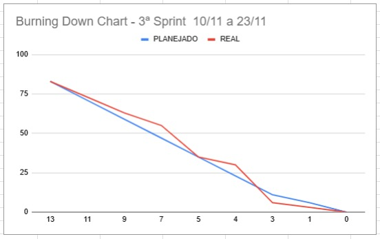

# Sprint Backlog 3 - GreenER

← [Voltar ao índice da documentação](../../README.md)

> **Período:** 10/11/2026 a 23/11/2026  
> **Status:** ✅ **Concluída em 23/11/2026**  
> **Objetivo da Sprint:** transformar os dados históricos consolidados na Sprint 2 em recursos de análise e tomada de decisão, finalizando ranking, comparação, filtros temporais, projeções, refinamentos de mapa, responsividade, tolerância a falhas, desempenho, testes e documentação. Durante a Sprint também foram incorporados o **Workspace com layout adaptativo** e a **Karma**, protótipo de assistente inteligente do GreenER.

---

## 1. Contexto e adaptações da Sprint

A Sprint 3 encerra o MVP do GreenER e concentrou o trabalho de **análise, integração, refinamento, regressão e fechamento**.

As estruturas fundamentais de coleta, persistência, histórico, cálculo ambiental, indicadores, autenticação e atualização automática já haviam sido validadas na Sprint 2 e foram reutilizadas como base para as novas capacidades analíticas.

### Evoluções incorporadas durante a Sprint

Além do escopo analítico originalmente previsto, a entrega final passou a incluir três evoluções importantes:

- **Workspace adaptável (TEC34):** página fixa de Monitoramento e páginas personalizadas pelo usuário, com widgets movíveis, redimensionáveis, minimizáveis e persistidos localmente;
- **Projeções ambientais (US17):** comparação de um mesmo consumo energético em diferentes localidades e cenário de redistribuição de serviços;
- **Karma:** protótipo experimental de assistente inteligente integrado à Home autenticada, com respostas determinísticas sobre dados do GreenER e uso opcional de Ollama local para classificação e redação de conhecimento.

Essas evoluções não substituem os requisitos obrigatórios; complementam o MVP entregue. A presença delas no **Sprint Backlog** registra o esforço e a rastreabilidade do desenvolvimento.
---

## 2. Resultado final do Sprint Backlog

| Ordem | ID | Item | Requisito relacionado | Prioridade | SP | Responsável(is) | Status final | Resultado / evidência principal |
| ---: | --- | --- | --- | --- | ---: | --- | --- | --- |
| 1 | TEC24 | Implementar seleção e filtros de período | RF14, RF15 | P0 | 5 | Vitor | ✅ Concluído | Períodos 1h, 6h, 24h e 7d compartilhados entre histórico, ranking e comparação. |
| 2 | TEC35 | Consolidar dados analíticos no backend | RF10, RF14, RF15 / BD04 | P0 | 5 | Gustavo | ✅ Concluído | Consolidação analítica por período implementada no backend para sustentar histórico, ranking e comparação. |
| 3 | US12 | Consolidar localização dos serviços | RF12 | P0 | 2 | Igor | ✅ Concluído | Localização dos serviços consolidada para uso no mapa e demais visualizações, com tratamento de dados ausentes. |
| 4 | US13 | Consolidar visualização geográfica | RF13 | P1 | 5 | Marcello | ✅ Concluído | Visualização geográfica consolidada no produto final, incluindo seleção de serviços, agrupamentos e tratamento de coordenadas incompletas. |
| 5 | US14 | Implementar ranking de impacto | RF14 | P0 | 5 | Vitor | ✅ Concluído | Ranking por energia e CO₂e integrado à página de Análises e disponível como widget do Workspace. |
| 6 | US15 | Implementar comparação entre serviços | RF15 | P0 | 8 | Vitor | ✅ Concluído | Comparação temporal e consolidada entre múltiplos serviços utilizando a mesma janela de análise. |
| 7 | TEC34 | Implementar painéis adaptáveis/recolhíveis | RF09, RNF01 | P1 | 8 | Igor | ✅ Concluído | Workspace com página fixa de Monitoramento, páginas personalizadas, widgets adicionáveis, movíveis, redimensionáveis/minimizáveis e persistência local. PR #183; documentação consolidada no PR #191. |
| 8 | TEC27 | Refinar UX/UI do Monitoramento, mapa e gráficos | RF08, RF09, RNF01 | P1 | 5 | Patricia e Marcello | ✅ Concluído | Refinamentos de hierarquia visual, interação, legibilidade e integração entre Monitoramento, mapa e visualizações analíticas. |
| 9 | TEC25 | Reforçar tolerância a falhas | RNF04 | P1 | 5 | Patricia e Gustavo | ✅ Concluído | Regressões automatizadas e validações manuais de indisponibilidade, dados parciais e recuperação do backend registradas na issue #162 e PR #182. |
| 10 | US17 | Projetar impacto ambiental por localização | RF16 | P1 | 8 | Vitor, Marcello e Gustavo | ✅ Concluído | Projeção por localização e cenário de redistribuição implementados como apoio à decisão, sem executar migração real de serviços. |
| 11 | TEC26 | Revisar desempenho | RNF03 | P1 | 3 | Marcello | ✅ Concluído | Polling, consultas analíticas, renderizações e carregamento do frontend revisados; otimizações relevantes registradas. |
| 12 | TEC28 | Finalizar responsividade/mobile | RNF01 | P1 | 5 | Patricia | ✅ Concluído | Monitoramento, Análises, ranking, comparação, projeções e mapa ajustados para telas menores. PRs #180 e #187. |
| 13 | TEC30 | Ampliar cobertura de testes | Qualidade | P1 | 5 | Patricia e Igor | ✅ Concluído | Cobertura consolidada para filtros, comparação, mapa, estados parciais, autenticação, Workspace e regressões; evidências reunidas no PR #189 e documentos de testes. |
| 14 | TEC31 | Validar requisitos e fluxo completo do MVP | RF01–RF15, RP05 | P0 final | 5 | Gustavo | ✅ Concluído | Rastreabilidade e fluxo completo do MVP revisados na validação final. |
| 15 | TEC32 | Revisar documentação final | RNF05 | P0 final | 3 | Todos | ✅ Concluído | README, API, banco, backlog, plano de entregas, Sprint 3 e documentos de validação reconciliados com a entrega final. |
| 16 | TEC33 | Preparar demonstração e vídeo final | Entrega | P0 final | 3 | Vitor e Patricia | ✅ Concluído | Roteiro, ordem das funcionalidades, ambiente e materiais da demonstração final preparados. |
| 17 | TEC39 | Implementar protótipo do Camaleão IA Karma | Evolução adicional | P2 | 3 | Igor, Vitor e Marcello | ✅ Concluído como protótipo | Karma integrada à experiência do GreenER como protótipo experimental adicional, documentada em `docs/assistente-ia.md`. |

### Capacidade registrada no Sprint Backlog

```text
Total de Story Points registrados na Sprint 3: 83 SP
```

## 3. Distribuição de tasks durante a terceira sprint

| Integrante |  Foco da Sprint 3 |
| --- |  --- |
| **Gustavo** | Foco em refinamento e controle do backend com enfâse em calculos e projeções |
| **Marcello** |  Foco na consolidação/revisão backend com atuação de suporte no frontend|
| **Igor** | Foco em inovação ficou responsável pelo desenvolvimento da karma e workspace|
| **Patricia** | Foco no refinamento do dashboard, responsividade, testes e qualidade  |
| **Vitor** | Foco nas funcionalidade de filtros, ranking e comparação, assim como suporte geral |

---

### 3.1 Análise temporal, ranking e comparação

A Sprint consolidou uma janela temporal compartilhada entre os recursos analíticos. O usuário pode alternar entre **1h, 6h, 24h e 7d**, explorar o histórico de um serviço, ordenar serviços por energia ou CO₂e e comparar múltiplos serviços na mesma janela.

Foi registrada a decisão de produto de que **serviços removidos continuam disponíveis no ranking e na comparação histórica quando possuírem dados no período selecionado**, identificados pelo respectivo estado.

### 3.2 Workspace e layout adaptativo

O Monitoramento passou a fazer parte de um **Workspace**. A aplicação mantém uma página fixa de Monitoramento para garantir uma visão inicial consistente, mas permite ao usuário criar páginas próprias e organizar o conteúdo de acordo com sua necessidade.

O catálogo de widgets inclui:

- mapa;
- consumo/intensidade regional;
- serviços;
- resumo do ambiente;
- ranking;
- histórico;
- comparação;
- projeção.

Nas páginas personalizadas, os blocos podem ser adicionados, removidos, movidos, redimensionados e minimizados. O arranjo é persistido localmente e possui comportamento adaptado à largura disponível.

### 3.3 Projeções e redistribuição

A entrega final incorporou projeções ambientais por localização. O GreenER mantém o consumo energético observado e estima como as emissões variariam em localidades com diferentes intensidades de carbono.

Também foi incorporado um cenário de redistribuição de serviços para apoiar a análise de alternativas de menor emissão. As projeções são apresentadas como **estimativas de apoio à decisão**, não como execução automática de migrações.

### 3.4 Karma — protótipo de assistente inteligente

A Home autenticada recebeu a **Karma**, protótipo experimental de assistente do GreenER.

A Karma:

- responde perguntas em linguagem natural sobre energia, emissões, serviços e panorama do ambiente;
- usa regras e serviços determinísticos para números e gráficos;
- mantém contexto de curto prazo da conversa;
- possui base curada sobre o GreenER e sua metodologia;
- pode utilizar Ollama local para classificação de intenção e redação de respostas de conhecimento;
- mantém fallback determinístico quando o modelo local não está disponível.

A arquitetura e as limitações atuais estão registradas em [`docs/assistente-ia.md`](../assistente-ia.md).

### 3.5 Robustez, desempenho e experiência

Foram executadas regressões de tolerância a falhas e refinamentos de responsividade. A aplicação mantém estados válidos diante de falhas isoladas e comunica dados parciais quando necessário.

Na revisão de desempenho foram incorporados lazy loading e pausa de polling quando a aba não está visível. O tamanho do bundle do frontend permanece registrado como oportunidade de otimização futura, sem impedir build ou execução do MVP.

---

## 4. Validação e evidências

O fechamento técnico utiliza como referências principais:

- [`docs/testes/manualdevalidacao.md`](../testes/manualdevalidacao.md);
- [`docs/testes/consolidacao_testes_sprint3.md`](../testes/consolidacao_testes_sprint3.md);
- [`docs/testes/manual_teste_unitario.md`](../testes/manual_teste_unitario.md);
- [`docs/testes/manual_integracao_postgres.md`](../testes/manual_integracao_postgres.md).

Últimos resultados documentados da entrega final:

- backend: **300 testes aprovados e 7 ignorados** na suíte comum;
- integração PostgreSQL: **7/7 testes aprovados** na execução dedicada;
- frontend: **101 testes aprovados** na varredura atualizada de 23/11/2026;
- typecheck do backend e frontend: aprovados nas execuções registradas;
- build de produção: aprovado, com aviso não bloqueante de tamanho do bundle.

> A evidência visual específica de uma falha HTTP isolada em apenas um histórico da comparação temporal **não foi localizada/reproduzida de forma controlada até o fechamento**. O comportamento foi corrigido no código para preservar os históricos bem-sucedidos e sinalizar a comparação parcial; a ausência dessa captura permanece registrada como limite de evidência, e não como funcionalidade declarada sem verificação.

---

## 5. Critérios de sucesso — resultado final

Ao final da Sprint 3, o GreenER permite ao usuário:

1. ✅ consultar serviços e indicadores ambientais atuais e históricos;
2. ✅ selecionar uma janela temporal comum para análise;
3. ✅ visualizar serviços geograficamente e selecionar pontos/agrupamentos;
4. ✅ ordenar serviços por energia ou CO₂e;
5. ✅ comparar dois ou mais serviços no mesmo período;
6. ✅ criar páginas personalizadas no Workspace e organizar widgets;
7. ✅ utilizar os principais fluxos em desktop e mobile;
8. ✅ continuar utilizando o sistema diante de falhas isoladas e dados parciais;
9. ✅ projetar impacto ambiental em diferentes localidades e analisar cenários de redistribuição;
10. ✅ executar o MVP por Docker Compose;
11. ✅ consultar documentação coerente com a versão final;
12. ✅ experimentar a Karma como camada conversacional sobre os dados do GreenER.

---

## 6. Definition of Done — fechamento

- [x] critérios de aceite revisados;
- [x] código das entregas integrado à `develop`;
- [x] testes relevantes executados e consolidados;
- [x] typecheck/build aprovados nas execuções registradas;
- [x] regressões das Sprints anteriores revisadas;
- [x] erros e estados incompletos tratados ou explicitamente documentados;
- [x] documentação afetada atualizada;
- [x] rastreabilidade `requisito → código → teste → evidência` consolidada;
- [x] ambiente e roteiro de demonstração final preparados.

---

## 7. Sprint Review, feedbacks e decisões

### 7.1 Contexto herdado da Sprint Review 2

O retorno formal da Sprint Review 2 não foi encaminhado à equipe. O time registra somente que a apresentação ocorreu e que os feedbacks recebidos foram positivos, indicando que o projeto seguia no caminho esperado. Como não houve uma devolutiva formal com ajustes específicos, nenhuma alteração de escopo da Sprint 3 é atribuída retrospectivamente à Review 2.

### 7.2 Sprint Review 3 — apresentação final

Na última Sprint Review, o cliente **não apresentou críticas nem solicitações de correção ou melhoria** para o incremento demonstrado. O principal destaque foi a maturidade da equipe em manter, desde a primeira sprint, um conceito coerente para o produto e fazê-lo aparecer em diferentes decisões de experiência e funcionalidade.

O conceito de **adaptação**, inicialmente associado à identidade do camaleão, foi reconhecido como uma linha condutora do GreenER: aparece na forma de organizar a interface, no Workspace personalizável, na leitura de diferentes contextos de monitoramento e na evolução da experiência entre as sprints.

Dois pontos receberam destaque positivo específico:

- **Karma:** o cliente valorizou a implementação do assistente como uma evolução inovadora e coerente com o produto;
- **Workspace personalizável:** foi destacado como uma aplicação concreta do conceito de adaptação e como recurso que amplia a flexibilidade de uso da plataforma.

Como a Review final não gerou críticas nem solicitações de mudança, **nenhum item corretivo de escopo foi criado a partir dessa cerimônia**. Os próximos passos registrados pela equipe são evoluções de qualidade e continuidade, e não pendências impostas pelo cliente para aceite do MVP.

### 7.3 Feira de Projetos — validação externa

Antes da Sprint Review, o GreenER também foi apresentado na Feira de Projetos para professores e demais participantes. Os principais elogios recebidos foram a **facilidade de compreender a proposta do produto**, a clareza das funcionalidades e a **navegabilidade direta da aplicação**.

Esse retorno reforçou uma decisão presente desde o início do projeto: manter uma identidade e uma arquitetura de interface coerentes, mesmo com o crescimento do número de funcionalidades. A Feira é registrada como uma validação externa complementar e não substitui a Sprint Review com o cliente.

Feedbacks posteriores recebidos nesse contexto também deram origem a evoluções pós-Sprint 3, registradas separadamente no Product Backlog, como a **TEC40 — relatórios ambientais em PDF**.

### 7.4 Decisões consolidadas no fechamento

As principais decisões efetivamente registradas durante a Sprint foram:

- manter a página **Análises** dedicada, devido ao volume de informação e interação;
- manter também widgets analíticos disponíveis no Workspace personalizado;
- manter serviços removidos em ranking/comparação histórica quando houver dados no período;
- aceitar a indicação atual de **Dados parciais** para a entrega final, explicando a limitação ao cliente;
- tratar projeções e redistribuição como apoio à decisão, sem executar migração real;
- apresentar a **Karma** como protótipo experimental adicional ao MVP obrigatório;
- preservar o conceito de **adaptação** como princípio de produto e experiência, validado positivamente na Review final.

---
## 8 · Acompanhamento da sprint

O burndown registra a evolução do trabalho ao longo da Sprint 3, permitindo visualizar a redução das atividades planejadas e os impactos causados por dependências, bloqueios e alterações de escopo durante o período.

<div align="center">



*Burndown — Sprint 3.*

</div>

---
## 9 · Demonstração Final

Nesta demonstração, apresentamos a versão final do GreenER, com monitoramento, análises, ranking, comparação, projeções e Workspace personalizável, além da Karma, nosso protótipo de assistente inteligente. 

<div align="center">

<a href="https://youtu.be/eA8kPQe3600">
  
</a>

**[▶ Assistir à demonstração da Sprint 2](https://youtu.be/eA8kPQe3600)**

</div>

### Fechamento

A **Sprint 3 foi concluída em 23/11/2026**, encerrando o ciclo de três entregas do GreenER. O produto final reúne monitoramento, histórico, análise temporal, ranking, comparação, mapa, projeções, Workspace personalizável, autenticação, tolerância a falhas, documentação reproduzível e o protótipo da Karma.

As limitações técnicas ou de evidência que permanecem foram mantidas explicitamente nos documentos de testes, sem serem apresentadas como verificações realizadas quando não houve comprovação.

---

## 10. Retrospectiva da Sprint 3 e do projeto

Após a Sprint Review final, os cinco integrantes realizaram a retrospectiva da terceira sprint e também refletiram sobre o ciclo completo do projeto. O consenso foi de que o principal diferencial da equipe esteve na **coesão entre visão de produto, comunicação e execução**: desde a primeira sprint, o GreenER manteve um propósito claro e um conceito de adaptação que orientou tanto decisões visuais quanto funcionais.

### 10.1 Síntese coletiva

<table>
  <tr>
    <td width="50%" valign="top">
      <h4>✅ O que funcionou bem</h4>
      Comunicação, responsabilidade, comprometimento e divisão de tarefas foram apontados de forma recorrente. A equipe conseguiu entregar os requisitos esperados e ainda incorporar inovações relevantes, como Karma e Workspace, sem perder a coerência do produto. A transparência entre os integrantes e a clareza sobre o objetivo final também ajudaram a integrar diferentes frentes de desenvolvimento.
    </td>
    <td width="50%" valign="top">
      <h4>⚠️ O que não saiu como planejado</h4>
      O prazo final foi considerado apertado diante do volume de demandas do MVP e das evoluções adicionais assumidas pela equipe. Como consequência, refinamentos visuais, responsividade e ajustes finos receberam menos tempo do que o desejado. Também houve descoberta de alguns erros apenas nos últimos dias, aumentando a pressão do fechamento.
    </td>
  </tr>
  <tr>
    <td width="50%" valign="top">
      <h4>💡 O que aprendemos</h4>
      O grupo destacou o amadurecimento na aplicação de Scrum e dos fundamentos ágeis, a importância da comunicação e de manter uma visão clara do produto sem perder o foco nas entregas menores. Também houve crescimento técnico em React, componentização, estados, arquitetura da aplicação, integração entre módulos e compreensão da IA/Karma. Um aprendizado importante foi a capacidade de navegar e compreender partes do projeto desenvolvidas por outros integrantes.
    </td>
    <td width="50%" valign="top">
      <h4>🚀 Próximos passos possíveis</h4>
      Refatorar e revisar a organização do código, reduzir acoplamento, melhorar legibilidade e segurança, concluir refinamentos de responsividade e experiência visual, evoluir Landing/Sobre/Funcionamento, ampliar animações quando fizer sentido, fortalecer perfis administrativos e aprofundar a integração e o treinamento da Karma. A equipe também deseja preservar a comunicação, a confiança e o espírito colaborativo construídos durante o projeto.
    </td>
  </tr>
</table>

### 10.3 Plano de evolução pós-projeto

| Prioridade | Frente | Direcionamento |
| --- | --- | --- |
| **Alta** | Refatoração e arquitetura | Revisar legibilidade, organização, duplicações e grau de acoplamento; facilitar manutenção e entendimento transversal do código. |
| **Alta** | Responsividade e acabamento | Reavaliar telas e componentes em diferentes larguras e concluir os refinamentos visuais sacrificados pelo prazo. |
| **Alta** | Karma | Ampliar treinamento, contexto, integração e confiabilidade da assistente, mantendo os cálculos determinísticos fora do modelo. |
| **Média** | Segurança e administração | Evoluir perfis administrativos, autorizações e revisões gerais de segurança. |
| **Média** | Experiência institucional | Refinar Landing, Sobre e Funcionamento e incorporar animações quando contribuírem para a compreensão do produto. |
| **Contínua** | Processo de equipe | Preservar comunicação, transparência, confiança, divisão clara de responsabilidades e colaboração entre frentes. |

> **Aprendizado central do projeto**
>
> A principal conclusão da equipe foi que a qualidade do GreenER não veio apenas da soma das funcionalidades, mas da capacidade de manter uma visão comum durante todo o desenvolvimento. O conceito de adaptação ajudou a conectar identidade visual, experiência, arquitetura de interface e inovação, enquanto a comunicação permitiu que os integrantes compreendessem e colaborassem além de suas próprias tarefas.

---

## 11. Encerramento do ciclo de sprints

A terceira sprint concluiu o ciclo acadêmico planejado para o GreenER. A Sprint Review final encerrou-se sem críticas ou solicitações de mudança e destacou positivamente a coerência e a maturidade do produto; a Feira de Projetos reforçou a clareza da proposta e da navegação.

Os próximos itens registrados pela equipe representam **evoluções pós-projeto**, não requisitos pendentes para considerar o MVP entregue. O Product Backlog permanece como referência para extensões posteriores